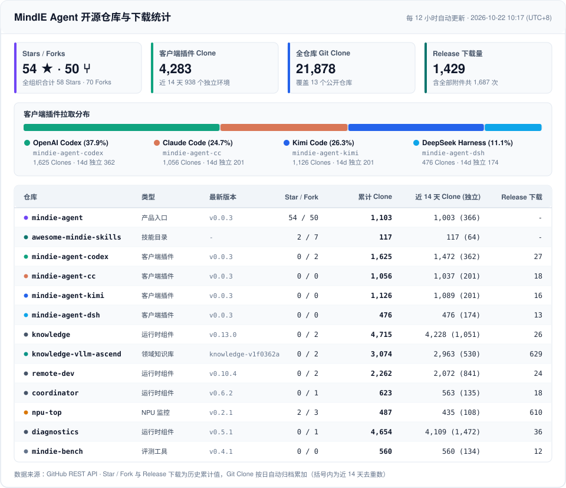

# 📊 MindIE Agent 开源仓库与下载统计

> **最近更新**：`2026-10-20 23:58 (UTC+8)` · 每 12 小时通过 GitHub Actions 自动同步。

## 仓库统计明细

| 类型 | 仓库 | 最新版本 | Stars | Forks | 累计 Clone | 近 14 天 Clone (独立) | 近 14 天浏览 (独立) | Release 下载 (含附件) |
| --- | --- | --- | ---: | ---: | ---: | ---: | ---: | ---: |
| 产品入口 | [`mindie-agent`](https://github.com/mindie-agent/mindie-agent) | `v0.0.2` | 54 | 50 | **929** | 857 (336) | 220 (78) | 0 (0) |
| 技能目录 | [`awesome-mindie-skills`](https://github.com/mindie-agent/awesome-mindie-skills) | `-` | 2 | 3 | **104** | 104 (57) | 13 (10) | 0 (0) |
| 客户端插件 | [`mindie-agent-codex`](https://github.com/mindie-agent/mindie-agent-codex) | `v0.0.2` | 0 | 1 | **1,457** | 1,351 (349) | 35 (14) | 19 (29) |
| 客户端插件 | [`mindie-agent-cc`](https://github.com/mindie-agent/mindie-agent-cc) | `v0.0.2` | 0 | 0 | **848** | 833 (176) | 3 (3) | 14 (26) |
| 客户端插件 | [`mindie-agent-kimi`](https://github.com/mindie-agent/mindie-agent-kimi) | `v0.0.2` | 0 | 0 | **915** | 880 (170) | 1 (1) | 12 (22) |
| 客户端插件 | [`mindie-agent-dsh`](https://github.com/mindie-agent/mindie-agent-dsh) | `v0.0.2` | 0 | 0 | **359** | 359 (135) | 1 (1) | 8 (19) |
| 运行时组件 | [`knowledge`](https://github.com/mindie-agent/knowledge) | `v0.12.2` | 0 | 2 | **3,709** | 3,238 (789) | 8 (5) | 22 (42) |
| 领域知识库 | [`knowledge-vllm-ascend`](https://github.com/mindie-agent/knowledge-vllm-ascend) | `knowledge-v1f0362a8ba94` | 0 | 2 | **2,830** | 2,731 (436) | 36 (13) | 629 (629) |
| 运行时组件 | [`remote-dev`](https://github.com/mindie-agent/remote-dev) | `v0.10.3` | 0 | 2 | **1,837** | 1,665 (672) | 2 (2) | 20 (47) |
| 运行时组件 | [`coordinator`](https://github.com/mindie-agent/coordinator) | `v0.6.1` | 0 | 1 | **368** | 312 (92) | 1 (1) | 14 (38) |
| NPU 监控 | [`npu-top`](https://github.com/mindie-agent/npu-top) | `v0.2.0` | 2 | 3 | **371** | 319 (85) | 19 (7) | 605 (625) |
| 运行时组件 | [`diagnostics`](https://github.com/mindie-agent/diagnostics) | `v0.5.0` | 0 | 1 | **3,573** | 3,031 (1,021) | 0 (0) | 32 (55) |
| 评测工具 | [`mindie-bench`](https://github.com/mindie-agent/mindie-bench) | `v0.4.0` | 0 | 0 | **225** | 225 (51) | 0 (0) | 8 (20) |
| **合计** | **13 个公开仓库** | — | **58** | **65** | **17,525** | **15,905** | — | **1,383** (1,552) |

## 数据文件

- [`dashboard.zh.svg`](./dashboard.zh.svg)：中文统计看板 SVG
- [`dashboard.en.svg`](./dashboard.en.svg)：英文统计看板 SVG
- [`telemetry-history.json`](./telemetry-history.json)：按日归档累加的历史统计 JSON
