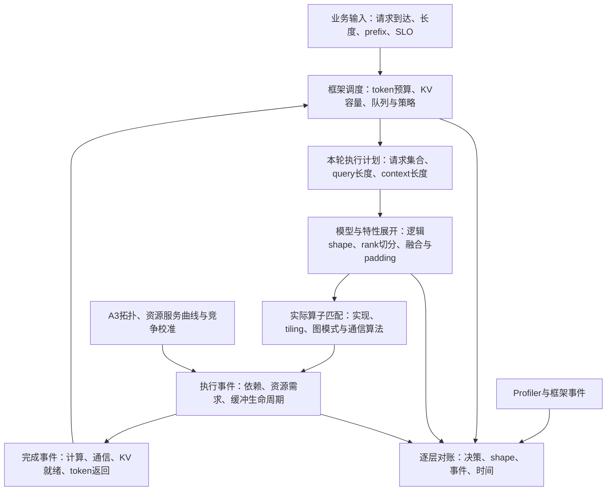

# A3 预测性能与应达性能双模型方案

[仿真系统设计](simulation-system.md) · [Profiler 系统设计](profiler-system.md) · [文档中心](README.md)

最低模型范围见 [九模型覆盖要求](a3-model-coverage.md)，实际进展和证据见 [实现与验收记录](a3-performance-modeling-acceptance.md)。

## 1. 目标与判断

MindIE Agent 需要提供两种独立的建模能力。**预测模型**回答“给定机器、输入输出 case 和配置，预计实际性能是多少，以及怎样配置更合适”；**应达模型**回答“按照硬件能力和业务约束，这个模型在这个 shape 下应该达到什么性能”。前者还原已有实现和调度的成本，后者构造资源上可行的目标实现，不能用一个统一效率系数在二者之间换算。

两种模型共享工作负载语义、硬件拓扑和资源引擎，各自生成执行计划和成本：

| 用途 | 输入 | 核心逻辑 | 输出 |
| --- | --- | --- | --- |
| 预测性能 | 机器、模型/shape、请求 case、实际配置或候选配置域 | 实际调度规则、算子/布局/padding、经验校准与解析外推、竞争和队列 | 时延/吞吐、配置排序、推荐配置、可解释执行计划及误差 |
| 应达性能 | 机器能力、模型/shape、必须满足的精度/容量/业务约束、允许改变的实现策略 | 必需的计算、访存、通信需求与依赖下界；合法 tiling、融合、并行、分块和重叠方案的可行性搜索 | 乐观下界 L、最佳已知可行目标 U、对应方案及求解范围 |

硬件校准解决“资源有多快”；框架语义解决“实际执行什么、何时执行、执行多少次”；资源模型解决“同时执行时还能有多快”。它们为预测模型提供现实条件，也帮助检查应达模型的可行目标是否真的能够接近。

允许耗时预测存在经验证的误差，但不能把错误的调度次数、算子选择、张量形状、通信参与组或依赖关系包装成连续误差。例如，`max_num_batched_tokens=16384` 时，16384 与 16385 个未命中缓存的 prompt token 可能进入不同的执行路径。若模型仍按输入长度线性缩放，校准再精确也无法解释 TTFT 的跳变。

本方案以 vLLM + vLLM-Ascend 的实际行为和 A3 为第一条验证路径，模型本体使用可参数化的计算、访存、通信需求、调度语义、特性变换和资源规则。版本只作为测量来源与适配上下文，不把源码 SHA、工作区洁净程度或固定版本白名单作为建模准入条件。同语义的新版本和未见过的合法 shape 必须仍可估计。

缺少实测点时，先用解析模型、跨 shape 插值或残差外推给出数值，并通过后续测量检验误差。缺失经验参数不等于缺失建模能力；不能把合法输入变成占位结果再附免责声明。只对确实无法解释的输入语义明确报错，或要求补齐不可推导的必要输入，不假造“实测”。

本文是实现审查和后续设计，日期为 **2026-10-20**。当前 `sim` 与 `profiler` 的源码结论基于本地干净主线，分别为 `d3d04567c0bfd85a61ac405eebb94d439a763afe` 与 `18918219fc954416d2d7beffa0dcd825ec55574b`。下文区分目标设计、实现进度与实测验收；基线问题保留为变更动机，最终状态以验收记录为准。

## 2. 当前实现能做什么

| 范围 | 已有实现 | 对实际性能优化的限制 |
| --- | --- | --- |
| 硬件 | 精确 SKU、CANN 配置与实机快照解析、容量与差异检查 | 参数来源与口径未完全贯通，尚无完整的 A3 实测服务曲线 |
| 算子流水 | 周期依赖图、迭代距离、缓冲复用、限制环与启动间隔求解 | 输入时长由调用方提供；稳态 II 不能代替有限任务的启动、排空、尾块和 launch |
| 子图 | 显式 DAG、逻辑 GM 流量、融合约束和关键路径 | 缺框架自动生成的执行图；并发任务之间没有共享资源服务模型 |
| 模型层 | 调用方阶段耗时的并行度缩放、prefix 和投机解码情景计算 | 没有从调度决策、shape、算子实现和 rank 映射生成执行计划 |
| 框架层 | 外部 provider 的部分算子桥接 | 没有请求状态、KV block 状态、动态 batch、图捕获选择与逐轮调度 |
| Profiler | 事件区间、shape 变体、Host/Device 关联、跨运行对比 | 可作为事实来源，尚未形成调度事件到资源模型的完整校准链 |

优先修正以下具体问题，避免现有结果误导下一层：

1. `net.py:181` 把阶段耗时总和除以 PP，通信与 overhead 也一起缩放。已有最小复现：`compute=80, communication=10, overhead=10 ms` 时，PP1 输出 100 ms，PP8 输出 12.5 ms。它只表达理想分摊假设，不能预测单请求通过流水线的延迟。
2. `net.py:251` 汇总传输时过滤空值。A3 的 1 GiB `rh2d`、路径未确定时，单项为 `null`，汇总却为零。必须分别返回已知部分与未建模部分，不得把总时间作为完整预测。
3. `pipeline_graph.py:338` 的 `calibrated` 仅表示时长输入完整；没有测量来源的数字也能得到这个状态。`comm.py:238` 从 PCIe 线速乘固定效率推算的带宽还会进入 `calibrated_uni_bw_gbps`。应区分声明值、公式推导值、实测值与经留出集验证的模型。
4. `subgraph.py:38` 默认使用 A5 容量；A3 调用未注入容量时可能错误通过融合准入。A3 的 SKU 表与通用通信默认表对封装内带宽也采用不同值。统一设备画像、资源作用域和来源，不能由入口决定硬件规格。
5. `pipeline.py:350` 的 `II × tile_count` 是稳态近似，需增加有限任务模型。现有求解器保留为循环约束分析组件。

源码定位见文末 [S1]、[S2]。本次针对性本地检查为 sim **57 passed**，profiler **55 passed、2 skipped**；跳过项需要外部完整 capture。它们验证局部行为，不构成 A3 性能预测精度或端到端收益证据。

## 3. 外部工具如何复用

| 工具与核验范围 | 值得复用的能力 | 本方案需要补齐的部分 |
| --- | --- | --- |
| msModeling `tensor_cast` | 模型图、算子性能模型、编译变换、多流与并行建模 | 与实际 Ascend 算子分派绑定；多流资源从 compute/comm 类别扩展到实际共享资源 |
| msModeling `serving_cast` | 请求状态、按 token 预算分块、服务仿真 | 不同入口的策略不同，需绑定选定框架版本；KV 传输与计算图通信须竞争同一物理资源 |
| msModeling 校准与寻优路径 | 数据驱动模型和候选配置搜索的组织方式 | 用 A3 实测重新验证；默认效率与拓扑画像不能直接成为可达性能标准 |
| CANNBot 算子建模技能 | 从实际计算流提取阶段、区分资源路径、按问题选择工具的工作方法 | 逐项核对硬件支持；不能把 Ascend950 的模型常数或模拟器能力移植成 A3 验证结果 |
| msOpProf simulator | A2/A3 指令、同步、内存通路波形、流水与源码关联 | 用于热点 kernel 下钻；不能代替跨流、跨进程和服务层的共享资源模型 |
| Vidur 等请求级模拟器 | 把请求到达、batch、执行成本和排队连接起来 | 重新绑定 Ascend 后端、vLLM-Ascend 特性及共享资源，不沿用 GPU 误差结论 |
| ASTRA-sim 等通信模拟器 | 拓扑、通信事件和网络竞争建模的方法 | 用实际 A3 拓扑、HCCL 算法和数据路径校准；只在简化模型不能解释决策时引入更细模拟 |

msModeling 在固定修订 [S3] 下有两处尤其相关：

- `serving_cast/engine.py:102` 的 `BatchScheduler` 会消耗 token 预算并更新剩余 prefill token；需要下一轮的请求不会在第一轮产生 `PREFILL_DONE`。但 `serving_cast/service/scheduler.py:62` 的另一路策略使用 slack budget，并采用简化的混合延迟估计，不能视作特定 vLLM 版本的等价实现。
- `tensor_cast/compilation/passes/multistream_pass.py` 以 compute/comm 资源就绪时间调度；`serving_cast/communication.py` 为 KV 等传输维护通道，尚未把它与前者统一成跨层资源竞争。复用代码时必须保留这些边界。
- `tensor_cast/layers/attention.py` 的 DCP 支持条件是 whole-batch decode；该实现对混合 batch 的处理不能外推成所有框架的行为。GQA 的局部 heads 和 sequence 变化也可能相互抵消，不能统一把 Attention 时间除以 DCP。
- `tools/model_diagnostics` 的 Theory/Runtime 对账对象是 msModeling 自身的运行时。它有内部一致性价值，但还需要与目标框架实际执行的第二条对账链。

CANNBot 固定修订 [S4] 的 `ops-simulator` 明确限定 Ascend950、AI Core、单卡，且不支持 MC2/HCCL；`ops-theoretical-performance-estimation` 限定 Ascend950 纯 Vector，排除 Cube/CV 混合。它们可以提供方法参考，不能直接充当本方案的 A3 仿真底座。

msOpProf 的官方指南明确列出 A2/A3 simulator 库、同步指令和内存通路波形，适合补充 A3 热点算子的阶段证据 [S7]。是否可用还要核对现场工具/CANN 版本。msKPP 在本次核验修订中的显式芯片列表为 910B 系列，尚不能作为 A3 已适配的依据 [S8]。

## 4. 建立可执行的跨层模型

### 4.1 框架决策先产生工作，资源模型再决定完成时间



不能先生成完整静态图，再用一个“框架效率”修正最终时间。执行完成时间决定下一次调度时哪些请求已到达、哪些 KV 已可用；下一轮 batch 又改变 shape、通信和执行时间，必须通过完成事件反馈给调度器。开放负载的到达时刻保持固定，闭环客户端则另行表达响应完成后再发请求的规则。

保留两种清楚分开的用途：

- **观测回放**：输入真实调度序列，检查 shape、算子和执行时间能否对账，用于定位误差。
- **反事实预测**：修改 token budget、并行度、特性或传输策略后，重新运行调度规则和所有受影响的展开过程，用于选择优化。不能固定旧 trace 的 batch，再宣称预测了新调度策略。

框架策略尽可能复用目标环境的原生纯逻辑或公开接口；通用策略显式声明自身规则，并用真实调度记录做差分验证。版本元数据帮助解释行为差异，不把修订锁作为泛化模型的使用条件。不得把尚未验证的近似策略标成原生框架的精确实现。

保留原生异步执行语义。调度器可以在前一批设备计算尚未完成时准备或提交下一批；完成事件只解除真实数据或资源依赖，不引入额外的全局同步。框架提交时乐观推进的 `num_computed_tokens`、设备实际完成的进度、KV 对消费者可见的进度分别记录。投机接受/拒绝按框架规则更新可提交状态，不能抹去已经发生的执行工作。

### 4.2 最小数据契约

复用现有 Run Manifest、源代码修订和产物引用，不另建运行身份或审计目录。以下是组件间语义契约，不要求每一类都落成独立文件。

建模组件只维护当前数据结构，直接修改生产者、消费者、测试和示例，
不建立 `schema_version`、数字格式后缀、旧版分流或迁移兼容链。
只有确实需要区分业务文档类型时才使用无版本号的 `kind`；
普通输入和报告不增加格式标签。SQLite 直接创建当前业务表，不为
版本标记维护额外元数据。历史实测原始文件保留，通过实际字段和来源
语义导入；硬件、精度、计时协议、训练/留出及错误状态的校验继续生效。

| 对象 | 必要内容 |
| --- | --- |
| `WorkloadSpec` | 到达时刻、prompt/output 长度、prefix 身份、请求类别、SLO；token 内容不可得时，说明哪些路由行为只能使用分布 |
| `SchedulerState` | 原生 scheduler/KV 状态的只读视图：waiting/running、scheduled/computed、in-flight iteration、各类 budget、KV block 引用与抢占；关联独立的设备完成及可见进度 |
| `IterationPlan` | 逐请求本轮 query token、已有 context、batch 合并方式、调度原因、执行/等待依赖 |
| `ShapeLineage` | 语义 shape、各 rank 逻辑 shape、物理布局/padding、实际 launch shape，以及改变它们的特性和输入 |
| `KernelChoice` | 框架调用点、实际后端实现与修订、dtype/layout、tiling、图捕获条件、workspace、合法性与选择依据 |
| `ExecutionEvent` | Host/Cube/Vector/MTE/collective/KV transfer 等事件、依赖、可并发条件、资源需求、成本覆盖范围、生命周期与完成回调 |
| `ResourceTopology` | die/package/节点/实际互联域、资源与链路身份、路由、共享关系、容量与服务曲线来源 |
| `PredictionReport` | 语义覆盖、未建模项、预测条件与区间、关键等待、候选收益、校准与验证范围 |

将执行事实和假设分开。对于已表达的模型语义，缺少专用 kernel 数据时按计算、搬运和同步的组合路径估计；缺少路由样本时采用可配置的专家分布与偏斜参数并提供敏感性结果；缺少 shape 样本时用解析模型或校准外推。结果记录采用的路径，不以 `null` 代替尚未采集到的经验数据。无法解析的模型结构仍需明确报错，不编造结构或实测值。

### 4.3 优先复用原生执行循环

原生框架适配主要用于行为校验和需要高保真复现的场景，不是通用建模的唯一入口。通用模型显式表达 budget、chunking、优先级、KV 和异步提交规则，能够在无完整框架安装时运行；用真实框架记录校验这些规则。针对复杂策略，还可保留原生 scheduler、KV manager 与执行循环，在 executor 的提交/完成边界接入模拟后端。上游 `EngineCore` 按配置解析 scheduler 类，使用实际同步 step 或异步 batch queue [S9]，不能固定替换为基类策略。

职责压缩为三个边界：

1. **框架提交**：原生 `SchedulerOutput` 与 worker 必要元数据形成 `IterationPlan`。请求、KV ownership、placeholder、抢占和 deferred free 继续由框架持有和更新。
2. **事件展开与推进**：`lower(plan, worker_view, recipes)` 生成事件图；资源引擎维护剩余工作、资源占用与下一事件，不修改原生请求状态。新竞争任务加入后重新求完成时间，不能在提交时锁死独占耗时对应的结束时刻。
3. **原生完成反馈**：模拟 executor 在 execute、sample 或 KV-ready 的实际条件满足后返回原生 schema 的结果，或使 pending future 完成。由原生循环调用 `update_from_output`，而非资源层直接推进 computed 或释放 KV。

虚拟时钟在框架等待点推进事件，不使用真实 `sleep`。到达请求先进入原生 ingress 的模拟入口，再按原生循环的读取时机交给 scheduler，避免回调越过调度循环提前改变 batch。

原生适配需验证 executor/时钟接入能否避开无关设备初始化，以及实际方法与结果契约。适配失败只影响该原生接入路径，不能使通用模型失去可计算能力。通用模型仍按其已表达的同步/异步、PP 和 KV 规则求值，并用对应行为集验收；不得用大量 mock 返回值掩盖未接通的原生路径。

模拟完成消息不意味着执行了模型数值计算。输出 token、draft 接受结果和 MoE 路由来自已声明的记录或工作负载结果模型，并保留来源和适用范围。反事实配置改变这些分布时，需要重估或补测，不能沿用旧记录后宣称获得真实路由；精度验收仍由真实执行完成。

## 5. 以 16K 调度边界验证真实业务逻辑

### 5.1 必须复现的因果链

固定 token budget `B=16384`，先使用没有 prefix 命中、没有其他请求、KV 空间足够、允许 chunked prefill、没有更小的 long-prefill 限制，且 max-model-len 留足空间的条件。具体行为以选定版本调度器为准：

1. `L=B` 可以在本轮预算内完成 prompt 计算。
2. `L=B+1` 留有未计算 token，需要后续调度；第一次 chunk 完成并不等于请求产生首 token。
3. 后续 chunk 的 query 长度很小，但已有 context 很长。模型仍需执行对应的投影、Attention/MLA、MLP/MoE、通信及输出路径；实际算子可能与首个 chunk 不同。
4. 第二轮增加调度和下发，可能遭遇其他请求、图模式切换、KV 传输或 collective 等待。因此 TTFT 可能出现大幅跳变；倍率取决于实际路径，不能预设必然接近 2。

令包含两个 chunk 的两次实际 batch 的设备执行时间为 `C1`、`C2`，其间等待为 `W2`，附加调度/下发/输出为 `H`。在这个简化且串行的例子里：

```text
TTFT(B+1) = C1 + W2 + C2 + H
```

`C2` 必须由新 query/context、shape、算子和竞争状态求得。它既不是 `C1/B`，也不能直接取 `C1`。若 prompt 已有缓存、chunking 关闭、存在 long-prefill 限制或批次中的其他请求，必须重新执行规则。

### 5.2 源码中的两条具体路径

本次按 vLLM-Ascend 修订 `175ef4d` 中 `.github/vllm-main-verified.commit` 的记录，读取其指向的上游 vLLM 修订 `cdc4824` [S9]。这组源码基线已经按仓库记录对齐；尚未确认与现场 A3 部署一致，也未在本次执行运行验证。

上游 `scheduler.py:523` 先调度 running 请求，`:565` 按预算截断，然后继续处理 waiting 请求，`:966` 再按预算截断。该版本还同时维护 token budget 和 input budget，并为 draft slots 留位；下表先关闭投机解码且不触及额外输入限制，由此需要分别验证：

| 情形 | 目标请求的 query chunks | 第二轮需要等待的工作 |
| --- | --- | --- |
| 16384 个 token，孤立请求 | `[16384]` | 无第二轮 prompt 计算 |
| 16385 个 token，孤立请求 | `[16384, 1]` | 该请求长 context 下的后续计算及输出 |
| 16385 个 token，第二轮还有 waiting prefill | `[16384, 1]` | 若允许合批，剩余预算可被其他请求填满；目标请求等待整个混合 batch |

第三种情形是接近两个大 batch 成本的一条具体机制。模拟器必须保留每轮所有请求的成员与 query/context，不能按目标请求剩余的 1 token 独立估时。这是源码支持的待验证路径，不是本次已经观察到的 A3 时延结果。

Ascend `model_runner_v1.py:1287` 又根据整个 batch 的状态选择 Attention 路径：computed 全为零时为 `PrefillNoCache`；scheduled token 全为 1 时可选 `DecodeOnly`，MTP 条件下可选 `SpecDecoding`。因此孤立请求的第二轮不一定是“再执行一次 prefill 算子”；混合 batch 的第二轮也可能走另一条路径。

上游 `scheduler.py:1379` 在调度后推进 computed 与 in-flight 计数，而未完成 prompt 的请求在 worker 中不会正常交付该轮采样输出。验证必须同时捕获提交、设备完成和首 token 可交付状态，不能只看 `num_computed_tokens`。

### 5.3 最小边界矩阵

| 变量 | 必测点 | 必须解释的变化 |
| --- | --- | --- |
| prompt 长度 | `B-1, B, B+1, 2B-1, 2B, 2B+1` | 调度轮数、每轮 query/context、首 token 产生条件 |
| prefix 命中 | 无命中、部分命中；有效剩余 token 跨过 B | 预算按何种 token 口径扣减、KV block 引用与分配 |
| 混合 batch | prefill 单独、已有 decode 请求、第二条 prefill | 预算争用、优先级、chunk 长度、队列等待 |
| KV 边界 | block 边界前后、容量刚够/不足、传输尚未完成 | block 分配、等待、抢占/重算、请求可运行性 |
| 执行模式 | eager、允许捕获的 shape、捕获范围外 | graph padding、replay/eager 选择、实际 kernel launch |

给原生框架和适配器输入相同的到达、完成事件记录时，调度轮数、逐轮 token 分配、依赖和算子选择应一致。闭环预测中，完成时间的误差可能改变下一轮 batch，不能要求整条预测 trace 与实测逐项相同；应分别检查相同状态下的规则、关键事件偏差、跨阈值 TTFT 增量及服务分布。

### 5.4 已执行的原生调度语义验证

2026-10-20 在 A3 主机 `.156` 的已有容器中，以 CPU 路径运行已安装 vLLM 0.27.1 的真实 `Scheduler`、`Request`、KV manager 与 `ModelRunnerOutput`。没有加载权重或设备 worker，结束时 NPU 尚未初始化；未改变已有服务或占用其设备。

六个 case 均完成。孤立 `16383/16384/16385` 的非空调度分别为 `[16383]`、`[16384]`、`[16384,1]`；混合 `[16385,16384]` 得到 `[{r0:16384},{r0:1,r1:16383},{r1:1}]`。`B=4096,L=4097` 得到 `[4096,1]`；long-prefill threshold 为 8192 时，`L=16385` 得到 `[8192,8192,1]`。完成后的空清理轮保留在 capture 中，但不计为模型 forward。

原生提交后 computed 与 in-flight 均提前增加，worker completion 后才扣减 in-flight。`q=1` 的 prompt 尾部在业务语义上是 `prefill_tail`；是否采用 decode-like kernel 属于独立执行模式，不能覆盖业务阶段。此次 completion 通过真实 schema 注入显式合成 token：未完成 prompt 的轮次无采样输出，最后一轮交付一个 token。它验证原生状态和输出契约，不构成 attention dispatch、设备耗时或 TTFT 的实测。

现场 scheduler 文件已与 tag `v0.27.1` 对应来源核对；不同于第 5.2 节的研究基线。该 capture 是安装版本的语义验证材料，源码身份只作为来源，不能用来限制其他版本的通用建模输入。

## 6. 特性必须驱动 shape 和算子选择

### 6.1 维护完整的 shape 传播关系

每个执行节点至少区分四种形状：业务语义形状、rank 局部逻辑形状、存储与 padding 形状、实际发射形状。禁止只用模型参数量和平均序列长度推导所有算子。

| 特性 | 必须传播的变化 | 下游影响 |
| --- | --- | --- |
| chunked prefill / continuous batching | 各请求 query/context、flatten 顺序、batch 组成 | Attention 工作量、GEMM 的 M、prefill/decode 混合实现 |
| TP / CP / DCP | heads、sequence、局部 token 与 padding、组成员 | attention kernel、merge、collective 的类型/字节/次数 |
| EP / MoE 路由 | 每专家与每 rank token 数、容量/padding、空专家 | grouped GEMM 的各组 M、dispatch/combine、最慢 rank |
| 量化 / 布局 / 融合 | packed storage、scale 粒度、cast、layout 转换 | 物理搬运字节、额外算子、可用 kernel 与 workspace |
| 图捕获 | capture bucket、padding、地址与输出契约 | 发射成本、无效计算、KV容量及可运行 batch |
| 投机解码 | draft/verify query 数、接受长度、拒绝与状态更新 | target/draft 图、KV提交/回退、下一轮 batch |
| prefix / KV offload / PD | 命中块、待传输块、传输完成时间 | 可运行 token、内存压力、D2D 与 Host 路径负载 |
| MLA / recurrent / hybrid attention | 专用缓存、状态、层型与更新规则 | 不能用普通 GQA 的 KV 字节和计算公式替代 |

修改一个特性后，重新展开受影响的子图、选择算子、核算 workspace/KV 容量并重新调度。不能对原来的 kernel 时间乘一个特性加速系数。特别是“更快”的实现若占用更多 workspace，可能减少 batch/KV 容量，最终吞吐反而下降。

固定 Ascend 源码已经展示两个具体的连锁变化 [S9]：

- `model_runner_v1.py:2730` 先进行 SP padding，再判定 uniform decode、选择 graph bucket；随后同步 DP token 数与模式，按 DP padding 后的结果再次选择 graph。最终 kernel shape 不是调度器最初的 token 总数。
- `ascend_forward_context.py:95` 用 DP 间最大 token 数选择 MoE 通信；`:242` 的 A3 分支还受 FUSED_MC2 开关、EP 规模及 MC2 capacity 约束。另一个 rank 的负载可能让本 rank 从 MC2 切到 ALLTOALL，不能独立估计各 rank 后简单取最大值。

首轮适配必须覆盖这两条链的阈值两侧，保留 scheduled、logical、padded、valid-output token 数；不能把 padding 后实际执行的计算和搬运量误当成有效业务吞吐。

### 6.2 实际匹配与最优匹配分别建模

**实际执行模式**复现当前框架分派：输入满足哪些条件，选择哪个算子或融合实现，发生哪些 padding、copy、cast 和通信。记录触发分支的最小原因，便于与 profiler 对账。

**优化搜索模式**只枚举语义和运行时均可行的候选：精度、shape/layout、内存、图捕获、并行组、硬件支持必须成立。每个候选形成完整执行计划，并在同一请求负载下重新模拟。

局部最快的 GEMM、Attention、通信算法不能各自独立选出后拼成“理论最优框架”。它们可能使用不兼容的布局、共享 workspace、争用同一带宽，或破坏融合/图捕获条件。输出应是“已枚举可行候选中的最佳预测”，最终由真机 A/B 确认；不宣称全局最优。

## 7. 显式建模共享资源与竞争

### 7.1 资源身份比流编号重要

流表达执行顺序，不能表示一份独立硬件能力。把两个算子放到两个 stream，不意味着可将两个独占性能曲线无损重叠。

A3 资源至少按实际作用域表达：每核/核组的执行管线与搬运资源、每 die 的缓存/HBM 服务能力、封装内连接、实际 HCCS/交换域、NIC/网络路径和 Host 内存路径。A3 的 processor、双 die 封装和 rank 不能混用。跨节点也不预设一定走 RoCE，需读取实际拓扑与传输配置。[S5]

事件携带分阶段资源需求：计算工作、各路径字节、队列占用、依赖和剩余工作。事件开始、结束或阻塞变化时重新分配资源服务率；共享容量满足约束，各事件按获得的服务推进。最初只对影响决策的争用域细化，不要求全芯片逐周期模拟。

每个成本后端声明覆盖范围。采用包含搬运和等待的整 kernel 时长时，不能再重复添加一遍 HBM/MTE 时间；需要模拟竞争的热点逐步拆成分阶段的计算和搬运需求，或采用经并发实验校准的条件时长模型。两种方式可在不同节点共存，但同一成本不得重复计算。

第一版为选中的资源明确服务量单位、容量作用域、仲裁策略、可否抢占及同一时刻的事件顺序。仲裁的微观公平性未知时用经验证的候选策略/范围表达，不能无证据地默认等分带宽。零工作节点不得推动时间，依赖未满足的任务不得开始，已完成事件只释放一次资源。

### 7.2 Cube 与 Vector 双流争用

至少拆开 Cube 算子的数据搬入/计算/写出，与 Vector 算子的读入/计算/写出，标明实际 core 放置与共享的存储路径。MTE 有本地管线约束，HBM/L2 等又有更大作用域的共享约束，不能笼统建成一个全局“MTE 带宽”。

最低校准集包括同 shape 的 C-only、V-only、C+V，以及改变相对启动时间和工作集大小后的结果。需要同时解释：

- 为什么重叠增加后，单个算子的持续时间可能变长。
- 为什么双流总墙钟既不等于两个独占时间之和，也不等于它们的最大值。
- 为什么相同 FLOPs/字节下，访问方向、缓存驻留、tiling 和核分配改变结果。

先建立经实测验证的共享带宽/阶段模型；若无法解释拐点，再增加资源阶段。禁止给所有 CV 组合套统一折扣，也不能用一次并发测量拟合并验证同一组合。

### 7.3 KV 传输与集合通信共享 D2D

KV block 搬运、TP/EP collective、PD 传输需要映射到实际路径上的同一组资源。若共享链路、HBM 或 NIC，就竞争服务能力；若路径不相交，不应施加统一串行限制。

必须同时建模传输大小、分块、方向、rank placement、collective 算法、启动时刻和同步依赖。区分提交、传输完成、远端可见与 consumer-ready，按具体后端的 block/chunk 粒度解除依赖。支持分块流水时，已就绪的块可以被消费，不能等待整次传输才统一释放；未就绪的块也不能因 CPU 已提交而提前读取。

验收包括 KV-only、collective-only、二者并发，以及不同 chunk、方向、带宽占用和路径重合度。除了总带宽，还测 collective 完成时间、KV-ready 时间和请求 TTFT/ITL。KV 迁移可能通过延迟请求准入改变下轮 batch，这一反馈要回到调度器。

当前 `max(0, sum(transfer_time)-overlapped_compute_time)` 只能表达假设下的暴露时间。它无法处理并发时服务时间变长、资源争用阶段变化，以及传输和计算的依赖，不作为目标模型。

### 7.4 三个最小判别用例

这些是新引擎的行为验收，不是已有实现通过的结论：

| 用例 | 明确条件 | 必须成立的结果 |
| --- | --- | --- |
| 共享容量 | 两个独立任务各需 6 单位搬运，共用容量 1 单位/ms，启动开销为零 | 总完成时间至少 12 ms；容量守恒，累计服务量等于需求；改用两个独立资源时为 6 ms |
| 传输依赖 | producer 计算 8 ms 后才产生 KV，传输 6 ms，consumer 等待该 KV，无其他开销 | consumer 最早 14 ms 就绪；不能用 8 ms 计算时长抵扣尚未开始的传输 |
| 分块可见 | 第一个 KV chunk 已满足可见性契约，第二个仍在传输，消费者只依赖第一个 | 允许首块消费者运行；不得读取第二块，也不得引入不必要的整传输屏障 |

真实 A3 竞争验收在这些精确因果/容量约束之外，再验证独占与并发的耗时变化。不要要求未知硬件仲裁下的指令顺序完全一致。

### 7.5 通信算子的展开方式属于执行模型

2026-10-21 补充：通信校准必须区分 AICPU、AIV 等实际展开方式。相同 collective、payload 和 rank 数不保证具有相同的调度开销或资源竞争，不能把不同展开路径的样本拟合成一条带宽曲线。

通信执行画像分别记录请求策略、观测到的实际策略、算法与参与组、传输阶段和计时协议。环境变量或框架选项只证明请求了某种策略；实际路径由日志、profiler 或能够对应到本次执行的证据确认。混合路径按阶段记录，未确认的旧样本保留 `unspecified`，不追填 AICPU/AIV 标签。

成本分解至少包括控制与下发、设备侧同步、搬运与归约、链路服务、完成通知。AIV 候选需要声明其 Vector、HBM、MTE 等资源需求，并与模型算子竞争；AICPU 候选也必须保留实际设备搬运及同步需求，不能将全部成本归为 CPU 或独立链路。具体资源需求由所选算法及展开路径确定，不能仅凭一个后端名称套固定效率。

预测路径只匹配兼容的展开方式、拓扑和协议；不兼容时仍给出解析估计并登记对应补测请求。应达路径可以枚举硬件和实现条件允许的展开候选，但每个候选需要独立的资源时间线。验收同时检查同路径样本能够影响预测、跨路径样本不会误匹配，以及通信与 Vector 算子并发时的竞争能够改变配置排序。

A5 采集独立列于 [A5 通信校准 TODO](a5-communication-calibration-todo.md)，由用户后续在 A5 环境执行；当前 A3 数据不能作为 A5 的已校准数据。

## 8. 校准与验证按层分开

硬件校准首先服务于关键业务路径。先选择已部署的一个 Dense 模型与一个 MLA/MoE 模型，覆盖真实 kernel/shape；再扩展规模和特性。测量需记录精确 SKU、die/rank 映射、CANN/驱动/框架/算子修订、图模式、频率状态、数据类型、缓存条件、竞争负载和时间口径。

| 验证层 | 验证对象 | 判断方法 |
| --- | --- | --- |
| 调度语义 | 轮数、token 分配、KV 状态、依赖 | 相同到达与完成事件输入下逐项对账；确定性分支要求一致 |
| 图与 shape | kernel 身份、shape/layout、padding、rank 组 | 对账实际执行计划；不能以时间接近掩盖图错误 |
| 算子成本 | 不同 shape 与特性下的独占时延 | 按算子族/shape 分桶的绝对误差与相对误差 |
| 竞争 | 并发时长、资源占用、完成顺序 | 留出并发组合、相对启动时间和拓扑，比较有/无竞争预测 |
| iteration | 每轮墙钟、暴露通信、等待 | 对账关键路径与残差，禁止累加重叠事件作为墙钟 |
| 请求与服务 | TTFT、逐 token ITL、TPOT、吞吐、goodput | 固定到达流与 SLO；分别报告分位数、尾部和接近饱和区间 |
| 优化决策 | 候选排序、选中配置的真实收益 | 在未用于校准的负载上验证，与已实测可行候选比较 regret |

数据按 shape 家族、特性组合、并行拓扑和时间分组留出，避免同一运行的切片同时进入拟合与验证。新增框架版本或 kernel 实现后，先重验语义，再决定哪些成本参数可以复用。

排查按层进行：调度 replay 不一致先修规则；shape/recipe 不一致先修展开；独占正确但并发错误再修资源模型；上述对账成立而请求指标不符，再检查到达、异步提交、交付和队列模型。闭环中的 batch 分歧可能来自时间误差，需要找到第一个分歧的状态与原因，不能只把全局误差均摊到算子效率。

第一轮工程目标可以对已声明覆盖的算子/iteration 采用约 10% 的中位相对误差、约 20% 的高分位相对误差作为排查起点，但阈值要结合测量噪声、时长尺度和决策需求确定，不是 A3 全场景保证。微秒级事件同时报告绝对误差；服务尾延迟和高负载区间单独验收。

更重要的门槛是：预测收益必须能与噪声和模型误差区分；模型选出的候选不能持续劣于基线。若误差足以反转排序，输出待测候选，安排最能区分它们的实验。标称预测区间还需检验留出集覆盖率，不能只给一个没有校准依据的 confidence 数字。

### 8.1 实测数据资产与覆盖清单

泛化模型必须建立在足够的实测覆盖上。数据是否足够，由业务中遇到的 shape/特性/竞争条件覆盖、留出误差和配置排序稳定性决定，不能用累计样本条数代替。首先从实际或模拟执行计划提取算子与通信需求，按调用频率、对关键路径的贡献和候选决策敏感度生成覆盖清单。

`CalibrationStore` 承载原始测量、聚合统计、校准参数、覆盖状态和补测请求。使用轻量 SQLite；每次连接设置 WAL 与 `busy_timeout=5000`，不在查询热路径重复建表、反射或检查文件所有权。现有 Run Manifest/run_id 作为运行来源，不创建第二套实验身份、租约或产物审计系统。

| 数据对象 | 必须保留的内容 | 使用规则 |
| --- | --- | --- |
| 原始测量样本 | 硬件/拓扑、算子与语义 shape、dtype/layout、实现、图模式、缓存/竞争条件、时间口径、全部重复值、run_id 与环境元数据 | 真实值原样保存；失败结果独立保留，不填入零时长 |
| 样本统计与校准 | 样本数、分位数/波动、拟合参数、训练来源、适用特征范围 | 标准化单位；包含发射/排队的整段时间不能冒充纯设备吞吐 |
| 留出集 | 预先划分的 shape 家族、特性组合、拓扑或时间段及其结果 | 不进入拟合；报告误差、区间覆盖率与候选排序 |
| 覆盖清单 | 精确覆盖、邻域插值、范围外外推、纯解析；各类请求频率、误差及未覆盖特征 | 预测仍可运行；覆盖清单直接驱动补测 |
| 补测请求 | 语义键、测量 manifest、缺口原因、优先级、状态、已有 run_id、失败原因 | 同义请求合并；元数据修订变化本身不创建重复任务 |

语义键至少区分设备作用域、算子族、shape、dtype、layout、特性、并行/通信组、路径和竞争条件。源码修订、驱动/CANN/框架版本作为样本上下文，可用于检测行为漂移；不以 SHA 相等作为样本可用性或模型准入门槛。已有证据表明行为变化时，拆分相应语义/实现条件并重新校准。

### 8.2 缺口到补测到重新校准

补测是可执行队列，不是报告末尾的 TODO。提供查询、显式登记缺口、导出测量 manifest、关联已存在运行、导入结果和重新拟合入口。单次预测默认无外部副作用；用户启用覆盖记录后，未知或高不确定性条件自动合并为补测请求。

1. **发现缺口**：从预测、配置搜索和真实 profiler 图生成需求；保留仍可计算的解析/插值预测及缺口原因。
2. **确定优先级**：结合出现频率、对 TTFT/ITL 或吞吐的影响、估计不确定性，以及能否区分排名接近的配置。优先采集可能改变决策的点，随后扩充边界和邻域。
3. **执行测量**：导出的 manifest 交给现有 `coordinator/remote-dev/mindie-bench`，使用共享队列租约和已确认的设备映射。状态为 pending/running/completed/failed；运行结果不明时先查原 run_id，不重复提交。
4. **导入与质量检查**：保留原始重复测量、预热和计时条件，检查时钟单位、失败样本、异常波动和语义匹配。失败不假冒完成，重试仍关联原缺口与后续 run_id。
5. **重新校准与验证**：只用训练部分拟合；在保留集比较校准前后误差、竞争组合和配置排序，更新覆盖报告。已补测点及其可插值邻域继续服务新 shape。

通用测量 worker 必须能消费导出的真实 manifest，至少执行 BF16 GEMM、Vector/本地搬运与已支持的并发组；通信测量另外注明 HCCL/P2P 具体路径。不能只提供能写入任意数字的数据库接口。新增算子或模型路径的测量能力随覆盖清单扩展，测量协议与预测使用的时间口径一致。

### 8.3 数据规模与首批实际采样

首批采样用于打通实际测量与校准链路，不能视为完整 A3 数据集。覆盖扩展需包含实际模型投影/MLP 的 N/K、decode 小 M 与 prefill 大 M、shape 边界、Attention 长 context、MoE 路由偏斜、量化/布局、不同拓扑及独占/竞争条件。每轮报告已测点、独立重复样本、训练/留出划分、业务覆盖比例和下一批补测清单。

2026-10-20 已在共享 HostQueue 运行 `a3-sim-cv-20261020-dnifzy`：30 个 case 全部完成，22 个训练 case、8 个留出 case，每 case 11 个重复样本。内容包括 BF16 GEMM、Vector/本地 copy、Cube/Vector 单独与双流/错峰；设备为 Ascend910_9362，使用已租用的物理 die，结束后租约已释放。事件区间包含真实 launch/dispatch 间隙，重复使用预分配缓冲，不等同于持续 HBM/MTE 带宽或网络 KV 测量。后续验收报告记录导入、拟合与留出误差，不把采样完成当作模型精度通过。

### 8.4 九模型算子的典型 shape 扫描

2026-10-21 按用户要求增加逐算子实测。先从九个模型的完整执行图提取实际调用，再合并语义等价的测量条件；不能只统计模型名或将所有算子归为 GEMM。每个条件保留模型、层、配置、业务输入、语义 shape、launch shape 和触发特性的来源，测量结果可以回填到所有等价调用点。

| 扫描对象 | 独立变量和边界 | 要解释的现象 |
| --- | --- | --- |
| GEMM、grouped GEMM | M/N/K、专家数与每专家 token 分布；合法 tile 边界前后 | launch floor、padding、算力饱和、权重复用与不均衡 |
| Attention/MLA、压缩与索引 | query/context、head、压缩比、窗口与候选数量 | query/context 不同缩放规律、压缩提交边界、选路切换 |
| KDA/GDN、卷积与状态操作 | 独立请求数、sequence 长度、state 维度、chunk | 每请求状态读写、chunk 尾部、prefill 与 decode 路径 |
| Norm、activation、softmax、量化/反量化、copy | 张量长度和行宽、dtype/layout、量化块 | Vector/MTE/HBM 主导区间、规约范围与转换开销 |
| 真实融合算子 | 相同语义输入下的实际融合与分解路径、tile 与缓冲 | 消除物化、有限 C/V 流水、额外操作和数值约束 |
| 通信 | payload、参与组、放置、实际展开、算法与并发偏移 | 启动/完成成本、带宽饱和、回退、资源竞争 |
| vision、Engram 与 draft 辅助路径 | 媒体 grid/token、访问行数、proposal/verify 宽度 | 特性触发后的形状和算子链变化 |

典型输入包括短至长 prefill、多个 decode batch、不同历史 context，以及用户业务中的 16K 预算边界。扫描点由真实需求和已知实现条件生成，避免无意义的全维笛卡尔积；预算、已选点和未选点都显式保留。不能把无法分配的大 shape 缩小后仍标记原条件已覆盖。

普通 kernel、实际融合 kernel 和可执行参考分解使用不同的 recipe 身份。参考分解可帮助检验正确性或观察未融合成本，但不能冒充目标融合实现的耗时。源 checkpoint、运行时权重格式、输入/输出 dtype、实际计算精度和观测后端分别记录，量化不能仅用一个全局开关代替。

采样先验证实际算子计算结果，再记录预热后的逐次设备耗时；默认起点为 10 次预热、30 次重复，按波动和时间口径调整。首次执行和 profiler 采样单独保存。独立验收提前划分留出 shape，拟合只使用训练数据，避免用已知答案决定分段位置。

曲线报告至少给出条件覆盖、原始分布、中位数、局部斜率、分段残差、转折点和留出误差。payload 或 FLOPs 相同比较仍需保持 recipe、dtype、布局、后端、拓扑和计时协议兼容。检测到跳变后补测其两侧，不能用一条全域直线将跳变平均掉。

这些实测曲线用于预测的插值/外推、候选排序和可行实现的性能参照；硬件下界 L 仍由必须的语义工作与能力约束独立求解。应达候选 U 使用合法的执行图和资源时序，不能把未融合实测时间直接当作充分优化后的成本。新模型引入时，结构与 recipe 清单、实际采集记录、曲线和仍待补测的条件共同进入参考包。

## 9. 应达性能怎样独立求解

应达模型从模型数学语义所需的计算、访存和通信出发，不把当前框架的等待、冗余 copy、保守 padding 和低效 kernel 当作不可改变的硬件成本。它保留必须满足的数学语义、精度、数据依赖、存储容量、物理链路和业务约束；只有当候选方案确实消除了某项工作，才减去对应成本。

先计算独立的乐观下界 L：每个资源的必需计算量或传输字节数除以可用能力、不可绕过的依赖链、必要传输与容量约束共同给出下界。按资源作用域和 dtype 核算；FLOPs、逻辑张量字节、实际存储字节和链路字节不混用。单个 Roofline 最大值只是其中一项，不能直接叫“应该达到的整网性能”。

再生成合法候选计划：例如分块数量与 tiling、可消除中间写回的融合、不同 rank placement、并行度及通信算法、启动时刻与重叠顺序。资源引擎为每个计划生成完整可行时间线，记录最佳目标 U 和实现方案。满足：

```text
L <= 所定义可行计划族的最优时长 <= U
```

若完整穷举一个有限计划族，可以称为该计划族最优；其他情况报告最佳已知目标与上下界间隙。U 表示在所用硬件服务模型中可行，实际实现达到程度由真机验证。增加可选计划不应使 U 变差，缩小约束也不能把原有可行计划无故丢掉。

**例子：选择重叠顺序本身就是优化。** 归一化资源模型中，C 任务需要 6 ms 共享内存服务再做 8 ms Cube 计算，V 任务需要 6 ms 同一内存服务再做 2 ms Vector 计算。假设公平共享内存，两者同时提交时，两个读阶段到 12 ms 才完成，整体 20 ms；若先运行 C 的读阶段，6 ms 后再启动 V，则 C 的计算与 V 的搬运重叠，整体 14 ms。资源总量给出的 12 ms 乐观下界仍不能替代这个可行目标。这是算法验收用例，不是 A3 实测。

**例子：分块不能无限细。** 三段在独占条件下的服务时间分别为 8、6、4 ms，位于独立资源，允许 n 块流水，每段每块有 0.2 ms 开销。在这个明确模型下，候选 `n={1,2,4,8,16}` 的完成时间是 `18.6、13.8、11.7、11.25、12.225 ms`，最优为 n=8。应达模型必须交付对应时间线，不能删除启动成本后宣称无限分块可达到瓶颈阶段时间。

### 9.1 如何判断接近应达性能

并列报告以下对象，保留既有 measured/ideal/predicted 的来源区分：

1. **硬件理想边界**：固定语义计算/访存/通信需求、资源和合法拓扑下的乐观下界，只用于判断明显不可能的目标。
2. **当前实现预测**：复现当前调度、shape、算子与竞争后的性能，用于检查模型是否解释现状。
3. **可行优化候选预测**：重新执行完整模型后，已枚举合法候选中的最佳范围。
4. **实测基线与实测候选**：相同正确性、输入、到达流、SLO 与软硬件条件下的结果。

当前实现与理想边界的全部差距不等于可回收收益。优化目标应首先接近经验证的可行候选，再判断是否值得投入更底层优化。不同候选收益不相加，组合后重新模拟和测量。

用反事实重跑做归因：分别替换算子实现、调度策略、布局、传输策略或资源瓶颈，再观察请求指标变化。保留交互项和未解释残差。单个 kernel 加速只能支持局部收益，只有真实业务负载下的 TTFT/ITL/goodput 改善才支持系统收益。

### 9.2 应达模型必须优化执行图

2026-10-21 补充：把当前框架的小算子逐项求和，即使单算子耗时已经校准，也不构成应达性能模型。应达模型从保留数值语义、状态和依赖的语义图出发，构造不同的实现图，分别求解其有限执行时间。预测模型使用当前实际实现图；应达模型允许改变融合、布局、中间结果驻留、分块、启动顺序和异步准备位置。

变换规则应当能够执行，并返回适用条件、消除的需求、保留的需求和执行见证：

| 变换 | 必须检查的条件 | 成本与依赖如何改变 |
| --- | --- | --- |
| residual/norm/量化与矩阵 epilogue 融合 | 精度、layout、归约边界、消费者数量、tile 容量 | 消除可驻留中间张量的写回和重读，保留归约、转换、scale 和最终输出 |
| QK、online softmax、PV 分块融合 | mask、可见 KV、QK/V 不同维度、数值约束、片上空间 | 生成有启动、流水和排空的 C/V 依赖；不物化完整分数矩阵，不删除必要的 KV 读取 |
| MLA 投影吸收或预变换 | 代数等价、权重布局、精度、是否跨请求复用 | 重新计算矩阵维度、权重驻留与预处理成本；不能直接套用 GQA 公式 |
| MoE pack/dispatch/GEMM/combine 协同 | 路由已知时刻、专家 shard、routed/shared 维度、通信可见性 | 合法分块后建立收发与消费关系，共享分支可独立执行；不靠减少通信字节伪造重叠 |
| 共享 KV/index、线性注意力状态和静态准备复用 | producer 所有权、更新条件、状态寿命、多消费者读依赖 | 合并重复生产或静态准备；消费者各自的读取与必要状态更新继续保留 |

上表是需要实现和验收的变换族，不能因为配置中出现 `fusion=true` 就计为支持。每次变换需给出 FLOPs、Vector 操作、HBM/MTE/链路字节、launch 和临时驻留量的前后差异。融合使片上占用增加或改变并行度时，收益可能变小甚至消失，应保留未融合候选。

C/V 重叠通过 tile 级生产消费、有限 buffer、资源占用和时序产生。单个节点的 `max(compute, memory)` 可以提供乐观成本，不能单独证明可行目标 U。大量重复 tile 可以采用经小规模展开验证的压缩流水求解，避免大模型必须生成数百万事件。尾 tile、启动与排空、双缓冲容量、实际执行次数必须保留。

forward 前的异步准备也属于执行图。每项准备工作声明输入就绪条件、最早启动时刻、消费者、复用范围和资源需求。已知请求的 token 元数据、静态权重元数据与未来 decode token、未来路由或投机接受结果具有不同依赖，不能统一提前执行。请求相关工作不得早于请求到达；首次准备与稳态复用分别计费。准备与当前 forward 共享 CPU、H2D、HBM/MTE 或链路时，共同求解竞争，并从时间线计算暴露尾部，不能简单从总耗时中减去一个“可掩盖时间”。

验收包含实际变换后的依赖与需求守恒、融合容量边界、跨流竞争、异步准备提前量不足、未来输入未就绪、首次请求与稳态复用。必须能观察到“合法融合后更快”“资源不足时保留未融合计划”“提前准备因竞争导致收益下降”三类结果。小型精确用例验证算法；目标模型的收益仍需对应条件下的实测检验。

### 9.3 新模型的建模结果作为可维护的参考

对新结构进行一次深入分析并将结果保存在仓库内，但沉淀的核心是可参数化的结构、规则和实例。建议 `sim` 保存以下材料；本仓负责入口与跨组件契约：

1. **模型结构描述**：原始 config、逐层 attention/FFN 类型、维度、量化、KV/index/state 的生产与消费关系，以及媒体、MTP/DSpark 等可选模块。来源修订是解释依据，不作为运行准入条件。
2. **实现与优化描述**：当前路径、合法融合和异步准备候选、变换前提、精度/容量限制及公式。通用规则由代码维护；模型描述只保留特有结构和参数。
3. **可复算实例**：机器拓扑、输入输出 case、配置、命令和生成的预测/应达结果，包含关键路径、资源需求、候选选择和被拒绝原因。实例用于对比和回归，新 shape 必须重新推导。
4. **实测覆盖与补测入口**：关联测量条件、原始样本和留出误差；缺失的关键融合、shape 边界、竞争条件、异步准备场景进入统一补测队列。不能用“已有参考文档”替代测量。

接入流程是“解析结构 → 校验语义与状态 → 展开当前实现 → 构造优化候选 → 求解预测与应达目标 → 生成补测 → 实测校准与留出检验 → 保存可复算参考”。已知算子族的新维度复用规则；新状态或新算子族补充语义与变换后再扩展参考，不要求每次模型修订重做整套人工分析。

首批覆盖 [九模型要求](a3-model-coverage.md) 中所有模型。文本 case 可以不执行未启用的视觉模块，但带媒体的 case 必须生成视觉、merge、projector 及文本 token 变化；同一模型的参考同时区分文本主干、媒体和可选 draft 路径。结构完全相同但名称不同的归档保留各自身份，不根据名字补造参数规模。

## 10. 实施顺序与仓库分工

| 工作包 | 主要仓库 | 最小交付与退出条件 |
| --- | --- | --- |
| P0 纠正现有语义 | `sim` | 修正未建模传输汇总、A3 画像贯通、校准来源命名、稳态/有限时长区分；L4 结果明确为情景估算 |
| P1 双模型可运行入口 | `sim` | 从机器、模型和请求 case 运行 predict/should/search；应达输出独立 L/U 与合法时间线，未见合法 shape 可估计 |
| P2 调度与 shape 闭环 | `sim`、框架适配 | 预算、KV、到达、图模式和特性重新展开；16K±1 孤立/混合路径与原生真实类型记录对账 |
| P3 资源竞争与实测校准 | `sim`、`profiler` | CV 和 KV/collective 独占/并发；共享资源、分块就绪、完成事件反馈；真实留出误差 |
| P4 数据资产与补测闭环 | `sim`、`coordinator`、`mindie-bench` | 真实数据入库、覆盖清单、缺口去重与优先级、manifest 执行、run_id 关联、重校准 |
| P5 业务级优化验收 | `sim`、`mindie-bench` | Dense/MLA/MoE 和多 rank 特性组合；固定输入与 SLO，盲测配置排序及真实系统收益 |
| P6 优化图与模型参考 | `sim`、本仓入口 | 九模型结构、合法融合/CV 流水/异步准备、可复算参考；优化前后图与成本真实变化，并关联实测覆盖 |

这些工作包并行推进，常规建模不依赖完整框架安装或全量硬件校准完成。通用语义模型先形成可运行闭环，原生调度与 profiler 记录提供独立验证，实际测量持续补全关键路径覆盖。泛化能力和实测覆盖同时验收，不能以其中一项替代另一项。

精确算法用例覆盖预算边界、动态公平共享、PP 有限流水、分块传输依赖、CV 启动顺序和分块最优选择；它们验证算法正确性，不能计为 NPU 性能精度。真实 A3 留出点单独评价独占/并发成本与候选收益。数据资产验收需实际完成一次“发现缺口→导出→租约下测量→导入→重校准→独立验证”，不能停在接口齐全或人工填入样本。

`sim` 负责模型与确定性求解；`profiler` 负责采集、事件关联和事实摘要；框架适配负责真实策略与执行计划；`remote-dev/coordinator` 负责既有资源与作业；`mindie-bench` 负责固定任务、裁判和留出验收；`knowledge` 只沉淀有条件和证据的可复用结论。本仓维护架构与契约，不加入运行时代码。

每个工作包均同时报告实现覆盖、语义验证、时间预测误差和 NPU 验证状态。完整校准和压力实验作为受管实验运行；常规 Tier 0/1 使用小型真实 capture，Tier 2/3 运行短 canary，不把长稳态测量硬塞进短测试预算。

## 11. 来源与定位

- **[S1] MindIE sim 源码**：本地核验修订 `d3d04567c0bfd85a61ac405eebb94d439a763afe`；重点为 `mindie_sim/net.py`、`pipeline.py`、`pipeline_graph.py`、`subgraph.py`、`comm.py`、`sku_profile.py`、`tensor_cast_provider.py`。仓库：[mindie-agent/sim](https://github.com/mindie-agent/sim/tree/d3d04567c0bfd85a61ac405eebb94d439a763afe)。
- **[S2] MindIE profiler 源码**：本地核验修订 `18918219fc954416d2d7beffa0dcd825ec55574b`；重点为 `enrichment_model.py`、`pmu_derivation.py`、`compare_metric.py` 及 modeling/provider 测试。仓库：[mindie-agent/profiler](https://github.com/mindie-agent/profiler/tree/18918219fc954416d2d7beffa0dcd825ec55574b)。
- **[S3] msModeling**：核验修订 `1adde03a04264fa976893fdf50495270175043e6`；[源码](https://github.com/Ascend/msmodeling/tree/1adde03a04264fa976893fdf50495270175043e6)。重点文件为 `serving_cast/engine.py`、`serving_cast/service/scheduler.py`、`serving_cast/communication.py`、`serving_cast/device.py`、`tensor_cast/compilation/passes/multistream_pass.py`、`tensor_cast/device.py`。工具的存在或示例不等于本方案下的 A3 精度验收。
- **[S4] CANNBot skills**：核验修订 `ce6528e14e796852c64fca24898fc1572a4e7f70`；[ops-simulator](https://github.com/hicann/cannbot-skills/blob/ce6528e14e796852c64fca24898fc1572a4e7f70/ops/ops-simulator/SKILL.md)、[ops-theoretical-performance-estimation](https://github.com/hicann/cannbot-skills/blob/ce6528e14e796852c64fca24898fc1572a4e7f70/ops/ops-theoretical-performance-estimation/SKILL.md)。这里读取技能作为研究对象，不执行其安装或远端命令。
- **[S5] A3 拓扑与通信**：应结合部署环境的 `npu-smi` 拓扑、HCCL 配置和框架 rank 映射核验；[HCCL 官方介绍](https://github.com/hicann/hccl/blob/c2d6790464654ccf58aca39448de4b65fdc7b184/docs/zh/user_guide/hccl_intro.md)、[vLLM-Ascend Context Parallel 文档](https://github.com/vllm-project/vllm-ascend/blob/128f35ed1461ecb34bc8b87583a67a66bc4bd1d6/docs/source/user_guide/feature_guide/context_parallel.md)。这些参考修订不代表实际部署版本。
- **[S6] 请求与通信仿真参考**：[Vidur 论文](https://arxiv.org/abs/2405.05465)、[Microsoft Vidur](https://github.com/microsoft/vidur)、[ASTRA-sim](https://github.com/astra-sim/astra-sim)。参考其建模分层，不将其论文误差或其他硬件校准迁移为 A3 结论。
- **[S7] A3 算子仿真后端**：[msOpProf simulator 指南](https://github.com/Ascend/msopprof/blob/1bb8de640f66af2f17f990c7382f2bd519404c55/docs/zh/user_guide/msopprof_simulator_user_guide.md)，核验修订 `1bb8de640f66af2f17f990c7382f2bd519404c55`；关注 A2/A3 库路径、支持矩阵、同步与波形，不能把单算子仿真当作服务并发验证。
- **[S8] msKPP 支持范围**：[Chip 定义](https://github.com/Ascend/mskpp/blob/5fcea15fdddf0bca9aa72745b07fea6d3093e555/mskpp/core/chip.py)，核验修订 `5fcea15fdddf0bca9aa72745b07fea6d3093e555`；显式列表不足以证明 A3 适配。
- **[S9] 框架机制源码**：Ascend 固定修订 `175ef4d49c2072f9233619636f0309f4f88b4e2c` 中的 [上游版本记录](https://github.com/vllm-project/vllm-ascend/blob/175ef4d49c2072f9233619636f0309f4f88b4e2c/.github/vllm-main-verified.commit) 指向 vLLM `cdc4824a21eaa986d4d1fee90a7e6465c9f706e6`。后者重点为 [scheduler.py](https://github.com/vllm-project/vllm/blob/cdc4824a21eaa986d4d1fee90a7e6465c9f706e6/vllm/v1/core/sched/scheduler.py) 的 496、523、565、952、1379、1733 行及 `gpu_model_runner.py:2154`、`engine/core.py:147`、`:622`。Ascend 重点为 `vllm_ascend/worker/model_runner_v1.py:1287`、`:2730`、`ascend_forward_context.py:95`、`:242`、`ops/fused_moe/shared_experts.py:257`。通过固定 Git 对象读取，未使用含并发修改的工作区文本；源码版本记录不替代现场部署与 NPU 验证。
