# MindIE Agent Architecture & Module Boundaries

[中文](architecture.md) · [Back to Documentation Center](README.en.md)

This document explains what MindIE Agent does, how its repositories are organized, and how remote Ascend execution, the knowledge & experience loop, NPU observability, and fault diagnostics work together.

- For task identity and lifecycle rules, see [Harness Boundary & Lifecycle](harness-boundary-and-lifecycle.en.md).
- For knowledge package format and search design, see [Knowledge & Experience System](knowledge-system.en.md).
- Every component is governed by the [Engineering Design Principles](design-principles.en.md).
- For current paired component versions and benchmarks, see the [`0.0.2` Release Notes](releases/0.0.2.en.md) (initial release: [`0.0.1`](releases/0.0.1.en.md)).

---

## 1. Product Scope & Trigger Modes

MindIE Agent targets the **Ascend NPU AI Infra workflow—spanning architecture design, feature development, operator implementation, and testing/verification**—by extending existing coding CLIs (**Claude Code**, **OpenAI Codex CLI**, **Kimi Code**, **DeepSeek Harness**) with domain knowledge retrieval, remote container execution, and privacy-redacted experience capture.

- **No reinvented wheels**: We do not ship a proprietary foundation model, replace your host's conversation UI, or take over your source code repository. You work inside your existing terminal and business codebase.
- **Two clear trigger modes (Manual On-Demand vs. Default Auto-Triggered)**:
  - **Manual `/mindie-agent` Trigger (Knowledge, Experience & Skill System)**: When designing features, troubleshooting Ascend workloads, adapting operators, or tuning inference, type `/mindie-agent` (or `$mindie-agent` in Codex; DSH uses its native `/mindie-agent` user gesture) followed by your problem description to invoke the Ascend Skill workflow, search historical experience packages, and bind the session's experience loop—staying out of the way during ordinary non-Ascend coding.
  - **Default Auto-Trigger for `remote-dev` (Remote Ascend Execution)**: `remote-dev` is registered as an always-ready MCP server. Whenever you mention a remote host, container, or NPU command in normal conversation, your Agent automatically invokes `remote-dev` for remote file I/O, patching, and background job execution without needing a slash command.
- **Configure once, persist across sessions**: After setting your unified contribution preference, public target repository, and project scope once, eligible tasks associate automatically. Historical experience is advisory reference material for the Agent—never a mandatory step.
- **Prerequisite: Authenticated GitHub Channel (`gh` CLI) & Two-Stage On-Demand Fork Policy**: Plugin marketplace fetches, locked release verification, `knowledge-vllm-ascend` sync, automated knowledge PR publication (via `gh api` and `!gh auth git-credential`), and opt-in fault reporting all use an authenticated `gh` (GitHub CLI) channel. Installation does not require a Star or a Fork. When the user enables contribution to a target knowledge repository, create or reuse its personal Fork and bind `fork` (`<GH_USER>/<repo>`) for publishing. Stars are optional.
- **Current coverage & roadmap**: Current knowledge packages and Skills focus on `vLLM` / `vLLM-Ascend` feature development and testing as well as `AscendC` / `Triton` operator engineering, with broader Ascend software stack domains expanding over time.

---

## 2. Repository & Component Ownership

MindIE Agent uses a decoupled architecture across **native Harness plugins**, **shared runtime components**, and **open Markdown knowledge repositories**:

| Component / Repository | Core Responsibility |
| --- | --- |
| [`mindie-agent`](https://github.com/mindie-agent/mindie-agent) (this repo) | Overall architecture, domain boundaries, engineering design principles, cross-component contracts, and unified release records (documentation only, no runtime code) |
| [`mindie-agent-cc`](https://github.com/mindie-agent/mindie-agent-cc), [`mindie-agent-codex`](https://github.com/mindie-agent/mindie-agent-codex), [`mindie-agent-kimi`](https://github.com/mindie-agent/mindie-agent-kimi), [`mindie-agent-dsh`](https://github.com/mindie-agent/mindie-agent-dsh) | **Native Harness Plugins (`v0.0.2`)**: Host task identity verification, first-time setup, Hook bridging, public conversation projection, native lightweight model invocation, plugin installation, and silent background updates |
| [`knowledge`](https://github.com/mindie-agent/knowledge) | **Knowledge & Experience Engine (`v0.12.2`)**: Durable admission cursors, deterministic privacy redaction, task package assembly, `TechnicalTokenizerV1`-based ReMe lexical & file-graph search (BM25 + `StrictFileGraph` + citation lineage merging), usefulness feedback, and automated PR creation |
| [`knowledge-vllm-ascend`](https://github.com/mindie-agent/knowledge-vllm-ascend) | **Public Domain Knowledge Corpus**: Reviewed, redacted `vLLM-Ascend` Markdown knowledge packages distributed via GitHub for incremental client sync |
| [`remote-dev`](https://github.com/mindie-agent/remote-dev) | **Remote Ascend Execution Substrate (`v0.10.1`)**: SSH-backed remote twins for file I/O, AST/symbol outlines, line-scoped editing, patching, grep/glob search, managed long-running background jobs, cancellation, and artifact syncing—compatible with local tool schemas across 6 Harnesses (Codex, Claude Code, Cursor, Kimi Code, DSH, Antigravity) and consuming `coordinator`'s `endpoints.json` |
| [`coordinator`](https://github.com/mindie-agent/coordinator) | **Remote Ascend Environment & Lease Manager (`v0.5.2`, Agent-Facing, Standalone Install)**: Owns the shared machine inventory (`machines.json` -> auto-synced `endpoints.json`), SSH key bootstrap & multi-node container mesh (`mindie_hosts`), container binding & provisioning (`mindie_container`), agentless NPU/server/mount probing & capacity ranking (`mindie_probe`), NPU/port lease coordination (`mindie_lease`), and Git-snapshot task execution (`mindie_run`) |
| [`npu-top`](https://github.com/mindie-agent/npu-top) | **Visual Cluster Telemetry Dashboard (`v0.1.9`, Human-Facing, Standalone Install)**: Reads `coordinator`'s `machines.json` to serve a live local Web UI (`127.0.0.1:8788`) and 90-day SQLite utilization heatmaps |
| [`diagnostics`](https://github.com/mindie-agent/diagnostics) | **Structured Diagnostics & Fault Reporting (`v0.4.3`)**: Bounded local structured logs, actionable fault IDs, and deduplicated GitHub Issue reporting controlled by the unified contribution switch |
| [`mindie-bench`](https://github.com/mindie-agent/mindie-bench) | **Evaluation & Release Benchmark Harness (`v0.2.0`)**: End-to-end task evaluation sandbox, per-release repository benchmark runner, and ten-repository report collector |

**Bundled vs. Standalone Boundary**: The four host plugins bundle and register `knowledge`, `remote-dev`, and `diagnostics`, while keeping host-specific session identity and transcript extraction inside each adapter. `coordinator` and `npu-top` are installed standalone on demand. Product release records aggregate versions, exact source SHAs, and benchmark reports across all ten code repositories; see [Paired Component and Plugin Releases](release-compatibility-and-update.en.md#paired-component-and-plugin-releases).

---

## 3. The Knowledge Capture & Experience Reuse Loop

How does a hard-won Ascend debugging session become reusable community knowledge without leaking private data or slowing down your terminal?

```mermaid
flowchart LR
    A["Everyday Ascend Engineering Session"] --> C{"Experience sharing enabled for this project?"}
    C -->|Not configured or disabled| R["Return clear status only when queried"]
    C -->|Configured and enabled| H["Fast Stop Hook<br/>Commits task cursor in milliseconds"]
    H --> L["Extract public dialogue & run deterministic redaction<br/>Save 16KB-chunked immutable Markdown blocks"]
    L --> M["Host's lightweight native model generates block titles,<br/>summaries & short task navigation (tasks/&lt;32-char task hash&gt;/index.md)"]
    M --> P["Assemble complete task package<br/>Automatically open GitHub PR"]
    P --> B["Grok Bot reviews safety & compliance"]
    B --> K["Merge into public corpus<br/>(knowledge-vllm-ascend)"]
    K --> S["Clients incrementally sync & rebuild local search index"]
    S --> N["Future tasks search & read relevant<br/>historical blocks on demand"]
    N -.-> F["Optionally submit helpful / not_helpful<br/>feedback after real use"]
    F -.-> B
```

### Why This Loop Is Both Safe and Fast

1. **Honest, distinct states**: Unconfigured, explicitly disabled, out-of-scope project, and component fault are reported as four distinct states—never disguised as "succeeded with empty output."
2. **Millisecond Stop Hooks**: When a turn finishes, the Stop Hook simply records a lightweight durable admission cursor in SQLite and exits immediately with neutral output so it never blocks your terminal or triggers extra model turns.
3. **100% deterministic body redaction; small models only build the table of contents**:
   - Saved blocks contain only **user input**, **public assistant progress**, and **final answers** (stripping raw tool payloads, hidden reasoning traces, and system prompts). Before touching disk or any model, Gitleaks and deterministic privacy rules strip secrets, private IPs, SSH `user@host` strings, and local home paths.
   - The adapter's lightweight native model **only generates titles, search summaries, and the `tasks/<32-char task hash>/index.md` outline—it never rewrites or truncates the primary conversation blocks**.

---

## 4. Knowledge Package Format & Local State Protection

Tracked locally via `current.json` dual-channel pointers (`draft` / `feed`), every task package is stored under `tasks/<32-char task hash>/` using plain, readable Markdown:
- `index.md`: Top-level `mindie-material-task/1` manifest (embedding the `mindie-entry/3` navigation directory) containing the overall task summary, applicability `conditions`, and an ordered table of blocks.
- `blocks/<64-char block hash>.md`: Immutable, 16KB-chunked conversation blocks (`mindie-material-block/1`). When searching, an Agent inspects `index.md` first and loads only the specific block(s) it needs rather than flooding its context window with an entire transcript.

Under the hood:
- **Markdown files are the sole source of truth** for content;
- **SQLite** stores compact cursors, queues, consent bindings, and external operation receipts;
- **ReMe** maintains a derived search index built on `TechnicalTokenizerV1` (tailored for Ascend/vLLM technical identifiers), combining **BM25 lexical search + Markdown heading/file graph (`StrictFileGraph`) + citation lineage merging** (`blocks.sqlite3` incremental checkpoints, without requiring heavy local Embedding vector computation) that can be rebuilt from the Markdown files at any time. If SQLite is missing or corrupted, the runtime reports a clear error while preserving all existing Markdown files rather than treating the error as a "fresh install" and wiping local data.

---

## 5. Usefulness Feedback & Corpus Evolution

After consulting a knowledge package in a real task, an Agent can optionally submit `helpful` or `not_helpful` feedback:
- Feedback is an advisory signal, not a certification of absolute truth, and skipping feedback is completely fine.
- When `vLLM-Ascend` or CANN evolves and an older workaround becomes obsolete, `not_helpful` feedback gives maintainers and automated review a clear signal to update or retire that entry while preserving Git history.

---

## 6. Silent Background Updates & Fault Diagnostics

- **Compatibility-checked silent updates**: Each plugin Release declares its verified Harness version range in `harness-compatibility.json`. Once 24 hours have elapsed since the last check, routine use asynchronously prepares the highest compatible Release in an isolated `uv` environment and switches atomically when the service is idle—preserving your existing consent settings without manual reloads. See [Release Compatibility & Silent Update](release-compatibility-and-update.en.md).
- **Structured logs and one contribution switch**: Components write bounded local structured logs. The installation profile's contribution switch controls both knowledge sharing and fault reporting. Once explicitly enabled, fault reporting uploads only allowlisted execution metadata (component, version, stage, error category, duration, exit code) and **never includes transcripts, command arguments, file paths, or credentials**. Disabling stops both outgoing paths while local logs and remote development remain available. See [Diagnostics & Fault Reporting](diagnostics-and-reporting.en.md).
