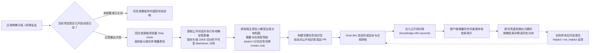

# MindIE Agent 系统架构与模块分工

[English](architecture.en.md) · [返回文档中心](README.md)

本文介绍 MindIE Agent 的整体设计定位、各子仓库职责边界，以及“远端开发 + 经验闭环 + 集群观测 + 故障诊断”是如何协同工作的。

- 任务身份与生命周期边界见：[宿主边界与任务生命周期](harness-boundary-and-lifecycle.md)
- 知识包结构与检索设计见：[知识与经验闭环设计](knowledge-system.md)
- 全部模块遵循：[工程设计原则与演进准则](design-principles.md)
- 当前配套版本与基准详情：[`0.0.2` 版本发布说明](releases/0.0.2.md)（历史首发：[`0.0.1`](releases/0.0.1.md)）

---

## 1. 产品定位与日常触发方式

MindIE Agent 的核心定位是**面向昇腾（Ascend）NPU AI Infra 设计、开发与测试全流程，为开发者现有的 AI 编程客户端（Claude Code、Codex、Kimi Code、DeepSeek Harness）提供领域知识检索、远端容器执行与工程经验沉淀能力**。

- **不另造轮子**：我们不自建底座大模型、不替代宿主本身的对话框架，也不强行托管用户的业务代码仓库。你依然在自己熟悉的终端和代码仓库里直接跟 Agent 对话。
- **两种清晰的触发方式（按需唤醒 vs 默认就绪）**：
  - **手动触发 `/mindie-agent`（知识、经验与 Skill 系统）**：在需要昇腾方案设计、推理排障、算子开发或模型迁移时，直接使用 `/mindie-agent`（Codex 中也可使用 `$mindie-agent`；DSH 中使用 `/mindie-agent` 用户手势）并阐述你的问题，即可唤醒昇腾 Skill 体系、检索历史经验包并关联当前任务的经验闭环；平时写普通代码时完全静默、零打扰。
  - **默认自动触发 `remote-dev`（远端昇腾开发执行）**：`remote-dev` 作为常驻 MCP 工具默认就绪。日常对话中只要提到远端服务器、容器或 NPU 命令，无需输入任何斜杠命令即可直接触发远端文件读写、补丁同步与后台长任务执行。
- **配置一次，长期有效**：首次配置好统一贡献开关、目标公开仓库与授权项目范围后，后续所有授权范围内的任务都会自动生效。历史经验仅供 Agent 按需参考，不强制检索或投票。
- **前置依赖：稳定的 GitHub 交互通道（`gh` CLI）与按需收敛 Fork 范围**：插件市场拉取、锁定发行版校验、`knowledge-vllm-ascend` 增量同步、经验闭环自动提交 PR（通过 `gh api` 与 `!gh auth git-credential`）以及可选的故障上报均使用已登录的 `gh`（GitHub CLI）通道。鉴于 `@mindie-agent` 组织下拥有十余个仓库，我们采用**按需两阶段 Fork 策略**：（1）**安装阶段**：校验 `gh auth status` 与 `gh auth setup-git` 后，仅为入口仓 `mindie-agent/mindie-agent` 点亮 **Star** 并创建个人远端 **Fork**（`--clone=false`），不批量 Fork 各个插件仓或知识库；（2）**开启知识贡献阶段（按需）**：当用户明确开启面向目标公开知识库（如 `mindie-agent/knowledge-vllm-ascend`）的社区贡献时，再按需为该知识库点亮 **Star**、创建个人远端 **Fork** 并绑定 `fork` 配置（`<GH_USER>/<repo>`）。
- **当前覆盖与后续扩展**：当前已沉淀 `vLLM` / `vLLM-Ascend` 特性开发与测试、`AscendC` / `Triton` 算子实现与验证等领域的知识包与 Skills，并持续向更广泛的昇腾基础软件栈扩展。

---

## 2. 仓库分工与职责全景

MindIE Agent 采用“**宿主原生插件 + 共享运行时组件 + 开放知识库**”的分层解耦架构：

| 组件 / 仓库 | 核心职责 |
| --- | --- |
| [`mindie-agent`](https://github.com/mindie-agent/mindie-agent)（本仓库） | 产品整体架构、领域边界、工程设计原则、跨组件契约与统一版本发布记录（纯文档与架构仓，不含运行时代码） |
| [`mindie-agent-cc`](https://github.com/mindie-agent/mindie-agent-cc)、[`mindie-agent-codex`](https://github.com/mindie-agent/mindie-agent-codex)、[`mindie-agent-kimi`](https://github.com/mindie-agent/mindie-agent-kimi)、[`mindie-agent-dsh`](https://github.com/mindie-agent/mindie-agent-dsh) | **宿主原生插件（`v0.0.2`）**：负责宿主任务身份识别、首次引导配置、Hook 事件桥接、公开对话提取、调用宿主原生轻量模型、插件安装与后台静默更新 |
| [`knowledge`](https://github.com/mindie-agent/knowledge) | **知识与经验引擎（`v0.12.2`）**：负责准入游标管理、确定性隐私脱敏、任务知识包构建、基于 `TechnicalTokenizerV1` 的 ReMe 词法与图谱检索（BM25 + `StrictFileGraph` + 引用谱系归并）、有用性反馈与自动 PR 提交 |
| [`knowledge-vllm-ascend`](https://github.com/mindie-agent/knowledge-vllm-ascend) | **公共领域知识库**：存放经过脱敏与合规审核的 `vLLM-Ascend` 结构化 Markdown 知识包，支持客户端增量同步 |
| [`remote-dev`](https://github.com/mindie-agent/remote-dev) | **远端昇腾开发执行底座（`v0.10.1`）**：基于 SSH 提供远端文件读写、语法大纲/符号精读、行范围精确编辑、补丁应用、全文/文件名搜索、受管长任务执行、作业取消与构建产物同步工具，兼容 6 大主流 Harness（Codex、Claude Code、Cursor、Kimi Code、DSH、Antigravity）的本地工具参数，并支持消费 `coordinator` 同步的 `endpoints.json` |
| [`coordinator`](https://github.com/mindie-agent/coordinator) | **远端昇腾环境与租约管理器（`v0.5.2`，面向 Agent，按需独立安装）**：统一管理机器台账（`machines.json` -> 自动同步 `endpoints.json`）、SSH 免密与多机容器互通（`mindie_hosts`）、远端容器绑定/开通（`mindie_container`）、无代理 NPU/节点/权重目录探测与空闲算力推荐（`mindie_probe`）、物理 NPU 与端口租约协调（`mindie_lease`）及受管源码快照任务（`mindie_run`） |
| [`npu-top`](https://github.com/mindie-agent/npu-top) | **昇腾集群可视化监控台（`v0.1.9`，面向开发者，按需独立安装）**：共享读取 `coordinator` 的 `machines.json`，提供本地 Web 实时看板（`127.0.0.1:8788`）与 90 天有界 SQLite 热力图 |
| [`diagnostics`](https://github.com/mindie-agent/diagnostics) | **结构化诊断与故障上报（`v0.4.3`）**：提供有界本地诊断日志、错误定位编号，以及受统一贡献开关控制、自动去重的 GitHub Issue 故障上报 |
| [`mindie-bench`](https://github.com/mindie-agent/mindie-bench) | **评测与发行基准工具（`v0.2.0`）**：提供端到端任务评测沙箱、各代码仓随 Release 交付的微基准测试运行器与十仓报告聚合校验工具 |

**插件打包与独立组件边界**：四个宿主插件默认打包并注册 `knowledge`、`remote-dev` 与 `diagnostics`；会话身份识别与 Transcript 提取留在各自插件内。`coordinator` 与 `npu-top` 作为独立组件按需安装。主仓库在每次版本发布时汇总上述十个代码仓的版本、精确源码 SHA 与基准测试报告，详见[组件与插件配套发布](release-compatibility-and-update.md#组件与插件配套发布)。

---

## 3. 知识沉淀与经验复用闭环

当你在终端里带着 Agent 解决了一个棘手的昇腾工程问题后，经验是怎样沉淀并帮到下一个人的？

### 为什么这套闭环既安全又不拖慢日常开发？

1. **状态清晰，绝不假装成功**：未配置、主动关闭、不在授权项目目录内、以及组件异常是四种明确区分的状态，系统绝不会把报错伪装成“正常但没数据”。
2. **毫秒级 Stop Hook，不卡终端**：每次对话回合结束时，Stop Hook 只做极轻量的本地游标登记就立即退出，既不会阻塞终端，也不会诱导大模型死循环续跑。
3. **正文 100% 确定性脱敏，小模型只写目录导航**：
   - 落盘的对话正文只保留**用户输入**、**助手公开进展**和**最终回答**（自动剥离工具原始载荷、隐藏思维链和系统提示词），并在落盘前强制通过 Gitleaks 与隐私规则扫描（自动抹除密钥、内网 IP、SSH 账号和本地主目录路径）。
   - 宿主原生轻量小模型**只负责给每个新增分块生成标题、摘要和 `tasks/<32位任务哈希>/index.md` 导航目录，绝不篡改或缩写对话正文**。

---

## 4. 知识包存储与本地状态保护

本地通过 `current.json` 维护草稿（`draft`）与公共订阅（`feed`）双通道指针，每一个任务知识包都以清晰的目录结构保存在 `tasks/<32位任务哈希>/` 下：
- `index.md`：顶层 `mindie-material-task/1` 清单（内嵌 `mindie-entry/3` 导航目录），记录任务整体摘要、适用条件（`conditions`）与分块导航表。
- `blocks/<64位块哈希>.md`：按 16KB 切分的不可变脱敏对话分块（`mindie-material-block/1`）。Agent 检索时可以先看 `index.md` 目录，再按需精读某几个分块，避免把长篇历史对话一次性塞爆上下文窗口。

在本地存储设计上：
- **Markdown 文件是正文的唯一权威来源**；
- **SQLite** 仅保存游标、队列、授权绑定与外部操作回执；
- **ReMe** 基于针对昇腾/vLLM 专业标识符定制的 `TechnicalTokenizerV1` 维护 **BM25 词法检索 + Markdown 标题/文件图谱（`StrictFileGraph`）+ 引用谱系归并**派生索引（通过 `blocks.sqlite3` 维护增量 Checkpoint，不强制依赖重型本地 Embedding 向量计算），可随时从 Markdown 重建。如果 SQLite 发生缺失或损坏，系统会明确报错并完整保护已有的 Markdown 正文，绝不会把它当成“首次安装”去清空你的数据。

---

## 5. 有用性反馈与知识库新陈代谢

当 Agent 在新任务中实际参考了某条历史经验后，可以自愿提交 `helpful`（有用）或 `not_helpful`（无用/过时）反馈。
- 反馈只是辅助信号，不代表绝对权威；不投票也完全正常。
- 如果某条经验随着 `vLLM-Ascend` 或 CANN 版本升级已经过时，`not_helpful` 反馈会帮助维护者和审核流程及时修正或下架该条目，让知识库保持鲜活。

---

## 6. 后台无感更新与故障诊断

- **兼容性筛选与无感更新**：每个插件 Release 都会在 `harness-compatibility.json` 中声明经过实机验证的宿主版本范围。距离上次检查超过 24 小时后，日常使用会在后台异步拉取最高兼容版本并利用 `uv` 构建锁定环境，趁服务空闲时原子切换，全程无需手动重装或重新授权。详见[版本兼容与无感更新](release-compatibility-and-update.md)。
- **结构化日志与统一贡献开关**：组件在关键操作边界记录有界本地日志。知识共享与工具故障上报共用当前安装配置的贡献开关；明确开启后，故障上报只上传白名单内的代码错误事实（组件名、版本、阶段、错误类型、耗时与退出码），**绝不包含任何对话正文、命令参数、机器路径或凭据**。关闭后两条外发链路停止，本地日志与远端开发仍可用。详见[诊断日志与故障上报](diagnostics-and-reporting.md)。
