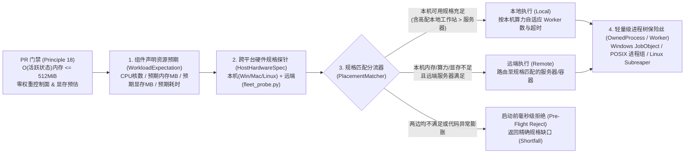

# 执行资源预期、代码有界性与跨平台本地/远端规格匹配设计

[返回文档中心](README.md) · [设计原则与 PR 自查清单](design-principles.md) · [架构与领域边界](architecture.md)

## 一、问题本质：为什么任务会跑超时或把本机搞挂？

在 MindIE Agent 的实际使用中（涵盖 Windows、macOS 与 Linux 用户），导致系统卡死、低 Swap 强杀、显存 OOM 或工具大面积超时的根因并非某一个操作系统的孤立问题，而是两类系统性缺口叠加的结果：

1. **代码自身缺乏性能与内存/显存有界性（Code-Level Unboundedness）**
   - 部分分析与模拟代码将“业务模拟的时间步数或日志全量规模”直接映射为内存中的常驻对象列表（如在数万步循环中无界 `append` 全量历史快照，或一次性对百 MB 级 Trace 执行 `json.load()`），导致一个纯 Python 分析进程一上来就申请十几个 GiB 内存；
   - 控制面或元数据读取路径误加载模型权重或初始化 `torch_npu`/CUDA 上下文，瞬间吞噬数 GiB 至数十 GiB 内存与显存；
   - 并行任务盲目使用 `os.cpu_count()` 启动 Worker，未考虑单 Worker 峰值内存与当前机器可用内存的乘积（例如在 16 核但仅剩 6 GiB 可用内存的笔记本上启动 16 个各占 2 GiB 的进程）。
2. **本地开发与远端开发之间缺乏“按真实硬件规格分流”的事前预期机制（Workload-to-Host Spec Mismatch）**
   - 算子/框架编译、大规模全模型仿真（`sim`）、GB 级 Profiling Trace 解析（`profiler`）、以及需要 NPU 显存（HBM）的基准测试（`mindie-bench`），天然对 **CPU 核数（决定会不会跑超时）**、**可用内存（决定本机会不会死机）** 与 **可用显存（决定会不会炸卡）** 有明确的规格要求；
   - 既不能在启动后才靠繁重的操作系统监控去“事后强杀”，也不能用 `if sys.platform == "darwin"` 这种按操作系统名称硬编码的特判（既漏掉了大量使用 16 GiB/32 GiB Windows 笔记本的用户，又错误拦截了拥有 128 GiB+ 内存、规格远超普通开发机的本地工作站用户）。

因此，系统性解决之道不是造一套沉重的跨平台容器监控守护进程，而是借鉴工业界成熟的 **Bazel Dynamic Execution (`ResourceSet`)** 与 **Ray / Kubernetes 声明式资源匹配 (`ResourceRequest` vs `NodeSpec`)** 范式，建立**“一层代码自身有界（PR 门禁）+ 二层事前规格预期与本机/远端自动分流（核心机制）+ 三层轻量级进程树保险丝（兜底保护）”**的三层体系。

---

## 二、整体架构：事前规格匹配为主，轻量保险丝为辅



---

## 三、第一层：编码性能、内存与显存健壮性硬约束（PR Checklist 门禁）

所有组件代码必须从源头消灭“一上来申请几十个 G”或“空转跑超时”的实现缺陷，并纳入 [`.github/pull_request_template.md`](../.github/pull_request_template.md) 与 [`docs/design-principles.md`](design-principles.md#18-编码性能内存显存有界性与本地远端规格分流准则bounded-memoryvram--spec-driven-placement) 作为提交开发 PR 的必查门禁：

| 约束维度 | 硬性工程标准 | 典型反模式（严禁出现） |
| --- | --- | --- |
| **1. 内存工作集有界性** | 主循环常驻内存只能是 $O(\text{当前活跃状态})$；统计分位数用在线增量聚合，明细用有界环形缓冲区（Ring Buffer）或流式落盘（JSONL）；`> 50 MB` 文件必须流式/分块/`mmap` 读取。 | 在数万步迭代中 `history.append()` 全量快照；对数百 MB 的 Trace 直接 `json.load()` 展开对象图。 |
| **2. 单进程 `1 GiB` 缺陷警戒线** | 控制面与分析组件（`sim`、`profiler`、`knowledge`、`coordinator`）单次常规调用内存增量 `<= 256 MiB`（峰值 `<= 512 MiB`）。除真实加载模型权重或大型 C++ 并行链接外，单进程峰值 `> 1 GiB` 默认定性为**代码算法 Bug**。 | 不优化数据结构（不使用 `__slots__`/扁平数组/流式迭代），试图靠调大机器内存限额放行。 |
| **3. 热路径性能与并发纪律** | 热循环内零 `deepcopy`、零外部子进程、零逐行 `sqlite.commit()`；同质重复步采用事件跳步（Analytical Step Folding）；并行度必须按 $\text{Workers} = \max(1, \min(\text{可用 CPU 核数}, \lfloor\text{可用安全内存}/\text{单 Worker 峰值内存}\rfloor))$ 计算。 | 在循环内跑 `subprocess.run`；无脑按 `os.cpu_count()` 启动十几个高内存子进程把本机乘爆。 |
| **4. 显存（HBM/VRAM）安全** | **零权重控制面**：读取模型结构只解析 `config.json` 或 `safetensors` 头部（前 8 字节 + JSON Header），严禁加载权重或初始化 `torch_npu`/CUDA 上下文。<br>**先算账后上卡**：上卡前必须核算 $\text{Expected VRAM} = \text{权重} + \text{KV Cache} + \text{激活峰值} + \text{HCCL Buffer} + \text{Runtime 预留}$，确认 `vram_free_mb >= Expected VRAM`。 | 为读词表/层数而调用 `from_pretrained`；未核对空闲 HBM 直接拉起推理/压测进程导致 OOM 炸卡。 |
| **5. 工具输出折叠与上下文保护** | **全量落盘 + 连续重复行折叠 + 头尾有界回显**：`remote-dev` 远端作业日志在磁盘文件保持 100% 原始完整；返回给宿主 LLM 的工具预览通过 [`preview.py:fold_repeated_lines`](../../remote-dev/remote_dev/core/preview.py) 将 `> 2` 行连续相同日志折叠为 `[previous line repeated N more times]`，超长时保留 Head/Tail 并附带原始日志指针供按需切片读取；中途阶段预算提醒一律追加于工具结果尾部（`additionalContext`），严禁改写会话起始 System Prompt 破坏 Prompt Prefix Cache（吸收 `HarnessPro` `arXiv:2610.26770v2`）。 | 把数千行重复编译 Warning / 进度条直接塞进对话历史撑爆上下文；在任务中途动态修改 System Prompt 导致 90% 折扣的 KV Cache 全部失效。 |

---

## 四、第二层：工作负载资源预期（`WorkloadExpectation`）与跨平台硬件规格（`HostHardwareSpec`）

### 1. 工作负载资源预期声明（`WorkloadExpectation`）

组件通过**静态规格档位（Tier Presets）**或**参数化估算函数（Parametric Cost Estimator）**在启动前毫秒级产出与操作系统无关的资源预期：

```json
{
  "tier": "heavy",
  "cpu_cores": 8,
  "memory_mb": 8192,
  "vram_mb": 0,
  "npu_count": 0,
  "expected_seconds": 60,
  "per_worker_memory_mb": 1024
}
```

- **四档标准预设（Tiers）**：
  - `light`（默认日常操作：`1 core`, `512 MB RAM`, `0 VRAM`, `15s`）：文件读写、Git、配置检查、轻量单测、元数据查询。任何 Windows / macOS / Linux 笔记本均可直接本地执行。
  - `medium`（中等分析/增量构建：`4 cores`, `2048 MB RAM`, `0 VRAM`, `60s`）：常规有界仿真、中小体积 Trace 汇总、增量构建。本机空闲内存与核数满足时本地执行，否则分流远端。
  - `heavy`（重度计算/大内存任务：`8+ cores`, `8192+ MB RAM`, `0 VRAM`, `300s`）：全量明细仿真、大体积 Trace 深度分析、全量源码编译（`install-vllm-ascend`）。仅当目标环境（远端服务器或高配本地工作站）具备充足空闲内存与算力时放行。
  - `npu`（加速卡与显存任务：`npu_count >= 1`, `vram_mb > 0`）：模型推理服务、算子实机验证、`mindie-bench`。必须路由至具备对应空闲 NPU 与空闲 HBM 的节点。
- **组件参数化估算器（复用业务输入）**：
  - [`sim/mindie_sim/a3_host_budget.py`](../../sim/mindie_sim/a3_host_budget.py)：提供 `estimate_prediction_resources(case, trace_detail)`，根据模型层数 `layers`、请求序列长度与 `trace_detail`（`bounded` vs `full`）计算 `layer_iterations`、`expected_memory_mb` 与 `expected_cpu_cores`，彻底废除 `sys.platform != "darwin"` 的硬编码。
  - `profiler` / `coordinator` 编译：根据待解析 Trace 文件体积或并行编译目标估算 `memory_mb` 与 `cpu_cores`。

### 2. 跨平台统一硬件规格模型（`HostHardwareSpec`）

无论是用户的 Windows 笔记本、macOS 工作站、Linux 开发机，还是 [`fleet_probe.py`](../../coordinator/mindie_coordinator/fleet_probe.py) 探测到的远端昇腾服务器，均归一化为同一份 `HostHardwareSpec` 结构：

```json
{
  "os_family": "windows | macos | linux",
  "cpu_cores": 16,
  "usable_cpu_cores": 12.5,
  "mem_total_mb": 32768,
  "mem_available_mb": 14200,
  "mem_usable_mb": 7646,
  "vram_total_mb": 0,
  "vram_free_mb": 0,
  "npu_count": 0,
  "free_npus": 0
}
```

- **本机端（Windows / macOS / Linux 全平台零子进程开销探针）**：
  - 在 [`remote_dev/core/host_spec.py`](../../remote-dev/remote_dev/core/host_spec.py) 中实现 `probe_local_hardware_spec()`：
    - 优先复用标准库/生态（`psutil` 若已安装则直接调用），并提供零外部依赖的原生 API 兜底：
      - **Windows (`nt`)**：通过 `ctypes.windll.kernel32.GlobalMemoryStatusEx` 直接读取内核 `ullTotalPhys` 与 `ullAvailPhys`；
      - **Linux (`linux`)**：直接读取 `/proc/meminfo` 的 `MemTotal` / `MemAvailable` 与 `/proc/loadavg`；
      - **macOS (`darwin`)**：读取物理总内存与可回收页面（free + inactive + speculative），扣除桌面交互保底预留（默认保留 `max(2 GiB, 20% 总内存)` 给 GUI 与系统，防止把本机桌面搞卡死）得到安全可用的 `mem_usable_mb`。
- **远端服务器侧（100% 复用 [`fleet_probe.py`](../../coordinator/mindie_coordinator/fleet_probe.py) 现有采集结果）**：
  - `fleet_probe.py` 已经采集了远端主机的 `server.cpu_cores`、`server.load_1m`、`server.mem_total_mb`、`server.mem_available_mb` 以及每张 NPU / Die 的 `hbm_total_mb`、`hbm_used_mb`、`free_phy_ids`。
  - 通过 `normalize_remote_probe_spec(probe_row)` 直接将 `fleet_probe.py` 的返回结构映射为标准 `HostHardwareSpec`（汇总空闲卡/Die 的 `vram_free_mb` 与主机 `mem_usable_mb`），无需新增任何远端 SSH 探测脚本。

---

## 五、第三层：本地 vs 远端规格匹配与自适应调度（Spec-Driven Placement）

在启动任务前，由 [`remote_dev.core.host_spec.evaluate_placement`](../../remote-dev/remote_dev/core/host_spec.py) 与 [`mindie_coordinator.placement.select_execution_target`](../../coordinator/mindie_coordinator/placement.py) 按统一规则完成决策：

### 1. 规格匹配不变量（与操作系统名称无关）

一个候选目标环境 $H$（无论是 `local` 还是某台 `remote` 服务器）满足工作负载预期 $W$ 的充要条件为：

$$\begin{aligned}
W.\text{memory\_mb} &\le H.\text{mem\_usable\_mb} \\
W.\text{cpu\_cores} &\le H.\text{cpu\_cores} \\
W.\text{vram\_mb} &\le H.\text{vram\_free\_mb} \\
W.\text{npu\_count} &\le H.\text{free\_npus}
\end{aligned}$$

### 2. 分流决策规则（Local vs Remote）

1. **优先本地执行（当本机规格充裕，或本机规格优于远端时）**：
   - 若任务不需要远端专属 NPU（$W.\text{npu\_count} == 0, W.\text{vram\_mb} == 0$），且本机 `local_spec` 满足上述全部条件（或者本机是一台空闲内存/算力比当前远端候选机更大的高配 Windows/macOS/Linux 工作站），则直接判定 `decision = "local"`。
2. **自动分流远端（当本机内存、CPU 算力或显存不足时）**：
   - 若本机 `mem_usable_mb < W.memory_mb`（在本机跑有搞挂系统风险）、`cpu_cores < W.cpu_cores`（在本机跑有严重超时风险）、或需要 NPU/HBM 显存，则从 `fleet_probe` 远端候选池中筛选满足规格的节点，并按剩余内存/显存与空闲算力余量排序，返回最优 `decision = "remote"` 及目标主机身份。
3. **启动前快速拒绝（当本机与远端均不满足时）**：
   - 若没有任何候选环境满足要求，在创建进程前立即返回 `decision = "reject"`，并附带结构化缺口诊断 `shortfall`（明确指出差多少 MB 内存、多少核 CPU 或多少 MB 显存），绝不盲目启动进程去赌运气。

### 3. 基于目标规格的并发度与超时自适应

选定执行目标 $H$ 后，自动根据 $H$ 的真实硬件规格推导执行参数：
- **安全并发 Worker 数**：
  $$\text{recommended\_workers} = \max\Big(1,\; \min\big(\lfloor H.\text{usable\_cpu\_cores} \rfloor,\; \lfloor H.\text{mem\_usable\_mb} / W.\text{per\_worker\_memory\_mb} \rfloor\big)\Big)$$
- **算力感知的超时缩放（Timeout Scaling）**：
  根据目标机器的可用核数与负载动态计算 `recommended_timeout_ms`（满足 `AGENTS.md` 的 `outer_timeout >= sum(inner_budgets) + cleanup_grace`），避免因机器核数差异导致误判超时。

---

## 六、第四层：轻量级跨平台进程树保险丝（兜底保护）

在完成事前分流后，实际拉起的进程通过 [`remote-dev`](../../remote-dev/remote_dev/core/local_process.py) 已有的跨平台进程组所有权机制做最后一道兜底，防止未知代码 Bug 引发内存泄漏或孤儿进程残留：

- **Windows 本机（`_WindowsJob`）**：复用 [`local_process.py`](../../remote-dev/remote_dev/core/local_process.py) 现有的 Windows Job Object（`JOB_OBJECT_LIMIT_KILL_ON_JOB_CLOSE`），并在传入 `max_memory_mb` 时启用内核原生 `JOB_OBJECT_LIMIT_JOB_MEMORY`（`JobMemoryLimit`），无需额外守护进程即可由 Windows 内核兜底整棵进程树内存与退出回收。
- **macOS / Linux 本机（`OwnedProcess` + `_posix_owner.py`）**：复用独立会话（`setsid`）与父进程死亡管道守护，确保超时或取消时整棵进程组（`-pgid`）干净回收，无后台孤儿 Python 残留。
- **Linux 远端服务器（`processes/worker.py`）**：复用 `PR_SET_CHILD_SUBREAPER` 与进程树排空确认（`descendants_drained`），在租约释放前确保所有子孙进程彻底退出。

---

## 七、组件职责与验证矩阵

| 仓库 / 模块 | 核心职责 | 关键入口与测试验证 |
| --- | --- | --- |
| [`mindie-agent`](../AGENTS.md) | 编码性能、内存/显存有界性原则（Principle 18）与 PR 自查门禁 | [`docs/design-principles.md`](design-principles.md)、[`.github/pull_request_template.md`](../.github/pull_request_template.md) |
| [`remote-dev`](../../remote-dev/remote_dev/core/host_spec.py) | Windows/macOS/Linux 本机硬件规格探针、`fleet_probe` 规格归一化、本地/远端分流判定器、`_WindowsJob` 内存保险丝 | `remote_dev/core/host_spec.py`、`remote_dev/core/local_process.py`、`tests/test_host_spec_placement.py` |
| [`coordinator`](../../coordinator/mindie_coordinator/placement.py) | 扩展 `RESOURCE_KEYS`（支持 `cpu_cores`、`memory_mb`、`hbm_mb`），对接 `fleet_probe.py` 实现本地与远端联合选机 | `mindie_coordinator/placement.py`、`tests/test_workload_placement.py` |
| [`sim`](../../sim/mindie_sim/a3_host_budget.py) | 跨平台（Windows/macOS/Linux）仿真资源估算 `estimate_prediction_resources` 与本机容量门禁（消除 `darwin` 硬编码） | `mindie_sim/a3_host_budget.py`、`tests/test_a3_host_memory.py` |
