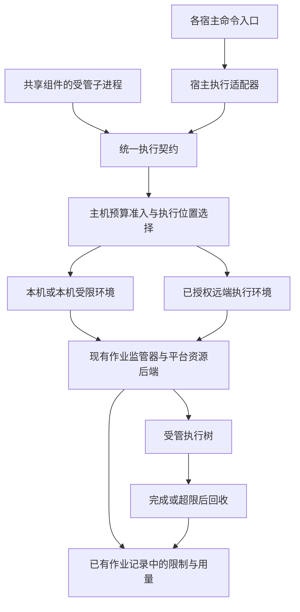

# 执行资源预算与进程监管设计

[文档中心](README.md) · [宿主边界与任务生命周期](harness-boundary-and-lifecycle.md) · [原生运行机制](native-runtime-reuse.md) · [分级测试体系](testing-architecture.md)

**状态：全局设计草案，尚未完成跨宿主实现与验收。**

时间、CPU、内存和并发额度共同组成执行器的资源契约。执行器在启动前准入，在运行时落实限制，在超限后回收所属进程树，并把原因与实测用量返回调用方。所有接入的命令复用这条路径，不按模拟、编译、测试等任务类型逐条追加 `AGENTS.md` 规则。

本设计优先保护交互式工作机，同时覆盖远端 CPU/NPU 研发任务。保障范围是已接入监管的执行树；不能据此保证整台机器上的其他应用永不耗尽资源，也不能把未接管的宿主原生工具算作已保护。

## 一 设计决定

1. **以执行树为单位限制，以物理主机资源池为单位准入。** 三个各用 8 GiB 的进程即使分别未超限，也不能同时挤进 16 GiB 的工作机。主进程退出、子进程仍存活时，额度继续占用。
2. **先建立限制，再放行目标程序。** 不能先启动 Python，再依靠 Agent 看到内存上涨后主动停止；也不能只限制 SSH 客户端而漏掉远端作业。
3. **预算请求不等于执行承诺。** 请求的值、最终获准的值、后端实际支持的限制与实测消耗分别返回。模型层数、命令名、历史峰值可以辅助估算，不能充当操作系统内存限额。
4. **本地和远端服从同一契约。** 执行位置由预算、平台能力、环境和既有授权共同决定。转远端不会隐式取消预算，也不会把本地不确定结果直接重跑一遍。
5. **组件优化与全局保护各自负责。** `sim` 需要消除不必要的历史累积；执行器需要保证组件出现下一次内存缺陷时只让该作业失败。两者都要有资源回归测试。
6. **能力不足必须可见。** 操作系统硬限制、监管进程监测终止、仅测量三种能力不混称；没有接入的原生 Bash 入口不能靠提示词补成“已受控”。

## 二 现状和缺口

2026-10-21 的故障中，三条 DSH 原生 Bash 拉起的模拟器 Python 进程合计 macOS footprint 约 31 GiB，随后出现低交换空间杀进程和 WindowServer 看门狗重启。模拟器内部历史累积已在 [sim PR 15](https://github.com/mindie-agent/sim/pull/15) 修复，但组件修复不能替代执行器的通用资源边界。原先追加执行位置规则的 [PR 267](https://github.com/mindie-agent/mindie-agent/pull/267) 已关闭。

| 当前入口或模块 | 已确认能力 | 本设计要补的能力 |
| --- | --- | --- |
| `remote-dev/core/local_process.py` 的 `OwnedProcess` | 本地操作的所有权、进程组或 Windows Job 回收 | 统一预算参数、实际限制能力、资源计量和主机总额度 |
| `remote-dev/processes/worker.py` | Linux 远端作业监管、显式超时、取消、后代回收 | 执行树内存/CPU/PID 限制、资源原因归类、主机池准入 |
| `remote-dev` 的 Bash 与六宿主别名 | 自有远端命令进入同一作业通道 | 预算字段端到端透传，控制通道与作业额度分离 |
| MindIE 的 DSH 插件 `host3.mjs` | 注册自有工具，拉起自有 sidecar | 当前代码没有接管 DSH 原生 Bash 的进程创建 |
| 其他宿主的原生 `exec`、`bash`、terminal | 由宿主掌握进程创建，不能从插件名称推断接管情况 | 逐宿主验证受支持的执行钩子、执行后端或外层监管接入 |
| `coordinator` | 放置、NPU 设备与服务端口租约、容器执行与回收 | 使用执行器给出的主机预算结果，不再维护第二份 CPU/内存库存 |
| `sim` 等业务组件 | 可以限制内部数据结构与输出规模 | 保留组件资源回归，不各自实现一套跨宿主进程监管器 |

上述源码检查只说明当前组件边界。没有从插件 API 中确认的原生工具拦截能力仍是待验证项；不能据此断言某宿主永远不支持，也不能直接覆盖宿主 Bash 工具来假装接入。

## 三 执行链与归属



`remote-dev` 扩展已有执行与监管基础设施，拥有通用预算协议、主机池准入、平台后端和作业资源结果。本地执行是同一执行协议的后端，不经过一次无意义的 localhost SSH，不另建一套本地作业状态机。文件读取等有界原生操作不必为统一接口多绕一层 Shell。

宿主适配器只负责可信的会话/父任务身份、取消信号和预算映射；目标程序实际启动必须落到能落实预算的执行层。`coordinator` 继续拥有 NPU/端口与现有放置逻辑；它询问并使用执行器的 CPU/内存准入结果，不复制库存和进程事实。资源预算中的 NPU 引用是现有租约引用，不是第二个设备分配器。

资源约束保护可信研发任务的意外超量，不承诺抵御具有宿主 root/管理员权限的恶意程序。若任务可以自行修改宿主控制组、调用外部容器守护进程启动旁路作业，应通过对应后端建立实际监管边界，而不是把权限模型留空。

### 需要纳入的入口

覆盖清单至少包括原生 Shell/terminal、MCP 工具的子进程、插件 sidecar 的工作进程、评测/编译/分析作业，以及远端容器内的目标进程。每个入口登记 `managed`、`partial` 或 `unmanaged` 及已验收能力，来自适配器接线与实际执行测试，不来自模型口头声明。

`partial` 例如只控制了 SSH 连接或只测量了一个 PID；`unmanaged` 例如当前未接入的 DSH 原生 Bash。全局验收要求目标使用场景的入口都为 `managed`，不能只展示 MCP 演示路径。

## 四 统一预算契约

### 资源维度

| 维度 | 含义和口径 | 约束动作 |
| --- | --- | --- |
| `wall_time_ms` | 目标执行开始后的单调时钟时长；排队、启动与清理分别计时 | 到期终止所属执行树 |
| `cpu_time_ms` | 整个执行树累计 CPU 消耗；记录是否包含内核态和已退出后代 | 消耗用尽后终止；不能用单 PID CPU 时间冒充总量 |
| `cpu_capacity` | 同一时段可用 CPU 带宽/核数额度 | 限速或排队；不能把 `nice` 优先级等同于硬配额 |
| `memory_bytes` | 整个执行树的后端原生内存计量；明确 accounted memory、commit 或 footprint | 后端落实总限制，超限按该后端实际原因失败 |
| `swap_bytes` | 执行树允许占用的交换空间；独立于物理内存口径 | 桌面保护配置可设为零；不默许依靠大量 swap 保持“未超内存” |
| `processes` | 进程/线程数量，按后端口径记录 | 限制派生规模，避免资源经子进程放大 |
| `output_bytes`、`scratch_bytes` | 内存缓冲、完整日志和临时结果的持久存储分别设额度 | 背压或可定位的额度错误；不静默截断业务结果后宣称完整 |

CPU 带宽、累计 CPU 时间和墙钟时间是三个不同维度。排队或限速导致的墙钟增长要体现在报告中；没有任务工作量语义时，不凭“看起来慢”终止正确的长作业。

每个预算值还带 `required_enforcement`，至少区分 `kernel`、`supervisor` 和 `observe`。后端返回同维度的 `effective_enforcement`、计量名称和适用边界；请求要求硬约束而后端只有采样能力时，准入失败或重新选择执行环境，不悄悄降级。

请求可省略某些值，由主机执行策略填充。未声明内存不表示无限内存；未声明总墙钟时长也不应被武断改成 90 秒。允许长作业没有业务总超时，同时仍受 CPU 带宽、内存、并发与取消控制。

### 请求与结果示意

以下是目标字段，不是现有 MCP 工具已经支持的参数：

```json
{
  "execution": {
    "parent_execution": "host-issued-parent",
    "placement": "auto",
    "budget": {
      "wall_time_ms": 120000,
      "cpu_time_ms": 90000,
      "cpu_capacity": 2,
      "memory_bytes": 536870912,
      "swap_bytes": 0,
      "processes": 64
    },
    "required_enforcement": {"memory_bytes": "kernel"},
    "restart_policy": "never"
  }
}
```

示例数值用于展示单位，不是给所有任务统一设定的默认值。最终有效预算由执行器合成主机策略、父级剩余额度与请求得到；超过父级授权或主机能力时返回具体冲突，不能静默缩减预算后启动一个注定失败的任务。

结果沿用现有作业 ID 和完成/失败生命周期，增加 `resource_usage`、`effective_budget`、`enforcement` 与 `termination_reason`。原因区分墙钟超时、CPU 用尽、内存超限、进程数超限、输出/存储超限、主动取消和能力不足；没有内核事件或监管证据时，不仅凭退出码 137 断言 OOM。

资源失败不等于业务外部效果已回滚。已经确认的业务结果继续保留；对外写入是否完成仍按已有 `completed`、`failed`、`unknown` 语义处理，不把资源原因反过来覆盖外部事实。

## 五 主机总额度和子任务继承

额度层级为 **物理主机 → 受管工作池 → 顶层任务 → 子任务/执行树**。不同宿主启动的任务使用同一个主机池；Fork 出子代理不会得到一份新的主机内存额度。父任务已预留额度内的子任务分配属于切分，不在主机层重复记账。

池身份来自目标主机执行器，而不是 SSH 别名、工作目录或某个插件安装目录。同一机器的两个别名和两个容器不能各自“发现”一份完整主机容量。VM 先作为宿主上的受管分配预留其上限，再在 VM 内切分作业额度；不能把宿主和 guest 的同一内存算成两份可用资源。

主机策略以整个受管池为上限，给系统、GUI、网络与监管控制通道留出余量。可用值同时受管理员/用户配置、物理容量和外层容器/VM 限额约束；不能仅因某次“空闲内存较多”永久扩大池容量。此策略配置一次，不按工具名称、模型系列或命令字符串维护白名单。

例如一台 16 GiB 交互机可以先评估 4 GiB 的受管作业池：三个各申请 2 GiB 的执行树最多同时准入两个。该数值只是待压测的初始配置；若本机没有所需内存硬限制，不能仅靠这道算术检查就称作安全本地执行。

准入先预留请求上限，而不是根据当前 RSS 很低就多放任务。CPU 带宽和活动作业数采用同样的总额度计算。默认策略不因实际低用量自动超售；确有弹性需求时应单独定义可抢占池，不能作为隐式行为。

主机池只有一个资源准入权威。复用 `remote-dev` 的主机身份、作业记录和短事务机制，必要的资源预留表只保存分配事实与已有作业引用，不复制一整套作业状态、心跳和完成回执。Linux 内核父控制组或 Windows 父 Job 提供池级约束；数据库用于准入并发计算，不代替内核限制。

宿主退出、连接断开或 Shell 父进程退出都不是释放资源的证据。现有监管器确认后代已回收后释放额度；恢复时依据已有作业/系统对象进行一次对账，不永久锁死任务，也不在每次工具调用前全盘扫描机器。

## 六 平台执行后端

| 平台 | 设计后端 | 必须确认的边界 |
| --- | --- | --- |
| Linux / WSL | 优先复用已有 systemd 管理或被委派的 cgroup v2；池和作业分别建组 | 控制器可用且可写、目标从启动起就在正确组内、实际包含所有后代与容器内工作 |
| Windows | 扩展现有挂起创建与 Job Object；组合池级和作业级限制 | 禁止不必要的 breakaway；验证嵌套 Job、commit 内存、CPU 与活动进程限制，而不仅设置 kill-on-close |
| macOS 原生 | 继续复用所有权/取消机制；测量 footprint 与压力，能力分项声明 | 目前没有验收执行树内存硬上限；owner-pipe、`ulimit` 或单进程 RSS 测量不能填补这个证明 |
| macOS 上的受限 VM / 容器环境或已授权远端 | 由具有硬配额的环境提供资源边界 | VM 自身先受宿主总额度约束；现有环境与共享目录/制品传输能力需明确，不自动安装新运行环境 |

Linux 后端使用 cgroup 的内存/交换空间限制、CPU 带宽控制和整组回收等原语；累计 CPU 预算仍需监管层基于组计量执行。即使称为内核硬限制，也保留内核文档规定的瞬时越界等语义，不承诺计量值绝对没有瞬态超调。[Linux cgroup v2 文档](https://docs.kernel.org/admin-guide/cgroup-v2.html)

Windows 内存限制与 CPU 限制要按 Job 的真实口径报告，commit 内存不能改名成 RSS。嵌套层级与创建顺序、CPU rate hard cap 使用官方原语，并由实际受限进程验证。[Job Objects](https://learn.microsoft.com/en-us/windows/win32/procthread/job-objects)、[Nested Jobs](https://learn.microsoft.com/en-us/windows/win32/procthread/nested-jobs)、[CPU rate control](https://learn.microsoft.com/en-us/windows/win32/api/winnt/ns-winnt-jobobject_cpu_rate_control_information)

macOS 的 footprint、压缩页和换出页需要与 RSS 区分；这也是本次故障不能只看 `ps` RSS 的原因。设计阶段将原生树级硬内存能力列为未验收，而不是宣称操作系统永远不支持。[Apple 内存计量说明](https://developer.apple.com/videos/play/wwdc2022/10106/)

**macOS 的落地决定：**要求硬内存隔离的任意代码任务，只有在能力验证通过的本地受限环境或已授权远端上才能准入。原生监测型执行可以作为显式的较弱能力保留，但不能通过全局硬限制验收；不能因任务没有声明规模就默认它很轻。若没有兼容的执行环境，返回能力不足，不用新增提示词掩盖缺口。

同样，`docker exec` 的工作进程由容器运行时创建，不因控制端处在受限组内就自动满足作业约束。对已有共享容器，需要可委派的作业边界或其他已验证后端；不能直接降低整个容器的限额、影响别人的服务来通过自己的测试。

## 七 准入和超限处理

### 启动前

1. 从宿主和已有任务上下文取得执行身份，解析预算及父级剩余额度。
2. 检查候选环境能力、所需数据/环境与既有授权。不能通过猜测命令字符串来判断任务一定很轻。
3. 在目标物理主机的池内短事务预留额度，按所需能力创建并绑定系统资源边界。
4. 监管器与取消通道就绪、限制已实际应用后才放行目标程序。配置失败时释放尚未消费的预留，不启动业务命令。

控制通道、停止操作和日志落盘保留独立余量，不能与目标作业一起被耗尽。现有 NPU/端口租约继续由 `coordinator` 管理；联合准入失败时释放尚未启动业务的预留，排队时不长时间拿着另一类稀缺资源等待，不引入分布式状态机。

### 运行中与回收

限制由内核或执行监管器负责，Agent 不参与采样决策。监管器只读取所属执行组的聚合指标，按预算尺度采样或使用系统事件；记录峰值/累计值，不逐样本写入无限日志。

CPU 带宽一般限速；累计 CPU、墙钟与其他耗尽预算触发终止。内存耗尽可能由内核先终止部分进程，监管器随后回收整条所属执行树。达到严重内存压力时，不等待过长的优雅退出宽限期；正常取消仍允许有界收尾。停止与外层 RPC 的预算继续满足 `outer >= stop_grace + drain_grace`。

只有目标执行组及后代已结束，才能发布作业资源终态并释放池额度。若业务结果已落盘但清理失败，保留业务成功事实并单独报告清理未完成；额度不能提前回收。无法确认存活情况时保持可恢复的已有作业引用，不伪造 `drained=true`，也不生成永久本地故障墓碑。

断开 SSH 不触发重提：由远端监管器继续执行预算和持久作业生命周期，恢复连接后查询同一作业。取消当前短工具调用与停止独立远端持久作业，继续遵守现有寿命边界。

### 执行位置变化

本地预算或限制能力不足时，可以在**执行开始前**选用已授权、环境匹配且预算能容纳的远端。放置沿用既有目标与 NPU 权威，不自动创建新付费环境，也不把资料发到未经授权的机器。

远端执行需要明确的命令、工作目录、源代码/输入、运行环境和输出映射。复用现有增量制品传输、准备缓存和源码身份，不简单给任意含本地路径的 Shell 命令套一层 SSH，也不每次全量复制工作区。

作业已经启动后，资源超限终止不等于可以安全地迁移重跑。只有调用方明确声明可重启的纯计算或有有效 checkpoint 的作业才允许恢复；有外部写入或结果不确定时先处理已有结果，不能让“自动转远端”制造第二次副作用。

## 八 资源契约的测试和验收

测试目标与超时测试相同：验证预算确实生效、错误可识别、后代已回收、结果保留，并且旁边的正常任务不受影响。仅检查 Schema 字段、异常字符串或 Agent 是否读到规则不算验收。

| 层级 | 具体测试 | 通过条件 |
| --- | --- | --- |
| Tier 0 纯内存 | 父子额度切分、并发准入、预算合成、超限原因转换 | 子任务不能扩张父额度；同一额度不重复记账；时间/内存单位无歧义 |
| Tier 1 真实进程 | 父进程分配、两个子进程合计分配、短暂 CPU 忙循环、活动 PID 增长、输出背压 | 每类额度实际触发；不是仅限制父 PID；回收后无存活后代或额度残留 |
| Tier 1 并发与生命周期 | 两个合法任务并发使第三个超出池总额；主控强杀、Shell 提前退出、子进程新建会话 | 第三个排队/拒绝；不超售；所有权、清理与恢复边界符合平台承诺 |
| Tier 1 能力与准备 | 缺少控制器/Job 能力、挂载只读、绑定失败、启动前取消 | 业务程序未开始；返回能力不足或具体启动错误，不静默无约束执行 |
| Tier 2 远端受限环境 | 真实 Linux 主机/已有容器的受管小任务、SSH 断开、恢复查询、停止 | 限制的是实际远端执行树；原作业只有一次；不影响其他服务 |
| Tier 3 宿主验收 | 每个声称支持的宿主，从原生工具入口拉起父子进程并触发预算 | 由实际宿主进程创建路径进入监管，不能用直接调用内部 Python 方法替代 |

内存测试使用很小的专用受限组，采用逐页触碰的真实分配，避免只申请虚拟地址却声称验证物理内存。验证子进程各自未超限、合计超过组限额这一用例；同时运行一个独立正常哨兵任务，验证没有误杀。限制边界和最大超调按后端声明验收，不为通过测试而申请几十 GiB 内存。

日常单平台组件测试按现有 Tier 预算划分：控制逻辑数秒，进程合同小于 15 秒，远端无损集成小于 25 秒；较长的原始故障负载回放单列远端资源预算，不塞进本机快速测试。缺少平台能力的环境明确记录未覆盖；跳过该测试不等于该平台的执行保证已通过。

### 业务性能与资源回归

统一执行预算以外，组件为固定真实工作量维护资源回归：输出正确性、墙钟分位数、累计 CPU、执行树峰值内存、吞吐、I/O 和报告大小。预算变更、输入规模与后端身份都与结果一起记录，不能通过少跑 token、减少模型层数、隐藏明细缺失或提高测试限额来伪造性能改善。

单进程 `ru_maxrss` 是组件回归的有效测量，但不是进程树硬上限或跨平台同口径证明。当前 sim 的 8 秒墙钟、5 秒 CPU、160 MiB RSS 检查只说明该测试用例满足组件预算；它没有验收 DSH 原生 Bash、跨 Agent 总额和整个 macOS 执行树硬限制。

组件不能无限累积本可释放的对象，再把所有负载移到大服务器。原始故障任务继续在声明的远端预算内回放，检验内存是否随迭代无界增长；资源优化不改变模拟器计算语义和完整统计。

## 九 组件分工与实施顺序

| 所有者 | 交付内容 | 完成证据 |
| --- | --- | --- |
| `remote-dev` | 共用预算结构、主机池准入、本地/远端执行后端、监管与用量输出 | 相同协议下的真实进程与并发合同测试 |
| 各 Harness 适配器或宿主原生执行器 | 原生命令创建前接入、父任务继承、取消和能力声明 | 各宿主原生入口的 Tier 3 回执与覆盖清单 |
| `coordinator` | 接受主机预算约束的放置，与已有 NPU/端口租约衔接 | 不重复库存、不发生等待占用死锁、不扰动其他 NPU 作业 |
| `sim`、`profiler`、`knowledge` 等组件 | 有界内部数据、准确工作量与资源回归 | 正确性不变且在明确资源预算内完成 |
| `diagnostics` / `mindie-bench` | 复用已有日志与报告，展示原因/峰值/耗时和验收覆盖 | 不丢业务结果、不无限记录采样、不把“可运行”当成“已受控” |

实施按以下依赖推进，设计阶段不提前宣称完成：

1. **P0 契约与接入口验证。** 确定各宿主真实执行入口，验证当前工作机上的可实施后端；优先查清 DSH 原生 Bash 接入路径与 macOS 限制能力。此项不成立时，全局保护不能验收。
2. **P1 共用执行预算。** 在已有本地所有权/远端监管器中实现预算、能力报告、主机池原子准入和资源失败原因。先做小额真实进程测试，再测试并发。
3. **P2 跨宿主接入与放置。** 宿主父子任务复用池额度，打通本地受限环境和已授权远端，验收代码/输入/环境/输出映射和不确定结果处理。
4. **P3 默认接管与故障回放。** 目标宿主全部必需入口通过覆盖验收后启用主机策略默认值；在明确远端限额下回放原始负载，验证 GUI 余量、吞吐和中断恢复。

统一执行入口验收后，删除 `sim` 按 `layer_iterations` 判断主机可运行规模的特殊准入；保留模拟器内部有界数据结构和固定工作量资源回归。后续其他工具只提交同一预算契约，不复制这个临时规模判断。

主机策略只定义一次可复用的执行级预算。后续新增大规模编译、分析或模拟任务，变化的是请求额度和工作量回归，而不是再新增一条 `AGENTS.md` 规则。

## 十 本轮范围和待验证决定

本轮交付是这份全局设计。sim PR 15 的历史释放与有界明细可以作为独立组件缺陷修复；其中的模型规模准入只是过渡检查，不是全局执行器方案。AGENTS 资源规则已撤回，不再扩展同类文字策略。

进入实现前必须实证回答三项：DSH 等原生 Shell 入口如何接入；macOS 严格内存模式采用哪个可验证后端；跨宿主是否能共享同一物理主机池而不重复记账。这些是代码/平台验证工作，不把它们转成每次运行都询问用户的审批队列。

源码依据：`remote-dev/core/local_process.py`、`core/_posix_owner.py`、`processes/worker.py`、`schemas/bash.schema.json`；`mindie-agent-dsh/host3.mjs`；`coordinator` 的 `placement.py`、`host_queue.py` 与 `managed_execution.py`。现有仓库负责架构与文档，具体运行时实现仍由对应组件拥有。
