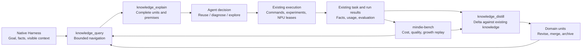

# Detailed Design: Context Layers, Experience Evolution, and Open Exploration

[中文](knowledge-context-and-exploration.md) · [Current knowledge system](knowledge-system.en.md) · [Documentation](README.en.md)

**Status: design proposal.** This document defines behavior, measurement, and acceptance for subsequent implementation. It does not claim that the proposed capabilities have shipped. It draws on local implementation checks and public sources read on 2026-10-20. Implementation can be assigned to Gemini, DeepSeek, or other contributors; this repository owns the design.

The goal is to improve the next engineering decision while controlling the total cost of completing the task. Three loops must work together:

1. **Context:** discover candidates, load selected content, observe cost and use, and adjust the working set and loading budget.
2. **Experience:** turn task facts into reusable conclusions, update existing knowledge, and validate, revise, or remove it from default retrieval through later use.
3. **Exploration:** identify gaps in established methods, run discriminating experiments, evaluate results, and return findings with explicit conditions to the experience system.

Performance artifact access, targeted capture, accounting, and comparison are specified in the companion [Profiler design](profiler-system.en.md). This document covers budgets, use, and revision when that evidence enters context and experience.

## 1. Decisions and boundaries

| Decision | Meaning |
| --- | --- |
| Separate architecture layers, knowledge categories, and reading depth | `L1–L4` describe the 4-tier cognitive and execution architecture (`L1` Foundation, `L2` Probe, `L3` Hermes Convergence, `L4` RSI Exploration); `axiom/measurement`, `sop`, `workflow`, and `mutator` describe semantic knowledge categories (`category`); navigation, body, and evidence describe reading depth |
| Load complete rules on demand | Conditions, constraints, and rationale form a semantic unit; do not truncate procedural steps to fit |
| Let knowledge grow while bounding context | Manage corpus size, candidate count, response budget, and currently visible knowledge separately |
| Update existing knowledge incrementally | Revise the existing unit for the same issue; add content for a new mechanism, condition, or decision branch |
| Derive statistics from events | Returned, loaded, applied, and evaluated are different observations; models do not author cumulative success counters |
| Explore information gaps | Repeated failure is a signal to inspect progress; new evidence, hypotheses, and available resources determine what happens next |
| Reuse the native Harness | The host owns conversations, compaction, independent contexts, and model calls |
| Keep implementation small | Reuse task IDs, run IDs, unit revisions, and results; introduce no hash chains, shadow receipts, generic workflow engine, or resident scheduler |

The user continues through `/mindie-agent` and natural language. Budgets and curation remain internal capabilities. Routine tasks do not require forms, frozen directories, or maintenance ceremonies. Existing consent, redaction, and publication boundaries remain in force.

## 2. Existing foundations and gaps

This is a snapshot of the inspected implementation. Subsequent acceptance must use the changed components and their actual results.

| Existing foundation | Gap | Proposed change |
| --- | --- | --- |
| Structured units, conditions, `id@revision`, dependency closure | Early schemas conflated architecture layers `L1–L4` with knowledge content categories via `tier` | Separate `L1–L4` architecture layers from semantic knowledge categories (`axiom/measurement`, `sop`, `workflow`, `mutator`); distillation can update any category |
| Body budgets and whole foundational rules (`axiom`/`measurement`) | Metadata is excluded; other bodies can be truncated; shared parents repeat | Account for the whole response, separate discovery from reading, deduplicate by reference |
| `_common` foundation rules | Large foundational constraint units can all be excluded by the default budget | Make foundational constraints atomic and select them for the subproblem |
| `knowledge_distill` and `reviewed_change` | Existing knowledge is not consistently supplied for comparison | Retrieve related units, propose a delta, check revisions, prefer updates |
| Query observations and feedback | Observation does not establish use or benefit | Associate declared use with real evaluation |
| RSI stall detection and candidate evaluation | Removing L3 from an object does not erase history; a missed target can become a refutation | Use native independent contexts and separate evidence, goal attainment, and reusability |

Inspected entry points include [`graded/index.py`](https://github.com/mindie-agent/knowledge/blob/70ae51c/mindie_knowledge/graded/index.py), [`graded/retrieval.py`](https://github.com/mindie-agent/knowledge/blob/70ae51c/mindie_knowledge/graded/retrieval.py), and [`graded/distill.py`](https://github.com/mindie-agent/knowledge/blob/70ae51c/mindie_knowledge/graded/distill.py) in `knowledge`, plus [`rsi_explorer.py`](https://github.com/mindie-agent/mindie-bench/blob/3ca7343/src/mindie_bench/runner/rsi_explorer.py) in `mindie-bench`.

Local read-only probes also found:

- Individual L1 bodies in the two inspected domains were estimated at roughly 925–1,806 tokens, exceeding the default query budget of 800. A condition-matched query without lexical overlap could receive no foundation rule.
- A Qwen query could return an L3 excerpt while excluding required parents for budget reasons. An RMSNorm query expanded the same parents in several results.
- These are estimates from the current UTF-8-bytes-divided-by-four method, not model usage or NPU measurements.

Fix assembly and accounting before adapting budgets. Adaptation based on incorrect measurements would amplify the error.

## 3. Three orthogonal dimensions: execution architecture (`L1–L4`), knowledge categories (`category`), and reading depth

### 3.1 Knowledge content categories (`category`) in the `knowledge` flywheel

> [!IMPORTANT]
> **Avoid calling the knowledge base an "L1–L4 knowledge base"**: `L1–L4` denotes the 4-tier cognitive and execution architecture (see [Architecture §4](architecture.en.md#4-l1l4-cognitive--execution-architecture-and-the-knowledge-flywheel)). Structured units inside the `knowledge` flywheel are organized by **semantic `category`** and serve the `L1–L4` architecture layers as needed (the `tier: L1..L4` field in the existing schema is merely a legacy compatibility alias mapping to the four categories below):

| Knowledge Content Category (`category`) | Architecture Layer Served (schema alias `tier`) | Content | Question answered |
| --- | --- | --- | --- |
| **`axiom` / `measurement`**: constraints and measurements | Serves **`L1` Foundation / `L2` Oracles** (`tier: L1`) | Hardware limits, software contracts, and conditional measurements | What premises must hold? |
| **`sop`**: diagnostic & operational procedures | Serves **`L2` Probe / `L3` Execution** (`tier: L2`) | Repeatable diagnostic, capture, development, or measurement operations | How do we obtain an observation or perform an action? |
| **`workflow`**: decision experience | Serves **`L3` Hermes Convergence** (`tier: L3`; stripped in `L4` RSI exploration) | Observations that select branches, method changes, and stopping conditions | Why is this the next useful step? |
| **`mutator`**: controlled code transformations | Serves **`L3` Reuse / `L4` RSI Transform Space** (`tier: L4`) | Conditional optimization or adaptation techniques with verification evidence | How might the implementation change? |

Routine `L3` work may reuse `mutator` transforms directly. Open `L4` exploration may produce a new `sop` diagnostic procedure or `measurement` finding. Experience distillation (`knowledge_distill`) can revise or add units in any category.

Evidence is independent of category. The target metadata distinguishes `hardware_spec`, `software_contract`, `reproduced_empirical`, `single_observation`, and `hypothesis`. A software interface contract is not a hardware specification; `axiom` / `measurement` permits `hardware_spec`, `software_contract`, and `reproduced_empirical`. `software_contract` is a proposed format addition.

### 3.2 Reading depth

| Depth | Content | Purpose |
| --- | --- | --- |
| Navigation | Title, brief purpose, applicability, missing facts, estimated reading cost, reference | Decide what is worth opening |
| Body | Complete decision unit and required premises, with shared premises once | Prepare to apply knowledge |
| Evidence | Relevant source excerpts, code, or run results | Check a claim, resolve conflict, or assess transfer |

A navigation summary is not an execution contract. The body expresses one coherent decision; long logs, complete code, and extensive examples remain behind source references.

### 3.3 Working modes

| Mode | Entry | Exit |
| --- | --- | --- |
| `reuse` | An established method fits the observed conditions | Goal achieved or unexplained deviation |
| `diagnose` | Code, environment, measurement, or applicability must be distinguished | Cause identified or a gap in existing methods established |
| `explore` | No reliable method explains the mechanism or remaining opportunity | Verified method, useful negative finding, or exhausted authorized resources |

Modes belong to subproblems. Model loading and communication can follow existing procedures while the first divergent operator enters exploration.

## 4. Data flow and ownership



| Owner | Responsibility | Boundary |
| --- | --- | --- |
| Native Harness / plugin | Visible context, compaction notifications, actual model usage, native independent contexts, capability differences | No replacement conversation store, model router, or Agent runtime |
| `knowledge` | Conditions, retrieval, complete assembly, budget estimates, revisions, changes, derived use statistics | Does not decide task success or the strategy for an open problem |
| Domain repositories | Conditional unit bodies and references, semantic consolidation | Do not store every run narrative as a unit |
| `remote-dev` / `coordinator` | Run identity, results, resources, and existing leases | Knowledge tiers do not define device policy |
| `mindie-bench` | Behavioral replay, paired task experiments, cost and growth evaluation | Must not be the sole implementation of production knowledge behavior |

Reusable pure knowledge logic in RSI belongs in `knowledge`; benchmark execution and benefit measurement remain in `mindie-bench`. Plugins call the shared implementation.

## 5. Token budgets and accounting

### 5.1 Four distinct budgets

| Budget | Scope | Response to pressure |
| --- | --- | --- |
| Model context capacity | Complete input and output for a request | Native compaction, splitting, or a new context |
| Knowledge loading | This tool response and the knowledge working set | Fewer candidates, deferred evidence, independent smaller units |
| Task model cost | Foreground, background, retry, and curation calls | Reduce branches or finish exploration within the task constraints |
| Experiment resources | Wall time, device time, and experiment count | Stop new experiments and retain established results |

A 4,000-token tool response is not a 4,000-token task. Later requests may carry the content repeatedly. Cached input still occupies context.

### 5.2 Measure the complete response

Count the serialized content actually delivered to the model: body, conditions, dependencies, source summaries, navigation fields, and duplicates. Index-building cost is a separate local metric.

Prefer, in order:

1. Compatible host tokenization or exact request counts.
2. An already available tokenizer compatible with the target model.
3. A clearly identified approximation.

Keep lightweight estimation available, but do not label bytes divided by four as measured usage. Check errors for Chinese, English, code, and JSON separately. Calibrate only against actual counts of the same payload. Whole-request usage cannot calibrate one knowledge response contained inside it.

A response needs only a compact `usage` object: budget, estimated consumption, estimator, and whether more content remains. Detailed diagnostics stay in existing local logs.

Budget the actual serialized response, not just the sum of candidate bodies. Measure after assembly; if necessary, remove the lowest-priority optional complete unit and recompute. Report insufficient budget when even minimal navigation cannot fit. Required premises are not optional content.

### 5.3 Loading and working-set limits

When the host exposes the current input size:

```text
C = min(model capacity, host working-capacity target)
P = complete current input, including already visible knowledge
R = reserve for the next output and expected tool results
H = max(0, C - P - R)

B_new = min(H, response loading limit, remaining knowledge working-set allowance)
```

Count `P` once. Existing knowledge is part of both input and the working set; do not subtract it twice from model capacity. The working-set allowance bounds additions and does not pretend to delete old messages.

For an illustrative configuration, `C=32,000`, `P=20,000`, and `R=6,000` leave 6,000 tokens of model headroom. With 3,000 remaining in the knowledge allowance and a 4,096 response limit, new knowledge is limited to 3,000. Two bodies costing 900 and 800, a shared premise costing 700, and 300 for metadata and serialization total 2,700 and fit together. Repeating the premise would raise this to 3,400; deduplicate rather than omit the premise or raise the limit. These are explanatory numbers, not measurements.

If the host does not expose current counts, mark headroom unavailable, apply the caller-supplied `token_budget` (together with `known_refs` deduplication), and follow native compaction signals. Plugins consume only explicitly provided host headroom (such as optional `host_headroom_tokens`) and never invent an exact value by inspecting private host state.

Initial tunable values for evaluation:

| Item | Starting value | Meaning |
| --- | --- | --- |
| Discovery (`knowledge_query`) | 1,024 estimated tokens | Complete navigation cards and deduplicated foundation premise cards; unused allowance is fine |
| Body read (`knowledge_explain`) | 4,096 estimated tokens | Includes shared premises (expanded once), target unit bodies, and envelope overhead |
| Evidence read | 2,048 estimated tokens | Source excerpts selected for the question |
| Visible knowledge working set | 8,192 estimated tokens | A loading target subject to actual host headroom |

These are evaluation starting points, not universal optima. If a complete dependency closure does not fit, return its estimated cost and unresolved references. The Agent can enlarge the budget, narrow the question, or read premises first. Never silently remove essential steps.

### 5.4 Actual model usage

Reuse native call receipts and background summary receipts (`SummaryLedger` and `mindie-bench` task receipts), associating task ID, native call ID, model, call purpose, and usage. Purposes include task work, summarization, distillation, and curation; all contribute to total cost.

Keep provider usage and normalize how `input_tokens`, `cached_input_tokens`, `output_tokens`, and `reasoning_tokens` relate. State whether cache fields are subsets of input and whether reasoning is included in output. Do not double-count either. The runtime tracks real token counts without maintaining a currency pricing table inside `knowledge`; offline cost conversion belongs in benchmark reporting with an explicit external rate version.

Missing usage is `null/unavailable`, not zero. Main-task success and failed background accounting remain separate results. Count a receipt once; count real additional retry calls.

Do not attribute all task input cost to knowledge. Online observations show loading volume and task cost; paired tasks determine whether knowledge reduces total cost.

### 5.5 Budget adaptation

Online changes remain local and evidence-based:

- A relevant complete unit did not fit: enlarge the body budget within headroom.
- Repeated queries revisit the same topic: combine the question and reuse currently visible revisions.
- A required condition remains unknown: obtain that fact instead of loading more prose.
- Responses repeatedly exceed declared budgets: fix accounting and assembly before raising limits.

Choose defaults with offline replay. Compare success, total tokens, rereads, compactions, and completion time. Prefer lower cost at comparable quality. Change one major loading parameter at a time; do not continually rewrite the system prompt in response to noisy task feedback.

## 6. Progressive loading, deduplication, and release

### 6.1 Discovery

`knowledge_query` searches units and task materials through one navigation interface. Filter by domain and conditions, then rank relevance. Do not reserve half the budget for each content source regardless of the question.

Cards include `ref`, title, purpose, applicability, missing facts, and estimated body-plus-premise cost. Detailed provenance appears during reading.

Relevant candidates with unknown conditions remain discoverable and identify the missing facts. They are not immediately applicable. Definite mismatches normally contribute no body; explicit conflict investigation can still read them by reference with the mismatch shown.

Broaden retrieval when candidates are missing, not the amount of unselected content sent to the model. Cross-domain discovery should consider mechanisms, symptoms, and operator concepts. A failed literal grep does not establish absence of relevant experience.

### 6.2 Assemble complete dependency closures

For selected units `S`:

```text
needed = closure(S) - visible_complete_refs
```

Return required premises, selected units, and optional evidence in that order. Shared parents appear once. `inherits_from` means a necessary premise; background relationships use ordinary references.

A unit with missing, mismatched, or unloaded required premises may have a navigation card, but cannot be marked `ready_to_apply`. Select among complete closures using relevance and marginal cost; shared parents are not charged repeatedly.

A small candidate set, existing closures, and stable greedy selection are sufficient initially. More sophisticated optimization needs evidence from replay.

### 6.3 Atomic foundational constraint rules (`axiom` / `measurement`, serving `L1` Foundation)

Each foundational constraint rule contains one complete constraint:

```text
Condition: hardware, software version, and execution path
Constraint: required relationship or observed behavior
Rationale: the correctness or measurement boundary it affects
Evidence: specification, code location, or existing run reference
```

Broad applicability does not mean every task loads it. Quantization constraints unrelated to communication diagnosis are not injected merely because they live under `_common`. Each atomic L1 rule body targets `<= 450` estimated tokens so relevant premises can be composed on demand within default navigation and body budgets instead of bundling communication, graph capture, weight loading, and quantization into one oversized document.

Splitting large rules must preserve conditions and rationale. Recheck software contracts when versions change; do not mechanically decay stable hardware facts with age.

### 6.4 Previously read is not currently visible

`known_refs` means exact revisions whose complete content is still visible, not everything ever opened in the conversation.

- After compaction, only completely retained rules remain known. A summary or pointer is insufficient.
- If retention cannot be determined, clear the visible set and reload selected content.
- Revision changes reload only affected units and premises, without rehashing the corpus every turn.
- Completed branches compact into findings, conditions, and evidence pointers. Keep the current goal, key facts, open questions, and next discriminating probe.

Removing a reference from the working set does not shrink historical messages. Actual context release requires native compaction or an independent context and must be checked in acceptance.

### 6.5 Cache stability

Keep entry Skills and common protocols stable. Add changing task facts and knowledge bodies through later messages. Surface relevant index changes without continually rebuilding the system prefix.

Cache content by `id@revision`, but evaluate conditions against current facts. Cached content does not preserve a previous applicability judgment.

Return an old revision's body only when that exact version is available. Otherwise report the changed revision and current reference. Merged IDs resolve to replacements. Do not present current content as an older revision or build a new full-history snapshot service; existing Git revisions and provenance support necessary historical lookup.

## 7. Decision experience units (`workflow`, serving `L3` Hermes Convergence) preserve decision skill

### 7.1 Contents

The following questions guide a decision experience (`workflow`) body; they need not become mandatory form fields:

| Content | Purpose |
| --- | --- |
| Trigger | Which problem warrants this method? |
| First discriminating observation | What cheaply separates the main explanations? |
| Branches and next actions | What do observations A and B imply? |
| Actual prerequisites | What must be available before applying the method? |
| Completion and exploration exits | When is the evidence sufficient or the method inadequate? |
| Mechanism and observed pitfalls | Why does it work, and where did it fail in practice? |

Names, paths, and the chronology of one run belong in a rule only when they affect the mechanism. The full narrative remains in task materials.

### 7.2 Triton recompilation example

A historical indexer investigation illustrates a useful decision structure:

1. Distinguish recompilation at the same repeated length from new specialization at new lengths.
2. For repeated lengths, inspect cache paths, process boundaries, and environment. For new lengths, inspect specialization keys and changing arguments.
3. If a work-partitioning argument remains `tl.constexpr`, adding `do_not_specialize` alone is insufficient; determine whether it should also become a runtime scalar.
4. Preserve existing tiles, arithmetic, and ownership first. Verify specialization convergence before measuring runtime cost.
5. Warm a finite set of legitimate tile variants; do not enumerate an unbounded family of length-derived scalars.
6. Leave this procedure for targeted exploration if evidence points to compiler internals or layout mechanisms.

The reusable value is the branching and rationale. Historical hardware, kernels, and performance remain provenance, not defaults for a new task. This design work did not rerun that device experiment.

### 7.3 Task progress versus durable knowledge

Task notes retain what has been tried and where work stopped. Knowledge explains how to decide when a similar observation appears again.

An unfinished task can contain a verified milestone worth distilling. `Stop` is a host interaction boundary, not automatic proof of task success.

Consequently, `task_state=inflight` must not reject every distillation request. Evaluate whether the selected inputs contain a verified conclusion. Unverified material from the same task may supply context but cannot strengthen the evidence.

A failed experiment can establish an invalid benchmark, a false premise, or a distinction between mechanisms. Those findings can be useful. A failure log without an interpretable conclusion can remain task material.

## 8. Distillation and revision

### 8.1 Minimal flow

1. Select new observations, conditions, evaluation results, and references from existing task results.
2. Retrieve and read a few related units.
3. Treat old units as comparison context and the new run as new evidence.
4. Propose no change, revision, creation, or consolidation; identify the new condition, branch, mechanism, or counterevidence.
5. Use `reviewed_change` to check references, conditions, and target revision, then write the body and update the derived index.

An existing unit is not a second experiment. A model summary cannot upgrade a single observation into independent reproduction.

### 8.2 Avoid compulsory extra model chains

A foreground Agent that already has the context can submit a structured proposal for deterministic validation and application. Background processing reuses the existing summarization/distillation call.

Do not require several paid generation, reflection, and review calls for every update. Logical responsibilities can be separate without each becoming a model invocation.

Account for distillation within the task budget. Repeated milestones, no new conclusion, or only unfinished run material normally require no update. A new card is not evidence that a learning loop worked.

### 8.3 Update choices

| Relationship | Action |
| --- | --- |
| Same mechanism and conditions, no new fact | No change; associate valid new use evidence if appropriate |
| Same mechanism, better boundary or explanation | Revise the existing unit |
| Same mechanism validated under new conditions | Add an explicit branch with its own evidence |
| Different conditions and conflicting conclusions | Branch or split instead of claiming universality |
| Equivalent units | Consolidate into a primary unit; retain resolvable replacement references |
| New evidence refutes an existing claim | Narrow, correct, or remove from default retrieval with the counterevidence |

Semantic similarity finds candidates; it does not prove equivalence. Matching titles or operator classes are insufficient.

### 8.4 Writes and concurrency

Run model reasoning outside the write lock. At application, check the unit revision. On conflict, read the newer body and form a new delta rather than overwriting another task's valid finding.

Reuse the existing writer and short SQLite transactions, with one path updating use statistics. Replace files atomically. The index is rebuildable; if the body was written but index refresh failed, report both facts separately without creating permanent local fault state.

Reuse task IDs, run IDs, Git revisions, and source locations. Do not introduce separate digest manifests for bodies, conditions, closures, and reads.

## 9. Knowledge growth and consolidation

### 9.1 Four sizes

| Object | Observe | Control |
| --- | --- | --- |
| Raw task materials | Authorized scope, bytes, retention | Existing storage and retention policy |
| Durable units | Unique units, body size, condition coverage, repeated topics | Revision, merge, split, archive |
| Navigation index | Corpus size versus response size | Domain routing, retrieval, pagination |
| Current context | Complete response tokens, duplicate reads, visible set | Budgeted assembly |

More units need not mean deterioration. Rewriting the same rule ten times or making query cost grow linearly with the corpus is a direct problem. A few long rules can cost more than many short units.

### 9.2 Growth metrics

Compute by domain and task type using existing task statistics:

```text
ΔU_active = created + reactivated - merged-away - archived
G_units   = ΔU_active / completed eligible milestones
G_body    = net change in estimated body tokens / eligible milestones
G_read    = change in loaded tokens on the same task set
```

A zero denominator is not a zero rate. Revisions are not new units. Track raw-material growth separately.

Also inspect revision-to-creation ratio, similar-topic candidates, non-adoption among retrieved units, and cross-task coverage. Non-adoption can reflect a changed task mix rather than useless knowledge.

The central question is whether a fixed task set finds suitable methods more reliably, with fewer wasted reads and preserved rare-case coverage.

### 9.3 Consolidation order

1. Update matching units during writes.
2. Curate only the topic showing duplication or rising read cost.
3. Merge equivalent rules and move long examples behind references.
4. Revise contradicted conditions and remove superseded units from default retrieval.
5. If reading still does not fit, select less content for this request rather than deleting stored knowledge.

Reuse existing background batches at task boundaries or explicit maintenance. No new polling service is needed. Curation has its own model cost; saving a small amount per read does not justify unlimited maintenance calls.

### 9.4 Archiving and rediscovery

Archiving removes a unit from default retrieval while preserving its sources and resolvable references. Stable specifications and rare unique correctness premises do not disappear merely because they were not recently used. Version mismatch belongs primarily in conditions.

Search archived candidates when default retrieval finds no suitable method, during version migration, or when investigating an old conclusion. Reactivation requires a current applicability judgment.

No universal 40-unit corpus cap or eight-unit class cap becomes a product rule. An operational threshold should come from retrieval-quality and cost replay and trigger review rather than unconditional deletion.

## 10. Measuring usefulness

### 10.1 Four events

| Event | Establishes | Does not establish |
| --- | --- | --- |
| `discovered` | A card was returned | The method was read or used |
| `loaded` | A complete body entered visible context | It affected a decision |
| `applied` | The Agent linked a decision to a unit and task step | The decision produced benefit |
| `evaluated` | A real evaluation can be linked to that use | A universal causal claim |

Count `loaded` only with host or caller confirmation. A server that only knows it returned content records delivery, not actual visibility.

Reuse task, call, step, and run identifiers. Usage can accompany existing feedback or milestone results; simple tasks need no extra tool ceremony.

### 10.2 Result attribution

Evaluation distinguishes support, contradiction, and inconclusive evidence. Infrastructure failures, contaminated measurements, and unevaluated use do not increment success or failure evidence.

Performance claims need the correct baseline. A candidate still two times faster than the initial implementation does not establish a contribution from the latest action. Compare that action against the valid preceding state. Attribute combined changes individually only when they were actually isolated.

An L3 method that identifies a root cause may support a diagnostic claim even when final performance is unchanged. Evaluation follows the unit's claim and the task objective.

### 10.3 Counts, confidence, and ranking

Derive counts from linked events, deduplicated by native event identity. Polls, replayed receipts, and repeated model summaries are not independent confirmations.

Repeated measurements within one task support stability. Validation across tasks and conditions supports transfer. Two run IDs alone do not establish independence.

Counterevidence should trigger condition and claim review. Low usage affects ranking, not factual truth. Start with explainable ordering: applicability, relevance, valid evaluation, version freshness, and marginal reading cost. Avoid an uncalibrated composite quality score.

Online statistics identify candidates for investigation. Causal benefit requires paired experiments; without a counterfactual, report association.

## 11. Exploration and return to knowledge

### 11.1 Information stagnation

Assess whether recent attempts produced new facts:

- Same hypothesis, method, and failure without a discriminating observation may be a stall.
- A global test still fails, but the first divergent layer is identified: progress.
- Unavailable hardware or a broken test entry point: repair execution conditions first.
- Repeated polling of one long experiment: still one experiment.

Two attempts without progress can prompt review, not automatically launch a large search. A short statement of the unexplained observation and next discriminating experiment is enough to justify targeted exploration.

### 11.2 Reduce anchoring to prior recipes and hand off `subagent_fact_pack`

An exploration context retains the goal, hard constraints, current code, observations, excluded conditions, open questions, and run references. Delay the old L3 recipe and its argument until independent hypotheses have been formed, then use it for comparison.

When entering de-biased exploration via `knowledge_query(..., mode="explore")` or `knowledge_explain(..., mode="explore")`, `knowledge.graded.explore.build_exploration_context` automatically:

1. **Strips `L3` (`workflow`) units while promoting inherited `L1/L2` premises**: Before stripping matched `L3` units (recorded in `stripped_l3_ids`), it recursively extracts and deduplicates their `L1` (`axiom`/`measurement`) and `L2` (`sop`) closure premises so hardware constraints and measurement guards are never lost.
2. **Injects `conditional_avoid` entries**: Converts recent unimproved attempts into scoped negative findings (`unit_id`, `hypothesis`, `failure_reason`, `observed_bottleneck`, `conditions`, `scope_note`) without creating a permanent cross-condition blocklist.
3. **Emits `subagent_fact_pack` (`mindie-rsi-subagent-pack/1`)**: Produces both structured JSON and a compact Markdown `prompt_brief` ready to seed a fresh Native Harness subagent (Codex / Claude Code / Kimi / DSH). A full-history fork is not isolation, and deleting `tier=L3` from a Python dict does not remove content already read by the current session model; the host spawns a fresh subcontext seeded only with `subagent_fact_pack`.

Without native independent contexts (`native_subcontext=False`, `isolation_mode="in_session_warning"`), continue in the current conversation and describe this as a strategy change, not proven historical isolation. Later retrieval of L2, L3, or L4 remains available.

### 11.3 Cheap discriminating checks first

Candidates commonly follow:

```text
Hypothesis and predicted observation
  → static or available compilation checks
  → correctness
  → valid measurement
  → necessary attribution or combination checks
  → reusable conclusion
```

These are evidence dependencies, not a mandatory four-gate workflow. One change compared with a valid baseline can suffice. Interacting changes require final-combination validation; mechanical leave-one-out can invalidate prerequisites.

Only proven device-independent steps run as CPU work. Device JIT, compilation probes, warmup, and timing use existing NPU leases. Isolate the actual assigned devices, without hard-coding device 0 or creating another task identity.

### 11.4 Three result axes

| Axis | Example |
| --- | --- |
| Evidence validity | Compile failure, numerical error, contaminated timing, valid observation |
| Goal attainment | Valid 1.04× against a 1.05× target: goal not attained |
| Reusability | Bottleneck identified, condition narrowed, valid transformation, or no new conclusion |

A valid 1.04× result does not refute a mechanism because the target was 1.05×. A result inside noise is inconclusive. A numerical failure rejects that implementation but requires analysis before rejecting the whole direction.

Negative experience states the conditions, attempted action, observation, and next check. Compiler, shape, dtype, or bottleneck changes can justify reconsideration. It is not a permanent blocklist.

### 11.5 Return at the right granularity

Constraints return as L1, diagnostic procedures as L2, decision branches as L3, and transformations as L4 through the same distillation path.

When resources run out, retain verified subfindings and unresolved hypotheses without declaring the entire direction false. A later task should continue from those findings without reconstructing the whole log.

## 12. Open-source lessons and implementation gaps

### 12.1 GEAK

GEAK v4 separates the general Harness runtime from optimization-specific judgment, experiments, and validation. A maintainer explains this in [#355](https://github.com/AMD-AGI/GEAK/issues/355#issuecomment-5031276885). MindIE should reuse native hosts and deterministic closed operations rather than copy an entire JS optimization workflow.

| Inspected source | Mechanism or reported problem | Design response |
| --- | --- | --- |
| [Learned knowledge design](https://github.com/AMD-AGI/GEAK/blob/main/kernel_workflow/knowledge/learned/README.md) | Separates episodic material from principles and isolated gains from end-to-end gains | Content and result boundaries |
| [Experience updater](https://github.com/AMD-AGI/GEAK/blob/main/kernel_workflow/roles/update_experience.md#L130-L156) | Documents concurrent index writes and disconnected feedback counting | One write path; statistics derived from use and validation |
| [`kb.py` capacity notes](https://github.com/AMD-AGI/GEAK/blob/main/kernel_workflow/scripts/kb.py#L46-L66) | Reports excessive class-level pruning and degraded comparison results | Replay coverage before reducing retained knowledge |
| [Current full index](https://github.com/AMD-AGI/GEAK/blob/main/kernel_workflow/knowledge/learned/INDEX.md) | This read contained 327 lines, about 65.6 KB | Search the corpus and return bounded navigation |
| [#370](https://github.com/AMD-AGI/GEAK/issues/370) | Closed report of total-token versus output-only throughput being compared | Carry metric name, unit, baseline, and measurement conditions |
| [#300](https://github.com/AMD-AGI/GEAK/issues/300) | Open report of task submission followed by no artifacts or error | Distinguish submission, startup, completion, and results |

These reports are not reproductions of current defects. Project-reported experiments do not predict MindIE's benefit. A single index-size observation cannot establish its historical growth rate.

Do not copy every content restriction. Absolute timings can remain conditional measurements; the issue is treating one machine's value as a universal target. Reliable negative evidence can lower a direction's priority without becoming a cross-condition prohibition.

### 12.2 Hermes

[Hermes Skills](https://hermes-agent.nousresearch.com/docs/user-guide/features/skills) separates listing, full Skill reading, and selected reference reading, and folds related new material into an existing Skill. MindIE adopts compact decision bodies with evidence loaded on demand.

As the catalog grows, navigation itself needs retrieval and budgeting. Calling it metadata does not make it free. Native hosts still own compaction and prompt caching.

### 12.3 ACE

The [ACE paper](https://arxiv.org/abs/2510.04618) describes loss of detail through repeated whole-context rewriting and proposes incremental evolution. MindIE updates individual units while preserving conditions and mechanisms.

The inspected official [`playbook_utils.py`](https://github.com/ace-agent/ace/blob/main/playbook_utils.py#L96-L143), however, lists `UPDATE`, `MERGE`, and `DELETE` as unimplemented operations, with `ADD` as the main implemented branch. Adopting the idea does not provide a complete consolidation loop. Actual merge, replacement, and archival behavior require acceptance tests.

### 12.4 Context engineering

[Anthropic's context engineering guidance](https://www.anthropic.com/engineering/effective-context-engineering-for-ai-agents) discusses on-demand retrieval, compaction, and structured notes. MindIE adopts working-set management: retain current facts and traceable references, and reread detail when needed. Its own task distribution determines budgets and benefit.

### 12.5 Eight RSI Safeguards Absorbed from `AMD-AGI/GEAK` and `apple-aiml-research/ml-rsi-inference-bench`

Source review of [`AMD-AGI/GEAK`](https://github.com/AMD-AGI/GEAK) (`kernel_workflow/kernel_lane.js`) and [`apple-aiml-research/ml-rsi-inference-bench`](https://github.com/apple-aiml-research/ml-rsi-inference-bench) (`tasks/*/tests/_verifier_lib/`) surfaced eight real-world RSI pitfalls. MindIE embeds their safeguards directly into `mindie_knowledge.graded.explore` and `mindie_bench.runner.rsi_campaign`:

| Pitfall & Source | Observed External Failure Mode | MindIE Safeguard & Entry Point |
| --- | --- | --- |
| **1. KB Over-Steering Crowding Out Cold Directions** (GEAK `kernel_lane.js:196-214, 1714-1735`) | Allowing the planner to seed every direction from learned KB cards regressed 16-kernel geomean speedup by **22.7% (`4.45x -> 3.44x`)**, collapsing one kernel from `25.77x` to `2.15x` (*"The KB must be an accelerant, not a cage"*) | `explore.enforce_direction_budget` enforces `kb_dir_cap=1` and `require_cold_direction=True`: at most `kb_dir_cap` directions retain `learned_refs`, and **at least 1 direction per round is a cold profile-only control (`learned_refs=[]`)** |
| **2. Survivor Bias & Baseline-Drift Credit in Feedback Ledger** (GEAK `kernel_lane.js:1737-1758, 1845-1875`) | Filing feedback only inside `finalPrimary > 1.0` filtered out losing runs (fake 100% win rate); rounds achieving `1.5x` after a `2.5x` incumbent were falsely credited; verifier crashes encoded as `0` penalized cited cards | `explore.build_citation_feedback_record` & `rsi_campaign`: (a) record feedback across both winning and losing runs outside the new-card distillation gate; (b) require `speedup >= incumbent_speedup * (1 + min_improve_delta)`; (c) encode verifier/infra void as `cited_then_verified = None` |
| **3. Return-Value-Anchored Harvesting Losing Timed-Out Patches** (GEAK `kernel_lane.js:1560-1585`) | An engineer subagent wrote a `1.56x` Triton patch to disk (`best_patch.diff`) and timed out before returning JSON; trusting the missing return discarded the win | `rsi_campaign.harvest_candidate_patch` uses **measurement-anchored harvesting**: only skip verification when the worker returns a valid below-floor measurement (`skip_verified_below_floor`); rescue disk patches on worker timeout (`disk_patch_rescued`) |
| **4. Stale Profile After Winning Commit & Uncalibrated Roofline Claims** (GEAK `kernel_lane.js:1456-1467, 1676-1683`) | Planning subsequent rounds against Round 0's profile after a winning commit shifted the bottleneck; hallucinating `"reach 90% of peak"` directions when `roofline_status="unknown"` | `run_rsi_gate_campaign` sets `reprofile_required=True` whenever `became_winner=True`; `enforce_direction_budget` filters peak-roofline hypotheses when `roofline_status != "calibrated"` |
| **5. Trivial Flag/Config Flip Gaming** (Apple `category_gate.py:50-152, 234-237`) | Agents gamed throughput tasks by editing `launch_server.sh` flags (`pure_flag_flip`), literal defaults in `config.py` (`config_default_flip`), or build artifacts (`artifact_only`) | `rsi_campaign.classify_candidate_patch_shape` classifies diffs into `empty` / `artifact_only` / `pure_flag_flip` / `config_default_flip` / `source_edit` / `mixed`, rejecting narrow flips at G3 when `reject_narrow_flips=True` |
| **6. Untracked Helper Files & JIT/Binary Cache Cross-Contamination** (Apple `candidate_capture.py`, `jit_cache_prune.py`, `_paired_helper.py:122-187`) | Shared `.so` or `TRITON_CACHE_DIR` / `ASCEND_CACHE_PATH` caused `pristine` to load the candidate's compiled kernel, canceling paired AB/BA speedup to `~1.0x` | `build_isolated_jit_cache_env(state_dir, side)` isolates `TRITON_CACHE_DIR`, `TORCHINDUCTOR_CACHE_DIR`, `ASCEND_CACHE_PATH`, and `MINDIE_JIT_CACHE_DIR` per side |
| **7. Speculative Decoding (MTP/DSpark) Fake Speedup via Disabled Drafting** (Apple `acceptance.py:135-205`, `equivalence.py:36-113`) | Candidates reduced step latency by breaking speculative drafting (`num_drafts <= 0`) or degrading `mean_acceptance_length` | `rsi_campaign.evaluate_speculative_acceptance` enforces `num_drafts > 0` and `cand_acceptance_length >= pristine_acceptance_length * (1 - rtol)` (`rtol=0.05`) |
| **8. Ratio-of-Means Distortion & Infra Void Misclassification** (Apple `regression_scoring.py:30-71`, `preflight.py:40-71, 227-249`) | Dividing separate means distorts speedup; `/dev/shm` starvation or wedged `smi` scored as `0` pollutes the ledger | Use **per-round paired AB/BA ratios -> workload median -> cross-workload geomean** (with per-guard `min_ratio`), and classify preflight/infra faults as `infra_failed` / `repair_execution_conditions` rather than `refuted` |

## 13. Interfaces and acceptance

### 13.1 Evolve existing entry points

These target signatures preserve backward compatibility with existing single-ref and `results` callers:

```text
knowledge_query(query, conditions, domain, domain_path,
                token_budget=1024, limit=8, continuation=None,
                include_unknown=True, include_archived=False,
                navigation_only=False, mode="reuse",
                ledger_entries=None, bottleneck_summary=None,
                native_subcontext=False, goal="")
  → cards, foundation_cards, results, continuation, usage, mode, exploration_context?

knowledge_explain(ref=None, refs=None, conditions=None,
                  known_refs=None, token_budget=4096, mode="reuse",
                  ledger_entries=None, bottleneck_summary=None,
                  native_subcontext=False, goal="")
  → units, requires, unresolved, usage, mode, exploration_context? (single-ref calls retain top-level compatibility fields)

knowledge_distill(inputs, task_state, domain, related_refs=None, proposal=None)
  → noop or actual reviewed_change application result

knowledge_feedback(ref, rating=None, reason="", event_type=None,
                   run_id=None, outcome=None, step_id=None)
  → vote / usage_event receipt
```

- `query` returns bounded navigation cards (`cards` and compatibility `results`) plus deduplicated foundation premise cards (`foundation_cards`); whole-response serialized tokens are accounted in `usage`. Both `navigation_only=True` and normal mode require the unit and all of its closure ancestors to be `matched` and `active` before setting `ready_to_apply=True`. When `mode="explore"`, `L3` (`workflow`) units are stripped while promoting their matched `L1`/`L2` closure premises, and `exploration_context` (with `stagnation`, `stripped_l3_ids`, `conditional_avoid`, and `subagent_fact_pack`) is attached. Unknown conditions surface as `match_status="condition_unknown"` and `ready_to_apply=False` without expanding bodies, while keeping `include_unknown` compatible. Archived or superseded units (`status in {"archived", "superseded"}`) are excluded from default retrieval unless `include_archived=True`.
- `explain` accepts either a single `ref` (preserving raw material reading and single-unit compatibility fields) or batch `refs` to assemble `needed = closure(S) - visible_complete_refs`: shared premises appear once in topological order in `requires`, and target units return complete, untruncated bodies in `units`. `known_refs` means complete, currently visible revisions (`id@revision` or full URI). `unresolved` distinguishes `condition_unknown`, `condition_mismatch`, `budget_excluded`, `removed_or_superseded` (with `superseded_by`), and `not_found`.
- `distill` admits `task_state="in_flight"` when `inputs` include at least one `outcome="verified"` milestone item; automatically retrieves related existing units (`related_units`) from `RoutingIndex` as delta comparison context before model invocation; and deterministically validates and applies a foreground-supplied `proposal` (`mindie-distill-decision/1`) with `model_calls=0`.
- `feedback` preserves `rating="up"|"down"` votes while recording `applied` and `evaluated` events (bound to `run_id` and `outcome="supported"|"refuted"|"inconclusive"`), and separates server-side `query` delivery (`discovered`) from `explain` full-body reads (`loaded`), deduplicated by `(root_opaque, unit_id, revision, event_type, run_id)`.
- Shared pure exploration and three-axis candidate evaluation (`assess_stagnation`, `build_exploration_context`, `evaluate_exploration_candidate`) live in `knowledge.graded.explore`, shared by `mindie-bench` (`rsi_explorer.py`) and harness plugins.

Query and explain do not call a model. The current Agent or existing distillation call supplies semantic judgment. Start with local retrieval and condition indexes; add embeddings only for demonstrated recall gaps.

### 13.2 Minimal records

Information can remain in existing units, calls, and results without a new master manifest:

| Location | Required information |
| --- | --- |
| Unit | `id@revision`, tier, conditions, sources, premises, body; replacement relation when needed |
| Loading result | Unit revision, estimated response tokens, estimator, applicability, omission reason |
| Use feedback | Task/step, applied unit revision, evaluation run, support/contradiction/inconclusive |
| Model receipt | Native call ID, model, purpose, provider usage, normalized accounting |
| Task result | Goal, outcome, elapsed and device time, intervention, reusable milestones |

These records answer why content was loaded, whether later use supported it, and how growth affects reading cost. Missing evidence stays missing rather than being replaced by invented fields.

A minimal complete replay spans two tasks: a verified milestone in A creates `U@1`; B discovers, loads, declares use, and associates its own run result. Valid counterevidence produces `U@2`, and the next query sees the revised conditions. An infrastructure failure in B leaves the claim unchanged with inconclusive evidence; resubmitting the same run adds no evidence. This checks that reading, use, statistics, revision, and subsequent retrieval are actually connected.

### 13.3 Behavioral acceptance

Follow the [testing architecture](testing-architecture.en.md), testing actual behavior:

| Scenario | Required behavior |
| --- | --- |
| Two L3 units share L1/L2 | Parents appear once within the whole-response budget; no ready status with unresolved premises |
| Large unit, small budget | Complete navigation and explicit omissions, no truncated executable procedure |
| Missing or conflicting facts | Unknown candidates remain discoverable; no false applicability |
| Native compaction | Reload bodies not retained; a summary pointer is not complete visibility |
| Repeated same-topic success | Revise or add evidence instead of linearly creating units |
| Concurrent revisions | Preserve valid deltas and count each evaluation once |
| Valid gain below target | Preserve valid evidence and missed-goal status without general refutation |
| Invalid benchmark found during exploration | Repair it before evaluating; exclude invalid results from optimization evidence |
| New software contradicts old knowledge | Revise conditions and ranking while retaining old-environment traceability |
| Consolidated units leave default retrieval | Use the primary unit, resolve old references, preserve unique conditions |

Tier 0 covers conditions, assembly, event deduplication, and pure result judgments. Tier 1 covers storage and process boundaries. Tier 2 checks actual NPU paths. Tier 3 runs short native-host canaries. Long exploration studies have separate budgets and are not promised to complete within the 90-second canary tier.

### 13.4 Paired task experiments

Begin with three configurations:

| Configuration | Purpose |
| --- | --- |
| A: same host and tools, no domain experience loaded | Native capability baseline |
| B: existing knowledge mechanism | Current implementation baseline |
| C: proposed loading and incremental revision | Test quality and total cost |

Match tasks, model configuration, repository state, and hardware environment. Interleave or randomize execution order and record environmental variation. Report 0day work, diagnosis, model performance, and operator performance separately.

Measure success, completion time, input/output/cache tokens, curation cost, device time, intervention, rereads, and ineffective attempts. Do not change the model and loading strategy together and then attribute the result to loading.

Fix initial knowledge for group comparison. Held-out tasks do not update the knowledge used by the same evaluation round. Evaluate online learning separately as a sequential task stream, recording which knowledge version was available at every step.

Choose budgets on a small real task set before expanding coverage. An initial grid can compare 1k/2k discovery and 2k/4k/8k body reads; expand only where quality or cost differences justify it.

### 13.5 Growth replay

Include:

- Repeated same-topic work, which should mostly accumulate validation and revisions.
- New domains or mechanisms, where growth is legitimate.
- Contradictions and version changes, which should produce branches, corrections, replacement, and archival.
- Rare unique conditions, which must remain discoverable and usable after curation.

Assess growth and quality curves under these inputs, not convergence to one corpus size. If bodies and fixed-task read cost grow without improved coverage, investigate duplicate writes, incorrect splitting, and retrieval degradation first.

## 14. Delivery sequence

| Stage | Work | Completion evidence |
| --- | --- | --- |
| P0: accounting and loading | Whole-response budgets, navigation/body separation, shared-premise deduplication, visible-reference semantics | Relevant behavioral checks and correct rereading after native compaction |
| P1: experience data | Prior-knowledge comparison, deltas, use/evaluation links, deterministic statistics | A unit is created, applied, supported/contradicted, revised; repeated events do not inflate counts |
| P2: consolidation and coverage | Merge/replacement/archive, growth statistics, topic-local curation | Repeated tasks do not create unbounded duplicates; rare conditions remain covered |
| P3: exploration and native contexts | Subproblem modes, real independent contexts, objective-aware results, return to any tier | Native-host and real-task evidence for switching, resource handling, and result semantics |
| P4: cost and quality calibration | A/B/C tasks, budget selection, online learning and growth curves | Measured quality, total cost, scope, and unresolved problems by scenario |

P0 and P1 can support daily work first. P2 and P3 evolve the same interfaces without a new control plane. Open-source lessons become concrete behavior: complete reading, incremental revision, real feedback, bounded loading, and revisable conclusions.

Report design, implementation, host integration, device validation, and benchmark benefit separately. A merged document, passing component tests, or a faster operator does not independently establish maturity of the entire knowledge system.

## 15. Mechanisms and Engineering Workflows Distilled from Real Transcripts (`T1–T7`)

Section 15 of [`knowledge-context-and-exploration.md`](knowledge-context-and-exploration.md#15-从真实-transcript-吸收机制) tracks both the six diagnostic reasoning mechanisms (`M1–M6`, distilled from `T1–T5`) and the six full-stack migration, verification, and PR delivery workflows (`W1–W6`, distilled from `T6`: `01a00f42-c273-7532-acf4-75e77f0a9267`):

1. **Diagnostic Reasoning Mechanisms (`M1–M6`)**:
   - **M1**: Choose discriminating experiments and perform Phase 0 upfront subgraph fusion analysis before microstage tuning.
   - **M2**: Locate the first equivalent boundary that diverges across logical token/state/stage/rank contracts and four-layer simulation (`mindie_sim`).
   - **M3**: Treat observation (`dump`, `clone`, `non_blocking=False` sync) as a possible intervention and run necessary causal controls.
   - **M4**: Reproduce history-dependent and sequence/concurrency-sensitive faults with minimal state transitions.
   - **M5**: Enforce independent semantic oracles, active execution branch proof, and the zero-burden `G0–G3` qualification ladder.
   - **M6**: Preserve conditional counterevidence, human corrections, and silent background anti-bloat (`Negative-Branch Folding` + `<= 8 KiB` rewrite-to-compact).
2. **Full-Stack Migration, Verification & Delivery Workflows (`W1–W6`, from `T6`)**:
   - **W1 (Progressive Verification Ladder & Pruned vs. Full Weight Boundary)**: Progress strictly through `Single-Op → 1-Node Pruned Weights / 2-Node Minimal Topology → 4-Node Full Weights → Immediate Cluster Release`. On 1-node pruned weights (e.g., 16 experts), ignore long-text semantic quality but mandatorily verify: (1) operator/weight loading, (2) KV Cache grouping and `build()` count, (3) minimal 2-bucket `ACLGraph` capture (never compile all graph buckets during debugging), (4) non-zero execution and acceptance rate on quantized/speculative paths, and (5) Peak Activation memory parity against the baseline (`fix hangs on 1–2 nodes → verify memory activation on 1 node → run full accuracy/performance on 4 nodes`). Downscale 4-node or long-context faults to 1–2 nodes whenever reproducible.
   - **W2 (Controlled Same-Topology Baseline A/B Diff & Three-Axis Parity)**: Lock the last known-good baseline anchor first; if operator sources match the verified branch, freeze operator suspicion and diff framework glue (Runner / Metadata Builder / KV Spec / Loader). Run old vs. new side-by-side on dual nodes or single-node split cards (`0..7` vs. `8..15` with identical `TP` and `block_size`) on the same weights, instrumenting key boundaries in one pass. Verify accuracy, Peak Activation memory, and speculative acceptance rate together.
   - **W3 (Upstream/Repo-Sibling First & Pre-Review Panorama Self-Audit)**: Before coding, check upstream `vllm` native hooks (`process_weights_after_loading`, native custom ops) and mature sibling implementations in `vllm-ascend` (e.g., `DSA V1` metadata builder placement, GLM DSpark); inherit `common` classes rather than cross-vendor `ROCm`/`CUDA` runners that require reverse monkey-patching. Before review or after a large rebase, audit every modified file line-by-line (`before → after → why`) to remove debug remnants, `NotImplementedError` defensive guards, and string-grep filler UTs, and verify cross-model blast radius on shared files (`kv_cache_interface.py`).
   - **W4 (Speculative Decoding `ACLGraph` Alignment, Out-of-Graph Tiling Sink & SLA Sweep)**: Align `K`-step speculative `ACLGraph` buckets to multiples of `K+1` and select initial graphs by padded `num_input_tokens`; construct fixed buffers and Tiling/Sink metadata in `AttentionMetadataBuilder` / `ModelRunner` outside the captured graph while eliminating `seq_lens` and Mamba `num_accepted_tokens` Host D2H syncs; validate `greedy` before `probabilistic` sampling; sweep power-of-2 inputs (`2K → 256K`, fixed `1K` output, ~95% prefix cache) × per-DP concurrency under `TPOT <= 30ms`, reporting `TPOT`, `ITL (p50/p90)`, and `mean_acceptance_length` in the same table.
   - **W5 (Parent Integration PR + Atomic Child PR Stack & `< 5 min` Reduced-Weight CI)**: Maintain 1 parent PR (full stack + deployment doc for multi-node E2E validation) alongside an ordered stack of orthogonal atomic child PRs; keep PR descriptions focused on current responsibilities and post separate clean benchmark tables + desensitized launch commands (no internal hashes or artifact paths); build `< 5 min` single-file layer/expert-reduced or dummy-weight E2E CI smoke tests; triage and reply to all non-AI human review comments after regression testing.
   - **W6 (Lightweight Pre-Flight & Build Anti-Repeat Checklist)**: Avoid heavy hash/manifest runbook ceremonies; enforce four lightweight pre-flight invariants: (1) parallel C++ builds (`-j` / `MAX_JOBS`) and `ASCEND_CUSTOM_OPP_PATH` `.so` verification, (2) explicit `VLLM_VERSION` pinning instead of dynamic commit drift, (3) `GLOO/HCCL_SOCKET_IFNAME` verification, and (4) running benchmark requests locally inside the remote server container rather than over VPN.
3. **PD Disaggregation Distillation (`nwpu-zxr/vllm-ascend-pd-disaggregation-skills`, audited against `vllm@7913c968` and `vllm-ascend@b61c9b20`)**:
   - **`knowledge-vllm-ascend` (`L1–L3` Graded Units under `vllm-ascend/distributed/pd-{layout,serving,accuracy}`)**: Distills `unit-vllm-ascend-pd-kv-connector-layout-and-handoff-invariants` (`L1` hook timing, scoped `N-1` handoff vs. SWA prefix replay, `(N-1)*block_stride + valid_bytes` span, and non-zero transfer proof), `unit-vllm-ascend-pd-connector-layout-compatibility-audit-sop` (`L2` `CircularBufferSpec`/`MambaSpec`, `layer_stride == 0` page sharing, and `TP/PCP/DCP` token interleave audit), `unit-vllm-ascend-pd-serving-launch-and-transfer-acceptance-sop` (`L2` post-init config check, `max_tokens=1` proxy forwarding without token duplication, and zero local-recompute acceptance), and `unit-vllm-ascend-pd-accuracy-topdown-bottomup-diagnosis-workflow` (`L3` step-0 vs. step-$\ge 1$ split, `(Colocated vs PD) × (Feature Off vs On)` `2×2` matrix, consumption-point dumps, and dtype-safe sentinel fill on exclusively owned blocks).
   - **Four Harness Plugins (`references/diagnostic-reasoning.md`)**: Syncs cross-instance consumption-point capture, exclusive-block sentinel fill, rejection of silent recompute fallbacks behind HTTP 200, and the `2×2` feature isolation matrix.
   - **`mindie-bench` (`evaluation/output_morphology_audit.py`)**: Provides a deterministic stdlib output morphology classifier (`empty`, `repeated_char_run`, `repeated_ngram`, `punctuation_run`, `replacement_char`, `immediate_eos`) for comparing colocated baselines against disaggregated candidates.
4. **Cross-Domain Contracts & Framework Capabilities Distilled from 100 Local Codex NPU Sessions (`T7`, `C1–C4`)**:
   - **C1 (Custom-Op ABI, Symbol Isolation & Counting-Domain Contract)**: Diagnose `161001` (`ACLNN_ERR_PARAM_NULLPTR`) for `opapi_math` shadowing `libopapi.so` and `_C_ascend`/`libascend_kernels.so` ABI drift; align `FIA` `actual_seq_lengths_kv` counting domain with tensor rank (`3D BSH/BSND` token count vs. `4D BNSD` sequence count) under MTP (`errcode 264`); pad non-32B-aligned `head_dim` (e.g., `35 -> 48`) before kernel launch; purge `.torchair_cache` / `torch_compile_cache` after C++ custom-op edits.
   - **C2 (Multi-Node/Multi-Thread Runtime State & True-vs-False Hang Triage)**: Sample `/proc/<pid>/status` (`State`) and `/proc/<pid>/wchan` (`disk_io_wait` in `coordinator` and `npu-top`) to distinguish cold NFS page-cache reads (`D` state, `lock_page_killable`) from HCCL deadlocks; inspect `EngineCore` `shm_broadcast` ring buffers when `/v1/models` returns 200 while `/v1/chat/completions` hangs; check `camem` swallowed `207001` OOMs; enforce `torch.npu.set_device` in worker threads (`107003`) and trace rogue `device 0` allocations with `perf probe`.
   - **C3 (Zero-NPU Safetensors Header Preflight & Linear-Attention/DCP Numerical Contracts)**: Inspect `.safetensors` 8-byte headers (`inspect_safetensors_checkpoint` in `coordinator`) before NPU allocation to catch unquantized `BF16` routed experts in W8A8 checkpoints and truncated shards; prevent double $1/\sqrt{d}$ query scaling and speculative state corruption in GDN/KDA; enforce `float32` natural-log LSE (`m + log(l)`) reduction in Ring/Ulysses/DCP.
   - **C4 (Hybrid Dense + MoE + MTP Profiler Layer Segmentation & Compute Stream Selection)**: Select the primary compute `streamId` by `argmax_s sum(duration_ns)` rather than `first_event`, keep `MlaPrologV3` and `KvQuantSparseFlashAttention` inside a single MLA layer, and group `Dense prefix + MoE trunk + MTP draft` layers into a single decode step (`docs/profiler-system.md`).
