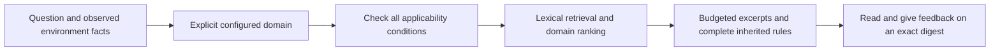

# Knowledge and Experience System

[中文](knowledge-system.md) · [Documentation](README.en.md)

MindIE Agent represents reusable engineering conclusions as knowledge units with explicit conditions, provenance and revisions. Redacted task materials remain available for tracing those conclusions. The `0.0.3` delivery scope focuses on **vLLM-Ascend and operators**, covering model 0day development, performance optimization for a fixed model or operator case, and issue diagnosis. Other domains can use the same interfaces; content coverage and actual acceptance are separate release claims.

The runtime lives in [`knowledge`](https://github.com/mindie-agent/knowledge). Domain content lives in [`knowledge-vllm-ascend`](https://github.com/mindie-agent/knowledge-vllm-ascend) and [`knowledge-operators`](https://github.com/mindie-agent/knowledge-operators). See [Architecture](architecture.en.md) for ownership and [Harness Boundaries](harness-boundary-and-lifecycle.en.md) for consent and session identity.

## 1. Knowledge units and source materials

| Content | Purpose | Authoritative content |
| --- | --- | --- |
| Graded unit, `mindie-graded-unit/1` | Conditional rules, procedures, workflows or code transformations, with retrieval, inheritance and revision feedback | Body and metadata in `<domain_path>/<unit_id>.md` |
| Task material, `mindie-material-task/1` | The public conversation projection and context of a task, retained as source material | `tasks/<task_hash>/index.md` and immutable `blocks/<block_hash>.md` |

Task materials are extracted and redacted deterministically, then split into roughly 16KB blocks. A lightweight native model supplies titles, summaries and navigation without rewriting the source bodies. A graded unit may distill reviewed material, source code, specifications or experiment records into a new engineering conclusion. It must retain provenance and cannot present itself as a verbatim source or claim stronger evidence than its inputs support. Existing task materials can coexist locally with graded units and are preserved during index migration. A public tree using the new publication contract does not mix in the legacy `tasks/` layout.

## 2. Tier describes use; evidence describes support

| Tier | Category | Intended content |
| --- | --- | --- |
| L1 | `axiom` / `measurement` | A specification-backed constraint or a reproduced measurement under stated conditions |
| L2 | `sop` | Diagnostic, development or verification steps under explicit premises |
| L3 | `workflow` | A task process with multiple steps and dependencies |
| L4 | `mutator` | A code transformation with source and verification evidence |

Tier is separate from confidence. `evidence_strength` records `hardware_spec`, `reproduced_empirical`, `single_observation` or `hypothesis`; L1 accepts only the first two. Compile failures, infrastructure failures, invalid measurements and unfinished runs cannot establish reproduced evidence. One successful observation does not establish a general rule.

A unit includes a stable `id`, `revision`, `content_digest`, title, domain path, category, applicability conditions, triggers, inheritance and provenance. Provenance binds a `source_locator`, an exact `source_digest` and relevant `evidence_refs`. IDs survive moves. The semantic digest excludes the path and revision number, allowing location changes to remain distinct from changes to the claim.

## 3. Match conditions, then read exact references

Every declared condition must hold. Framework requirements are conjunctive. Ordinary lists describe allowed values; `exact_set` binds a complete case collection so a shape from one workload cannot be paired with a dtype from another. Missing facts, uninterpretable versions and `unknown` values retain their reasons and are excluded from matched injection by default. Explicitly requesting unknown entries does not make their conditions established.

Conditions describe premises that can be checked before using the knowledge. Readiness status, steps still to perform, a known fix and a reviewer's conclusion do not belong in matching conditions. Source-scoped claims bind the repository and revision. Measurement claims also bind the actual hardware, input and measurement conditions.

The local routing index resolves stable IDs and the complete inheritance graph before queries, rejecting missing dependencies and cycles. Each inherited unit must independently match the task. If a parent rule does not fit the budget, its omission is reported rather than returning a rule with its premises truncated. The current budget estimates tokens from UTF-8 bytes and covers body excerpts and inherited bodies only. It excludes response metadata and is not the actual token count of the entire host request.

`query` returns references pinned to content digests; `explain` reads that revision. A withdrawn or replaced unit makes the old reference fail explicitly instead of silently returning different content. A readable reference does not establish applicability. Optional `helpful` / `not_helpful` feedback binds the content revision actually used; votes alone cannot establish correctness.

## 4. Native domain routing and consent

Explicit `domain_configs` bind each domain to its storage, Feed and configuration. Registration makes a domain selectable; it does not enable capture or contribution, load every domain into a session, or copy another domain's consent. Cross-domain reuse uses declared configuration and references while preserving provenance and conditions.

Capture processes only the verified current task within an authorized project. The public projection keeps user input, public assistant progress and final answers, excluding hidden reasoning, system prompts, raw tool payloads and duplicate host wrappers. Deterministic privacy rules and Gitleaks run before storing knowledge material, preparing distillation input or publishing content. Unresolved sensitive content blocks that operation.

Source materials, local drafts, reviewed public units and feedback serve different purposes. Public content carries admitted bodies and source identities; local paths, private run directories and credentials cannot serve as public evidence links.

## 5. Distillation, review and revisions

Distillation receives a selected set of sources and evidence. The model can propose units or revisions, or return no change when evidence is inadequate. Code validates citations, evidence strength, conditions and the inheritance graph. Proposals cannot introduce unprovided sources or promote failed experiments to reproduced evidence.

`reviewed_change` checks and applies reviewed changes against the complete current graph. New units start at revision 1; semantic changes increase the revision; location-only moves retain content identity. A `review_reference` records the caller's review basis; it is neither an authentication signature nor proof that an independent review occurred. Applying C6 locally updates local content only. Opening a PR, merging remotely and synchronizing a client remain separate steps.

Updates and withdrawals revalidate the reference graph and preserve traceability. Rollback restores specified known content; it must not erase failed receipts, substitute content behind an old reference or relabel failure as success.

## 6. Feed publication and consumption

Graded Feed `publication-contract/2` describes the content tree and its derived routing index. Synchronization validates the complete candidate tree, unit count and digests, inheritance closure and index consistency before switching the installed collection. Read errors and missing blobs are synchronization errors, not evidence that a remote unit was deleted.

The `0.0.3` publication contract uses a separate `graded-v2` branch in each domain, with the client Feed and contribution target bound to the same branch. The legacy `main` branch retains its `publication-contract/1` contract for older clients; upgrading some clients does not justify replacing that contract in place. Content can keep evolving under a compatible contract. Changes to the contract format or pinned digest require a coordinated consumer compatibility change. Successful installation in four isolated native profiles establishes acceptance for those profiles, not an upgrade of every existing user.

Markdown is authoritative; routing and retrieval indexes are rebuildable. SQLite stores cursors, queues, consent and receipts. Database or index corruption is reported while source content remains intact.

After the user enables contribution, the runtime publisher uses the configured GitHub channel to open or update a target corpus PR; the existing publisher uses `gh`. Installation does not require a Star or Fork. A personal Fork is prepared when contribution to that corpus requires it. An uncertain remote write is reconciled through reads before any retry.

Delivery records unit review, public merge, installation of the exact Feed revision and actual native-host use of `query`, `explain`, feedback and routing as separate outcomes. Unit tests, retrieval timings and successful installation support their respective claims. Version-level engineering benefit requires a separate comparison under matched models and task conditions.
