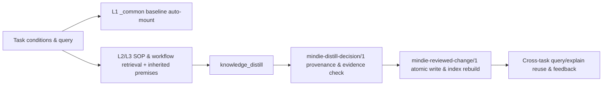

# Knowledge and Experience System

[中文](knowledge-system.md) · [Documentation](README.en.md)

MindIE Agent organizes reusable Ascend engineering experience into structured knowledge units (`mindie-graded-unit/1`) with explicit applicability conditions, source references, and revision numbers, while keeping redacted session transcripts locally traceable. Current domain coverage centers on **vLLM-Ascend and Ascend operators**—complemented by corpora for inference engine internals, distributed communication, observability, and operator compatibility—across three core scenarios: **new model bring-up (0-day adaptation), model and operator performance tuning, and runtime fault diagnosis**.

The retrieval and distillation runtime lives in [`knowledge`](https://github.com/mindie-agent/knowledge); domain corpora live in [`knowledge-vllm-ascend`](https://github.com/mindie-agent/knowledge-vllm-ascend), [`knowledge-operators`](https://github.com/mindie-agent/knowledge-operators), and companion repositories. See [Architecture](architecture.en.md) for component boundaries, [Harness Boundaries](harness-boundary-and-lifecycle.en.md) for session identity and user consent, and [Context, Experience & Exploration Design](knowledge-context-and-exploration.en.md) for extended context-budget and exploration specifications.

This document describes the three core mechanisms implemented in the runtime:
1. **Foundational baselines and premise inheritance (`L1/L2` Foundation & `inherits_from`)**: automatically mounting condition-matched `_common` hardware constraints and measurement rules, and injecting complete parent premises whenever a child workflow or SOP is retrieved.
2. **Experience distillation and cross-task reuse (`L3` Experience Loop)**: turning verified troubleshooting or optimization milestones into reviewed knowledge updates (`reviewed_change`) via `knowledge_distill`, ready for retrieval and feedback in subsequent tasks.
3. **Fresh-context exploration (`L4` Exploration Mode, `mode="explore"`)**: when routine tuning stalls repeatedly, stripping routine `L3` workflows to avoid anchoring bias, mounting only hardware constraints, measured bottleneck facts, and candidate code transformations, and running parallel CPU compiles, serial NPU timing, and 4-step verification (compile → accuracy → speedup → leave-one-out ablation) tracked in `experiment-ledger.jsonl` and `PROGRESS.md`.

## 1. Structured Knowledge Units and Redacted Task Records

Each knowledge repository manages two complementary types of content:

| Content Type | Engineering Purpose | Authoritative Path |
| --- | --- | --- |
| **Structured Knowledge Unit** (`mindie-graded-unit/1`) | Conditional hardware rules, diagnostic SOPs, troubleshooting workflows, or code optimizations supporting condition-matched retrieval, premise inheritance, and revision feedback | Body and YAML front-matter in `<domain_path>/<unit_id>.md` |
| **Redacted Task Record** (`mindie-material-task/1`) | Redacted session transcripts and key troubleshooting steps retained as traceable source material for knowledge distillation | `tasks/<task_hash>/index.md` and immutable `blocks/<block_hash>.md` |

Task records are extracted and redacted deterministically using privacy regexes and Gitleaks, then split into ~16KB blocks with titles and navigation summaries generated without altering the underlying text. Structured knowledge units are distilled from reviewed task records, source commits, hardware specifications, or live NPU experiment logs, retaining explicit provenance and an honest `evidence_strength` rating.

## 2. Knowledge Categories (`category`) and Engineering Roles (`tier: L1..L4`)

Knowledge units are organized by **semantic `category`** (the `tier: L1..L4` field in the schema maps 1-to-1 to these four categories):

| Knowledge Category (`category`) | Schema Role Field (`tier`) | Intended Content |
| --- | --- | --- |
| **`axiom` / `measurement`** (Hardware constraints & measurement baselines) | `tier: L1` | Specification-backed hardware/framework invariants (such as memory alignment or `ACLGraph` capture rules) and reproducible measurement standards |
| **`sop`** (Diagnostic & operational procedures) | `tier: L2` | Concrete fault-isolation steps, profiling capture/analysis recipes, and module adaptation checklists |
| **`workflow`** (Troubleshooting & tuning decision trees) | `tier: L3` | Multi-step troubleshooting and tuning workflows with observation branches and stopping criteria (automatically stripped in `mode="explore"`) |
| **`mutator`** (Verified code optimizations) | `tier: L4` | Operator, graph, or communication code optimizations with pinned source locations, applicability conditions, safe fallback paths, and ablation evidence |

- **Independent evidence maturity**: Neither `category` nor `tier` represents confidence. Evidence maturity is recorded separately in `evidence_strength` as `hardware_spec` (hardware manuals or code contracts), `reproduced_empirical` (repeated verified runs), `single_observation` (single runtime observation), or `hypothesis` (source-derived optimization design). Foundational `L1` units accept only `hardware_spec` or `reproduced_empirical`.
- **Clean identity and provenance**: Every unit has a stable `id` and integer `revision`, binding source provenance directly to repository names, Git commits, and file paths, and binding experimental provenance to run IDs.

## 3. Foundational Baselines and Premise Inheritance (`_common` & `inherits_from`)

### 3.1 Routing Index Construction and Inheritance Closure

`RoutingIndex.from_root(root)` scans `mindie-graded-unit/1` Markdown files under the repository root and computes each unit's `inherits_from` closure:
- Every parent unit must exist; missing dependencies or cycles raise an immediate validation error;
- At query time, each parent in the closure **independently checks its own applicability conditions** before its full body is injected into `inherited_rules`—premises are never truncated mid-rule.

### 3.2 Condition Matching and Automatic Baseline Mounting (`foundation_baseline`)

`query(query, conditions=..., domain_path=..., token_budget=..., limit=...)` evaluates `match_conditions` across all candidates:
- Every declared condition must hold; `exact_set` binds complete workload tuples so a shape from one case is never mixed with a dtype from another;
- Entries with unobserved or `unknown` prerequisites are excluded by default (unless `include_unknown=True` is explicitly requested for inspection).

When a query provides hardware or repository `conditions`, any condition-matched `L1` unit under `_common` is automatically mounted with `route == 'foundation_baseline'` (score `0.05`) even if the query keywords are unfamiliar:
- For example, querying `vllm-ascend` with `conditions={'repository': 'vllm-ascend', 'npu_model': 'Ascend910B4'}` automatically mounts the core runtime and accuracy verification baselines:
  - `unit-vllm-ascend-npu-runtime-and-graph-invariants`
  - `unit-vllm-ascend-verification-and-state-parity-gates`
- Querying the operators corpus automatically mounts the Ascend memory alignment and operator profiling baselines:
  - `unit-ascend-910b-a3-memory-alignment-and-tiling-axioms`
  - `unit-ascend-operator-roofline-and-four-view-measurement`

### 3.3 Token Budget Allocation and `inherited_rules`

Each query hit includes `id`, `revision`, `tier`, `category`, `evidence_strength`, `conditions`, `provenance`, `applicability`, `route`, `score`, and `inherited_rules`. Token budget is allocated to matched `L1` premises first before workflow excerpts, ensuring long workflows never crowd out essential hardware alignment or numerical parity rules.

### 3.4 Exact Revision Inspection and Feedback

`GradedRepository.query` attaches `ref`, `unit_ref`, and `feedback_ref` to each hit and records the observed revision via `feedback.observe`. Agents can read the exact revision via `explain` and record `helpful` / `not_helpful` votes via `feedback.record_vote`.

## 4. Experience Distillation and Cross-Task Reuse Loop

### 4.1 Trigger and Evidence Redaction

`knowledge_distill(inputs, task_state, domain=...)` runs when a task reaches a `verified_milestone` or `completed` state. Callers pass selected, authorized evidence items (`experiment_ledger`, `run_manifest`, `authorized_transcript`, `ecosystem_repo`, `hardware_spec`, or `ablation_receipt`). `prepare_request` runs deterministic privacy rules and Gitleaks scanning once, returning `noop` if inputs are empty or still `in_flight`.

### 4.2 Provenance Validation and Atomic Admission

After the host model proposes a new or updated unit (`mindie-distill-decision/1`), `validate_decision` enforces:
- Every `provenance.source_locator`, `source_digest`, and `evidence_ref` must bind to the submitted evidence inputs;
- `evidence_strength` cannot exceed the submitted evidence (`L1` requires `hardware_spec` or repeated `reproduced_empirical` runs; `L4` empirical claims require a verified ablation receipt).

Approved updates are applied atomically via `mindie-reviewed-change/1`, advancing the unit's integer `revision` and rebuilding the routing index after verifying the full inheritance graph in memory.

## 5. Fresh-Context Exploration (`mode="explore"`) and 4-Step Verification

When routine troubleshooting or tuning (`L3`) stalls repeatedly while significant headroom remains against hardware roofline bounds, MindIE Agent supports switching to **fresh-context exploration**:
- De-biased context assembly lives in [`mindie_knowledge.graded.explore`](https://github.com/mindie-agent/knowledge) (exposed via `knowledge_query(..., mode="explore")`);
- Candidate scheduling, multi-input generalization checks, and leave-one-out ablation live in [`mindie_bench.runner.rsi_explorer`](https://github.com/mindie-agent/mindie-bench) and [`mindie_bench.runner.rsi_campaign`](https://github.com/mindie-agent/mindie-bench).

### 5.1 Routine Tuning Stall Detection

`assess_stagnation` and `should_escalate_to_rsi(l3_attempts, max_stalled_attempts=2)` track consecutive valid experiments that fail accuracy, ablation, or target speedup thresholds. Compile errors or invalid measurements trigger immediate repair rather than counting as strategic stalls.

### 5.2 Stripping Routine Workflow Bias (`build_exploration_context`)

Calling `knowledge_query(..., mode="explore")` (`build_exploration_context`):
- **Strips all `L3` workflow bodies** (recording only their IDs in `stripped_l3_ids`) so the agent is not anchored to a stalled routine playbook;
- **Mounts core constraints and candidate optimizations**: retains matched `L1` hardware constraints, `L2` bottleneck observations (including `L1/L2` parents inherited by stripped `L3` workflows), and `L4` code transformations (`mutator`);
- **Attaches condition-matched negative results (`conditional_avoid`)**: includes previously refuted directions only when their recorded hardware, shapes, and software conditions match the current task;
- **Generates a fresh sub-session brief (`subagent_fact_pack`)**: emits a compact `prompt_brief` so host agents can spawn an isolated sub-session free from prior conversational bias.

### 5.3 Parallel CPU Compilation and Serial NPU Timing

To prevent NPU contention from distorting latency measurements, `plan_rsi_compile_and_timing` separates candidate verification into two phases:

| Phase | Parallel | Resources | Scheduling Rule |
| --- | --- | --- | --- |
| **`compile`** | Yes | `npu_count: 0` | Runs up to `max_compile_slots` CPU-only compile jobs in parallel waves to filter out syntax and build errors |
| **`timing`** | No | `devices: [0]` | Runs serial, exclusive NPU accuracy and latency measurements only for candidates that compiled cleanly |

### 5.4 Four-Step Verification and Progress Persistence

Each candidate optimization is evaluated across four sequential checks (`evaluate_rsi_candidate_gates` / `run_rsi_gate_campaign`):
1. **Compile, accuracy & multi-input generalization (Gate 1)**: verifies compilation and golden numerical parity on the target case, then runs `evaluate_hidden_input_generalization` across held-out input shapes and numerical distributions. Any regression (`opt_regression`) or runtime error rejects the candidate, preventing single-shape overfitting.
2. **Measurement hygiene guard (Gate 2)**: verifies stream synchronization, warmup iterations, valid timing samples, and workspace memory bounds (`workspace_delta_bytes`).
3. **Leave-one-out ablation (Gate 3)**: for multi-factor optimizations, `verify_sequential_ablation` verifies that each individual change contributes net benefit; factors marked for pruning default to `RETAIN` unless the pruned combination is independently verified on NPU.
4. **Target speedup & conditional archiving (Gate 4)**: checks whether speedup meets the target threshold (default `1.05x`), while preserving smaller verified gains (e.g., `1.03x`) as valid conditional observations rather than false refutations.

After each run, `append_ledger_and_render_progress` appends `experiment-ledger.jsonl` and atomically updates `PROGRESS.md` (`Best Supported Candidate`, `Active Hypotheses`, `Refuted Directions`, and `Experiments To Complete`) so long-running optimization campaigns can resume cleanly across sessions.

## 6. Domain Isolation, Privacy Redaction, and Community Publishing

- **Explicit domain routing**: Each domain binds its own storage and configuration; registering a domain never enables background capture or copies consent across domains.
- **Deterministic privacy redaction**: Every task block, distillation request, and public knowledge unit passes through deterministic privacy rules and Gitleaks scanning before storage or publication, stripping internal IPs, local paths, credentials, and sensitive CLI arguments.
- **Opt-in PR publishing**: Markdown files in Git are the single source of truth, and routing indexes are rebuildable from Markdown at any time. Only when community contribution is explicitly enabled does the publisher open or update a PR against the target knowledge repository via `gh`.

## 7. Representative End-to-End Scenarios

| Engineering Scenario | Knowledge Retrieval, Exploration, and Distillation Flow |
| --- | --- |
| **`Qwen/Qwen3.5-0.8B` 0-day model bring-up** | Cold queries auto-mount `_common` `L1` runtime and parity baselines; targeted queries retrieve the hybrid linear-attention bring-up `workflow` and `GatedDeltaNet` adaptation `sop`; verified milestones distill into a new revision for downstream reuse |
| **`GatedDeltaNet` DP=2 idle-rank hang diagnosis** | Conditioned queries (`DP=2`, `Ascend910_93`, `conv_state`/`ssm_state`) retrieve the multi-card recurrent state troubleshooting workflow and reproduced diagnostic SOP; verified fixes distill back with revision feedback |
| **`fused-rmsnorm-gate` operator optimization** | Consecutive routine tuning stalls trigger `mode="explore"`, stripping the routine 5-stage workflow while mounting `L1` alignment/roofline baselines, `L2` memory bottleneck evidence, `L4` vectorization/residual-free fastpath transforms, and `conditional_avoid` rules; candidates run through parallel CPU compile, serial NPU timing, and 4-step ablation before updating `PROGRESS.md` |

## 8. Industry References

MindIE Agent's knowledge loop and exploration workflow build on established engineering practices:
- [Hermes Skills](https://hermes-agent.nousresearch.com/docs/user-guide/features/skills): loading operational procedures on demand and updating skills in place from verified fixes and user corrections.
- [Anthropic's Effective Harnesses for Long-Running Agents](https://www.anthropic.com/engineering/effective-harnesses-for-long-running-agents): using Git and structured progress files (`PROGRESS.md` + experiment ledgers) to hand off state cleanly across fresh context windows.
- [AlphaEvolve](https://deepmind.google/blog/alphaevolve-a-gemini-powered-coding-agent-for-designing-advanced-algorithms/): decoupling candidate generation from deterministic execution and scoring to guide iterative optimization.
