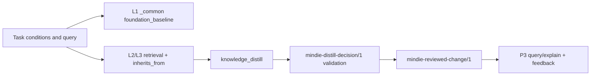

# Knowledge and Experience System

[中文](knowledge-system.md) · [Documentation](README.en.md)

MindIE Agent represents reusable engineering conclusions as knowledge units with explicit conditions, provenance and revisions. Redacted task materials remain available for tracing those conclusions. The `0.0.3` delivery scope focuses on **vLLM-Ascend and operators**, covering model 0day development, performance optimization for a fixed model or operator case, and issue diagnosis. Other domains can use the same interfaces; content coverage and actual acceptance are separate release claims.

The runtime lives in [`knowledge`](https://github.com/mindie-agent/knowledge). Domain content lives in [`knowledge-vllm-ascend`](https://github.com/mindie-agent/knowledge-vllm-ascend) and [`knowledge-operators`](https://github.com/mindie-agent/knowledge-operators). See [Architecture](architecture.en.md) for ownership and [Harness Boundaries](harness-boundary-and-lifecycle.en.md) for consent and session identity.

See the [detailed design](knowledge-context-and-exploration.en.md) for proposed context layers, token accounting and budgets, L3 decision experience, knowledge growth control, and open exploration. That document specifies target behavior; this page retains the current mechanisms and evidence.

This document describes the three implemented loops: the **L1/L2 Foundation** that mounts condition-matched `_common` baselines and `inherits_from` premises; the **L3 Hermes self-evolution loop** that turns a verified milestone into a `reviewed_change` through `knowledge_distill` and reuses it through P3 queries with recorded feedback; and the **L4 RSI de-biased exploration engine** that strips routine L3 bias after consecutive L3 stalls and runs a CPU-parallel compile, serial-NPU-timing, four-gate funnel that writes `experiment-ledger.jsonl` and `PROGRESS.md`. Implemented, verified and still-design-only claims are marked separately.

## 1. Knowledge units and source materials

| Content | Purpose | Authoritative content |
| --- | --- | --- |
| Graded unit, `mindie-graded-unit/1` | Conditional rules, procedures, workflows or code transformations, with retrieval, inheritance and revision feedback | Body and metadata in `<domain_path>/<unit_id>.md` |
| Task material, `mindie-material-task/1` | The public conversation projection and context of a task, retained as source material | `tasks/<task_hash>/index.md` and immutable `blocks/<block_hash>.md` |

Task materials are extracted and redacted deterministically, then split into roughly 16KB blocks. A lightweight native model supplies titles, summaries and navigation without rewriting the source bodies. A graded unit may distill reviewed material, source code, specifications or experiment records into a new engineering conclusion. It must retain provenance and cannot present itself as a verbatim source or claim stronger evidence than its inputs support. Existing bodies and user consent are preserved; development formats are converted directly and derived indexes are rebuilt.

`0.0.3` adopts the current format through a breaking refactor, without parallel compatibility paths for old clients or development snapshots. Runtime, content and plugin completion are tracked separately; editing this document does not establish implementation.

## 2. Tier describes use; evidence describes support

| Tier | Category | Intended content |
| --- | --- | --- |
| L1 | `axiom` / `measurement` | A specification-backed constraint or a reproduced measurement under stated conditions |
| L2 | `sop` | Diagnostic, development or verification steps under explicit premises |
| L3 | `workflow` | A task process with multiple steps and dependencies |
| L4 | `mutator` | A code transformation with source and verification evidence |

Tier is separate from confidence. `evidence_strength` records `hardware_spec`, `reproduced_empirical`, `single_observation` or `hypothesis`; L1 accepts only the first two. Compile failures, infrastructure failures, invalid measurements and unfinished runs cannot establish reproduced evidence. One successful observation does not establish a general rule.

A unit uses a stable `id` and `revision`, with a title, domain path, category, conditions, triggers, inheritance and provenance. Source references reuse the repository, Git revision and file path; experiments reference existing run IDs and results. Callers do not compute additional digests for these identities or maintain separate SHA256 bindings for bodies, conditions, inheritance closures, manifests and entire trees. Internal digests remain only where they provide actual content addressing or download integrity.

## 3. L1/L2 Foundation: `_common` baselines and `inherits_from`

### 3.1 Index construction and inheritance closure

`RoutingIndex.from_root(root)` scans `mindie-graded-unit/1` Markdown units under the domain root and skips derived or non-unit directories such as `index`, `docs`, `tasks` and `feedback`. Building the index also computes each unit's `inherits_from` closure:

- every parent must exist; a missing dependency is an immediate error;
- an inheritance cycle is an immediate error;
- the closure is stored in stable order and shared by retrieval and `reviewed_change` validation.

Inheritance therefore does not mean concatenating every parent body into the child at runtime. **Each parent independently matches its own conditions** before it is injected as a complete rule. A parent rule is never returned with its premises truncated.

### 3.2 Condition matching and `foundation_baseline`

`query(query, conditions=..., domain_path=..., token_budget=..., limit=...)` runs `match_conditions` independently for every candidate:

- every declared condition must hold;
- ordinary lists describe allowed alternatives;
- `exact_set` binds a complete case collection so a shape from one workload cannot be paired with a dtype from another;
- missing facts, uninterpretable versions and `unknown` values retain their reasons and are excluded from matched injection by default. `include_unknown=True` only exposes entries whose applicability is unknown; it does not make them matched.

When a query supplies `conditions` and an L1 unit is not hit by the query terms but its conditions match, the index mounts it with `route == 'foundation_baseline'` if its path is `_common` (or the requested domain path). Each L1 is mounted once; if a higher-scoring matched unit already injects the same parent through `inherits_from`, it is not mounted twice. The baseline score is fixed at `0.05`; it means "the foundation premise is mounted", not relevance or confidence.

This is why a cold query remains useful. For example, `conditions={'repository': 'vllm-ascend', 'npu_model': 'Ascend910B4'}` with completely novel query terms returns the two `_common` L1 units:

- `unit-vllm-ascend-npu-runtime-and-graph-invariants`
- `unit-vllm-ascend-verification-and-state-parity-gates`

A cold operators query returns:

- `unit-ascend-910b-a3-memory-alignment-and-tiling-axioms`
- `unit-ascend-operator-roofline-and-four-view-measurement`

### 3.3 `inherited_rules` in query results

Each result carries `id`, `revision`, `tier`, `category`, `evidence_strength`, `conditions`, `provenance`, `applicability`, `route`, `score` and `inherited_rules`. `inherited_rules` contains the complete bodies of closure parents that **independently match**. A parent that does not match appears in `inheritance_excluded` with its reason; a parent that does not fit the budget is marked `budget_excluded`. No rule is returned with a truncated premise. `body_token_estimate` covers body excerpts and inherited bodies only; it excludes response metadata and is not the actual token count of the host request.

Matching L1 premises receive budget before the workflow excerpt. Standalone L1 results also retain their complete bodies; an ID that cannot fit appears in `excluded_budget`. Long workflows therefore retain their numerical and hardware premises, and a small budget cannot produce half an axiom.

The current content relationships are:

- vLLM-Ascend: `unit-vllm-ascend-0day-hybrid-model-bringup-hermes-workflow` (L3) and `unit-vllm-ascend-qwen35-gated-deltanet-decode-adaptation` (L2) both inherit the two `_common` L1 units. A complete-condition query for `Qwen3.5 GatedDeltaNet decode` returns L3, L2 and both L1 `inherited_rules`.
- vLLM-Ascend: `unit-vllm-ascend-hybrid-recurrent-dp-state-hermes-workflow` (L3) and `unit-vllm-ascend-idle-dp-gdn-state` (L2, `reproduced_empirical`) also inherit both L1 units. A query with DP=2 and `affected_state` `conv_state`/`ssm_state` returns them.
- Operators: `unit-rmsnorm-five-stage-ablation-workflow` (L3), `unit-gated-rmsnorm-ascend-fastpath-load-stage-evidence` (L2) and `unit-residual-free-rmsnorm-fastpath` (L4) inherit the two `_common` L1 units.

### 3.4 P3 reuse and feedback

`GradedRepository.query` builds on `RoutingIndex.query` and adds `ref`, `unit_ref` and `feedback_ref` to every hit. It calls `feedback.observe` to record the `unit_id` and `revision` actually returned. `explain` reads that exact revision; a withdrawn or replaced revision is reported explicitly, without substituting bytes. `helpful` / `not_helpful` feedback goes through `feedback.record_vote` and binds the observed revision; votes alone do not establish correctness.

## 4. The L3 Hermes self-evolution loop

### 4.1 Trigger and evidence selection

`knowledge_distill(inputs, task_state, domain=...)` is called only when the task reaches `verified_milestone` or `completed`; an ordinary Stop is not completion. The caller submits only selected, already-authorized evidence, and every item declares:

- `kind`: `experiment_ledger`, `run_manifest`, `authorized_transcript`, `ecosystem_repo`, `hardware_spec` or `ablation_receipt`;
- `outcome`: `observed`, `verified`, `compile_failed`, `infra_failed`, `measurement_invalid` or `in_flight`;
- `source_locator`, body, `evidence_refs` and repetitions.

`prepare_request` redacts the selected evidence once with Gitleaks and deterministic privacy rules, producing a `mindie-distill-request/1` with a `request_digest`. `value_gate` returns `noop` for `in_flight` or empty input, producing no unit.

### 4.2 Decision validation and local admission

`build_prompt` hands the redacted evidence and the `mindie-distill-decision/1` output schema to the native model. The model may propose new units, revisions or `noop`. `parse_validate_result` / `validate_decision` validate locally:

- the decision binds the same `session_digest` and `evidence_inputs`;
- unit `provenance.source_locator`, `source_digest` and `evidence_refs` must bind to the selected evidence; no source may be invented;
- `evidence_strength` cannot exceed the evidence: L1 accepts only `hardware_spec` / `reproduced_empirical`; `reproduced_empirical` needs repeated `verified` evidence; L4 also needs a baseline-bound ablation receipt whose final combination is verified;
- `tier` / `category` must describe the same use.

`apply_decision` performs local admission only. It does not open a PR, write a remote or trigger publication.

### 4.3 `reviewed_change` review and application

A reviewed change uses the `mindie-reviewed-change/1` plan:

- `base_generation` must equal the corpus generation seen at review time; a corpus changed after review is rejected;
- every change supplies a stable `id`, `expected_revision`, complete unit bytes and a `review_reference`;
- a new unit starts at revision 1; a semantic body change advances the revision; a location-only move retains it;
- `prepare_change` projects the complete inheritance graph in memory and rejects missing dependencies, cycles, path conflicts and stale revisions;
- `apply_change` validates before the first write, writes atomically and rebuilds the routing index. It does not commit, push or publish.

### 4.4 Verified loop

This deterministic end-to-end verification exercised two Hermes paths in a sandbox copy of `knowledge-vllm-ascend`:

1. **Qwen3.5-0.8B 0day bring-up**: distilled L2 `unit-vllm-ascend-qwen35-gated-deltanet-decode-adaptation` from revision 2 to revision 3. `apply_change` returned `applied`; the P3 query hit revision 3; `feedback.observe` + `record_vote` recorded that revision.
2. **k3-gdn-idle-dp-state diagnosis**: created the L2 milestone unit `unit-vllm-ascend-idle-dp-gdn-state-milestone` (revision 1) inheriting both L1 units. The P3 query hit the new unit and recorded feedback.

Both paths used the real `prepare_request` redaction, `build_prompt`, `parse_validate_result` validation and `reviewed_change` writes. The model call was replaced by a deterministic reviewed decision; no paid model was invoked.

## 5. The L4 RSI de-biased exploration engine

The implementation lives in [`mindie_bench.runner.rsi_explorer`](https://github.com/mindie-agent/mindie-bench) with contract version `mindie-bench-rsi/1`. It currently provides context assembly, scheduling plans, result evaluation and progress records. Execution connects through `TaskClient` / `coordinator`.

### 5.1 L3 stall detection

`should_escalate_to_rsi(l3_attempts, max_stalled_attempts=2)` consumes the four-gate evaluation results. Consecutive valid experiments that fail correctness, ablation or the performance target count as stalls. Compile failures, invalid measurements and pending ablation call for repair or further verification and reset the streak. A successful experiment also resets it. Polling or resuming one `run_id` counts as one experiment, using its latest record.

### 5.2 De-biased context

`build_debiased_rsi_context(goal=..., retrieved_units=..., bottleneck_summary=..., ledger_entries=..., conditions=...)`:

- **L3 unit bodies never enter the L4 context**; only their IDs survive in `stripped_l3_ids`, with `stripped_tiers == ["L3"]`;
- mount the L1 Foundation (the `foundation_baseline` field is retained and may carry a cold-query baseline), L2 bottleneck observations and L4 mutators;
- removes L3 bodies from nested `inherited_rules` while retaining and deduplicating their L1 premises; a query that returns only an L3 child still supplies its L1 parents to the foundation;
- selects `conditional_avoid` only from `refuted` entries whose recorded conditions match the current observations. Each rule retains its `conditions`, candidate, reason and `run_id`. Changed hardware, shapes or software premises permit a new attempt; missing conditions do not match;
- the output reports `mounted_tiers == ["L1", "L2", "L4"]` and keeps flat `foundation_axioms`, `measurement_rules` and `inherited_rules` fields for consumers.

In the `fused-rmsnorm-gate` verification, the real query's L3 `unit-rmsnorm-five-stage-ablation-workflow` was stripped. L1 `unit-ascend-910b-a3-memory-alignment-and-tiling-axioms` and `unit-ascend-operator-roofline-and-four-view-measurement`, L2 `unit-gated-rmsnorm-ascend-fastpath-load-stage-evidence`, L4 `unit-residual-free-rmsnorm-fastpath` and the refuted candidate's `conditional_avoid` were mounted.

### 5.3 Compile and timing schedule

`plan_rsi_compile_and_timing(candidates, state_dir=..., npu_device=0, max_compile_slots=3)` produces two phases:

| Phase | Parallel | Resources | Rule |
| --- | --- | --- | --- |
| `compile` | yes | `npu_count: 0` | Up to `max_compile_slots` CPU-only compiles, split into waves; `CoordinatorService` is the single progress owner |
| `timing` | no | `devices: [0]` | Serial, exclusive NPU timing only for candidates with a proved compile |

Candidates with missing or failed compile results appear in `skipped_candidates`. The caller supplies its existing coordinator `state_dir`; evaluation uses the executor's `run_id`. The planner does not derive a second run identity or scheduling directory from content digests.

### 5.4 Four-gate funnel and persistence

`evaluate_rsi_candidate_gates` checks, in order:

1. **Gate 1**: compile and oracle / correctness freezer;
2. **Gate 2**: measurement guard (synchronization, warmup, valid measurement);
3. **Gate 3**: leave-one-out ablation attribution retained;
4. **Gate 4**: speedup reaches the target (default `1.05`).

All four passing yields `supported` with `distill_ready == true`. Failed correctness, valid ablation rejection or a valid measurement below target yields `refuted` with conditional negative experience. Compile failure, invalid measurement and pending ablation yield `inconclusive`, retaining the reason for the next repair. Later stages that did not execute retain `passed: null`; omitted ablation remains pending.

`append_ledger_and_render_progress` appends `experiment-ledger.jsonl` and atomically replaces a deterministic `PROGRESS.md`:

- "Best Supported Candidate" is the supported entry with the highest speedup;
- "Active Hypotheses" lists supported candidates;
- "Refuted Directions" lists negative experience with its observed conditions;
- "Experiments To Complete" lists inconclusive experiments and their existing run IDs.

## 6. Native domain routing and consent

Explicit `domain_configs` bind each domain to its storage, Feed and configuration. Registration makes a domain selectable; it does not enable capture or contribution, load every domain into a session, or copy another domain's consent. Cross-domain reuse uses declared configuration and references while preserving provenance and conditions.

Capture processes only the verified current task within an authorized project. The public projection keeps user input, public assistant progress and final answers, excluding hidden reasoning, system prompts, raw tool payloads and duplicate host wrappers. Deterministic privacy rules and Gitleaks run before storing knowledge material, preparing distillation input or publishing content. Unresolved sensitive content blocks that operation.

Source materials, local drafts, reviewed public units and feedback serve different purposes. Public content carries admitted bodies and source identities; local paths, private run directories and credentials cannot serve as public evidence links.

## 7. Feed publication and consumption

Graded Feeds use the current content format. Synchronization reads one Git revision, parses units and checks their actual references, then builds the local index before switching the installed collection. Format and body read failures are reported directly. A fixed contract-file SHA256 is not a compatibility switch, and content already identified by Git does not acquire additional layers of digest admission.

Both domains use `main`, with the client Feed and contribution target pointing to that same branch. Development formats do not retain long-term readers, dual writes or fallback paths. Plugins and shared components adopt the current implementation through the existing background updater. Any data conversion runs once while preserving user bodies, cursors and consent. Acceptance covers current-format installation and automatic updates of existing installations, without a historical-version combination matrix.

Markdown is authoritative; routing and retrieval indexes are rebuildable. SQLite stores cursors, queues, consent and receipts. Stale or damaged derived indexes are rebuilt directly. Body or persistent-state read/write failures remain visible, without fabricated empty data or permanent fault states.

After the user enables contribution, the runtime publisher uses the configured GitHub channel to open or update a target corpus PR; the existing publisher uses `gh`. Installation does not require a Star or Fork. A personal Fork is prepared when contribution to that corpus requires it. An uncertain remote write is reconciled through reads before any retry.

## 8. Closed-loop verification boundary

Current local verification exercises the knowledge runtime, both domain corpora and RSI planning/evaluation through the paths below. Native host distillation and NPU execution connections continue to be verified on concrete tasks.

| Scenario | Verified closed-loop behavior |
| --- | --- |
| `Qwen/Qwen3.5-0.8B` 0day adaptation | Cold-query `foundation_baseline` mounting `_common` L1 axioms; targeted L3 + L2 + L1 `inherited_rules` retrieval; Hermes distillation producing a new `revision`; P3 downstream query and `knowledge_feedback` |
| `k3-gdn-idle-dp-state` issue diagnosis | DP=2 / `Ascend910_93` conditioned query returning the L3 Hermes workflow + `reproduced_empirical` L2 + L1 foundation; milestone distillation and P3 feedback |
| `fused-rmsnorm-gate` operator optimization | Consecutive L3 stalls escalate to L4 RSI; de-biased context strips L3 (`stripped_l3_ids`) and mounts L1/L2/L4 + `conditional_avoid`; parallel `npu_count: 0` CPU compiles + serial `devices: [0]` NPU timing; four-gate funnel; `experiment-ledger.jsonl` + `PROGRESS.md` persistence; Hermes distillation of supported candidates |

A complete delivery records unit review, public repository merge, installation of the exact Feed revision by a client, and actual host-task completion of `query`, `explain`, feedback, and domain routing separately. Component tests, retrieval timings, and successful installation each support only their corresponding claims; version-level engineering productivity gains require matched comparisons under identical model and task conditions.

## 9. Next connections and design references

The next Hermes connection is a lightweight distillation prompt at a milestone confirmed by the native host, using the existing `knowledge_distill` inputs and `task_state=verified_milestone`. Experience on an existing topic should revise that unit first. The next RSI connection uses one TaskClient for the compile and timing queues and passes actual run results to the existing evaluator. Retrieval, model generation and resource coordination retain their existing component owners.

These connections adopt established practices:

- [Hermes Skills](https://hermes-agent.nousresearch.com/docs/user-guide/features/skills): load procedures on demand and update skills from successful workflows, error recovery and user corrections.
- [Anthropic's long-running harness](https://www.anthropic.com/engineering/effective-harnesses-for-long-running-agents): continue from Git and a short progress file, completing a verifiable increment each time.
- [AlphaEvolve](https://deepmind.google/blog/alphaevolve-a-gemini-powered-coding-agent-for-designing-advanced-algorithms/): execute and score programs to select subsequent candidates, separating proposal generation from evaluation.

Local debugging transcripts add two practical constraints: repair compilation failures at the implementation level, and apply a negative result only under the conditions that produced it. Existing run IDs, conditions, outcomes and next actions are sufficient for continuation.
