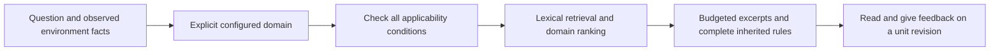

# Knowledge and Experience System

[中文](knowledge-system.md) · [Documentation](README.en.md)

MindIE Agent represents reusable engineering conclusions as knowledge units with explicit conditions, provenance and revisions. Redacted task materials remain available for tracing those conclusions. The `0.0.3` delivery scope focuses on **vLLM-Ascend and operators**, covering model 0day development, performance optimization for a fixed model or operator case, and issue diagnosis. Other domains can use the same interfaces; content coverage and actual acceptance are separate release claims.

The runtime lives in [`knowledge`](https://github.com/mindie-agent/knowledge). Domain content lives in [`knowledge-vllm-ascend`](https://github.com/mindie-agent/knowledge-vllm-ascend) and [`knowledge-operators`](https://github.com/mindie-agent/knowledge-operators). See [Architecture](architecture.en.md) for ownership and [Harness Boundaries](harness-boundary-and-lifecycle.en.md) for consent and session identity.

## 1. Knowledge units and source materials

| Content | Purpose | Authoritative content |
| --- | --- | --- |
| Graded unit, `mindie-graded-unit/1` | Conditional rules, procedures, workflows or code transformations, with retrieval, inheritance and revision feedback | Body and metadata in `<domain_path>/<unit_id>.md` |
| Task material, `mindie-material-task/1` | The public conversation projection and context of a task, retained as source material | `tasks/<task_hash>/index.md` and immutable `blocks/<block_hash>.md` |

Task materials are extracted and redacted deterministically, then split into roughly 16KB blocks. A lightweight native model supplies titles, summaries and navigation without rewriting the source bodies. A graded unit may distill reviewed material, source code, specifications or experiment records into a new engineering conclusion. It must retain provenance and cannot present itself as a verbatim source or claim stronger evidence than its inputs support. Existing bodies and user consent are preserved; development formats are converted directly and derived indexes are rebuilt.

`0.0.3` adopts the current format through a breaking refactor, without parallel compatibility paths for old clients or development snapshots. The single publication path and simpler references and digests below are requirements for this refactor. Runtime, content and plugin completion are tracked separately; editing this document does not establish implementation.

## 2. Tier describes use; evidence describes support

| Tier | Category | Intended content |
| --- | --- | --- |
| L1 | `axiom` / `measurement` | A specification-backed constraint or a reproduced measurement under stated conditions |
| L2 | `sop` | Diagnostic, development or verification steps under explicit premises |
| L3 | `workflow` | A task process with multiple steps and dependencies |
| L4 | `mutator` | A code transformation with source and verification evidence |

Tier is separate from confidence. `evidence_strength` records `hardware_spec`, `reproduced_empirical`, `single_observation` or `hypothesis`; L1 accepts only the first two. Compile failures, infrastructure failures, invalid measurements and unfinished runs cannot establish reproduced evidence. One successful observation does not establish a general rule.

A unit uses a stable `id` and `revision`, with a title, domain path, category, conditions, triggers, inheritance and provenance. Source references reuse the repository, Git revision and file path; experiments reference existing run IDs and results. Callers do not compute additional digests for these identities or maintain separate SHA256 bindings for bodies, conditions, inheritance closures, manifests and entire trees. Existing fields such as `content_digest` and `source_digest` are simplified together with consumers in this refactor. Internal digests remain only where they provide actual content addressing or download integrity.

## 3. Match conditions, then read exact references

Every declared condition must hold. Framework requirements are conjunctive. Ordinary lists describe allowed values; `exact_set` binds a complete case collection so a shape from one workload cannot be paired with a dtype from another. Missing facts, uninterpretable versions and `unknown` values retain their reasons and are excluded from matched injection by default. Explicitly requesting unknown entries does not make their conditions established.

Conditions describe premises that can be checked before using the knowledge, such as source revision, hardware, framework, input and dtype. Reference patch, oracle and measurement report digests, and verification status, belong in evidence rather than retrieval prerequisites. Steps still to perform, a known fix and a reviewer's conclusion also do not belong in matching conditions.

Content import or modification checks units and inheritance, rejects missing dependencies and cycles, and builds the local routing index. Queries use that index without revalidating the entire tree. Each inherited unit must independently match the task. If a parent rule does not fit the budget, its omission is reported rather than returning a rule with its premises truncated. The current budget estimates tokens from UTF-8 bytes and covers body excerpts and inherited bodies only. It excludes response metadata and is not the actual token count of the entire host request.

The target read and feedback interface uses the unit ID and revision returned by `query`. `explain` reads that revision; a withdrawn or unavailable revision is reported explicitly so the caller can query again. Existing digest references change with this interface, without an old-reference compatibility layer. Optional `helpful` / `not_helpful` feedback records the revision actually used; votes alone cannot establish correctness.

## 4. Native domain routing and consent

Explicit `domain_configs` bind each domain to its storage, Feed and configuration. Registration makes a domain selectable; it does not enable capture or contribution, load every domain into a session, or copy another domain's consent. Cross-domain reuse uses declared configuration and references while preserving provenance and conditions.

Capture processes only the verified current task within an authorized project. The public projection keeps user input, public assistant progress and final answers, excluding hidden reasoning, system prompts, raw tool payloads and duplicate host wrappers. Deterministic privacy rules and Gitleaks run before storing knowledge material, preparing distillation input or publishing content. Unresolved sensitive content blocks that operation.

Source materials, local drafts, reviewed public units and feedback serve different purposes. Public content carries admitted bodies and source identities; local paths, private run directories and credentials cannot serve as public evidence links.

## 5. Distillation, review and revisions

Distillation receives a selected set of sources and evidence. The model can propose units or revisions, or return no change when evidence is inadequate. Code validates citations, evidence strength, conditions and the inheritance graph. Proposals cannot introduce unprovided sources or promote failed experiments to reproduced evidence.

`reviewed_change` checks and applies reviewed changes. New units start at revision 1; content changes increase the revision; location-only moves retain it. Review records reference the actual review conclusion without adding signature or digest proof chains. Applying C6 locally updates local content only. Opening a PR, merging remotely and synchronizing a client remain separate steps.

Updates and withdrawals check affected inheritance relationships. Revision history reuses the content repository. A rollback restores a known revision and rebuilds the index. Failed experiments retain their actual outcomes.

## 6. Feed publication and consumption

Graded Feeds use the current content format. Synchronization reads one Git revision, parses units and checks their actual references, then builds the local index before switching the installed collection. Format and body read failures are reported directly. A fixed contract-file SHA256 is not a compatibility switch, and content already identified by Git does not acquire additional layers of digest admission.

Both domains use `main`, with the client Feed and contribution target pointing to that same branch. Development formats do not retain long-term readers, dual writes or fallback paths. Plugins and shared components adopt the current implementation through the existing background updater. Any data conversion runs once while preserving user bodies, cursors and consent. Acceptance covers current-format installation and automatic updates of existing installations, without a historical-version combination matrix.

Markdown is authoritative; routing and retrieval indexes are rebuildable. SQLite stores cursors, queues, consent and receipts. Stale or damaged derived indexes are rebuilt directly. Body or persistent-state read/write failures remain visible, without fabricated empty data or permanent fault states.

After the user enables contribution, the runtime publisher uses the configured GitHub channel to open or update a target corpus PR; the existing publisher uses `gh`. Installation does not require a Star or Fork. A personal Fork is prepared when contribution to that corpus requires it. An uncertain remote write is reconciled through reads before any retry.

Delivery records unit review, public merge, installation of the exact Feed revision and actual native-host use of `query`, `explain`, feedback and routing as separate outcomes. Unit tests, retrieval timings and successful installation support their respective claims. Version-level engineering benefit requires a separate comparison under matched models and task conditions.
