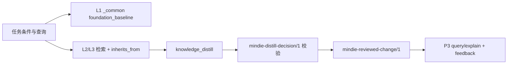

# 知识与经验系统

[English](knowledge-system.en.md) · [返回文档中心](README.md)

MindIE Agent 把可复用的工程结论组织为带适用条件、来源和版本的知识单元，同时保留脱敏后的原始任务材料供追溯。`0.0.3` 的交付范围集中在 **vLLM-Ascend 与算子两个领域**，服务于模型 0day 开发、固定 case 的模型或算子性能优化、问题定位三个场景。其他领域可以通过同一接口扩展，是否已完成内容建设和实际验收应分别查看发布记录。

运行时由 [`knowledge`](https://github.com/mindie-agent/knowledge) 维护；领域内容分别放在 [`knowledge-vllm-ascend`](https://github.com/mindie-agent/knowledge-vllm-ascend) 与 [`knowledge-operators`](https://github.com/mindie-agent/knowledge-operators)。整体职责见[系统架构](architecture.md)，授权及会话边界见[宿主边界与任务生命周期](harness-boundary-and-lifecycle.md)。

本文描述当前实现的三层闭环：**L1/L2 Foundation** 提供条件匹配的 `_common` 基线和 `inherits_from` 继承前提；**L3 Hermes 自演化循环**把已验证里程碑经 `knowledge_distill` 变成 `reviewed_change`，再由 P3 查询复用并记录反馈；**L4 RSI 去偏探索引擎**在 L3 连续停滞时剥离 L3 常规偏差，按“CPU 并行编译 + NPU 串行计时 + 四门漏斗”产出 `experiment-ledger.jsonl`、`PROGRESS.md` 与可提炼结论。已实现、已验证和仍属设计的内容在下文分别标注。

## 1. 知识单元与原始材料

两类内容承担不同职责：

| 内容 | 用途 | 权威来源 |
| --- | --- | --- |
| 分级知识单元 `mindie-graded-unit/1` | 表达有条件的规则、操作步骤、工作流或代码变换，支持检索、精读、继承与版本反馈 | 领域仓库内 `<domain_path>/<unit_id>.md` 的正文和元数据 |
| 任务材料 `mindie-material-task/1` | 保留一次任务的公开对话投影、过程与上下文，作为结论的来源 | `tasks/<task_hash>/index.md` 和不可变的 `blocks/<block_hash>.md` |

任务材料经确定性提取与脱敏后按约 16KB 分块。宿主轻量模型生成标题、摘要和导航，不改写这些原始正文。分级单元可以由经审核的材料、源码、规范或实验记录提炼而来；它是新增的工程结论，必须保留来源，不能冒充原文或比原始证据更强的结论。已有正文和用户授权保留，开发期格式直接转换，派生索引重新生成。

`0.0.3` 按当前格式直接重构，不为旧客户端和开发期快照维护双轨兼容。运行时、内容和插件的实际完成状态分别记录，修改文档不代表实现已经完成。

## 2. 分级描述用途，证据描述可信范围

| 层级 | 类别 | 应表达的内容 |
| --- | --- | --- |
| L1 | `axiom` / `measurement` | 有规范支持的约束，或在声明条件下复现的测量结论 |
| L2 | `sop` | 在具体前提下执行的诊断、开发或验证步骤 |
| L3 | `workflow` | 由多个步骤及依赖组成的任务流程 |
| L4 | `mutator` | 有来源和验证证据的代码变换方法 |

层级不是置信度。`evidence_strength` 单独记录 `hardware_spec`、`reproduced_empirical`、`single_observation` 或 `hypothesis`；L1 只接受前两类。编译失败、基础设施失败、测量无效或尚未完成的运行不能成为已复现实测结论。一次成功观测也不能自动升级为通用规律。

单元用稳定的 `id` 和 `revision` 标识，包含标题、领域路径、类别、适用条件、触发词、继承关系与来源。源码来源复用仓库、Git revision 和文件路径；实验来源引用已有运行 ID 和结果。调用方不需要为这些标识再计算摘要，也不需要维护正文、条件、继承闭包、清单与整棵内容树的多套 SHA256。仅确有内容寻址或下载完整性用途的内部摘要保留。

## 3. L1/L2 Foundation：`_common` 基线与 `inherits_from`

### 3.1 索引构建与继承闭包

`RoutingIndex.from_root(root)` 扫描领域根目录下的 `mindie-graded-unit/1` Markdown 单元，跳过 `index`、`docs`、`tasks`、`feedback` 等派生或非单元目录。构建索引时同时计算每个单元的 `inherits_from` 闭包：

- 父单元必须存在，缺失依赖直接报错；
- 继承图出现循环直接报错；
- 闭包按稳定顺序保存，供检索与 `reviewed_change` 校验共用。

因此“继承”不是运行时把所有父正文拼进子单元，而是**每个父单元独立通过自己的适用条件**后才作为完整规则注入。父规则不得截断前提后返回。

### 3.2 条件匹配与 `foundation_baseline`

`query(query, conditions=..., domain_path=..., token_budget=..., limit=...)` 先对每个候选单元独立执行 `match_conditions`：

- 所有声明的条件必须同时满足；
- 普通列表表达允许的候选值；
- 需要绑定完整 case 集合时使用 `exact_set`，避免把一个 workload 的形状与另一个 workload 的 dtype 错配；
- 缺少环境事实、版本无法解释或值为 `unknown` 时保留原因，默认不作为匹配知识注入；`include_unknown=True` 只用于显式查看未知适用性条目，不会把未知条件变成已匹配。

当查询带有 `conditions`、某个 L1 单元没有被查询词命中但条件已匹配时，若它位于 `_common`（或请求的领域路径），索引会以 `route == 'foundation_baseline'` 挂载它。每个 L1 只挂载一次；若已有更高分的匹配单元通过 `inherits_from` 注入同一父单元，则不再重复挂载。基线分数固定为 `0.05`，只表示“基础前提已挂载”，不表示相关性或置信度。

这正是冷查询仍然可用的原因：例如 `conditions={'repository': 'vllm-ascend', 'npu_model': 'Ascend910B4'}` 配合完全陌生的查询词，会返回两个 `_common` L1 单元：

- `unit-vllm-ascend-npu-runtime-and-graph-invariants`
- `unit-vllm-ascend-verification-and-state-parity-gates`

算子的冷查询则返回：

- `unit-ascend-910b-a3-memory-alignment-and-tiling-axioms`
- `unit-ascend-operator-roofline-and-four-view-measurement`

### 3.3 检索结果的 `inherited_rules`

每个检索结果包含 `id`、`revision`、`tier`、`category`、`evidence_strength`、`conditions`、`provenance`、`applicability`、`route`、`score` 和 `inherited_rules`。`inherited_rules` 是闭包中**独立匹配**的父单元完整正文；未匹配的父单元进入 `inheritance_excluded` 并带原因；预算不足的父单元标记为 `budget_excluded`，不会返回被截断的规则。`body_token_estimate` 只覆盖正文摘录与继承正文，不包含返回元数据，也不等于宿主请求的实际 token 数。

当前内容中的实际关系：

- vLLM-Ascend：`unit-vllm-ascend-0day-hybrid-model-bringup-hermes-workflow`（L3）和 `unit-vllm-ascend-qwen35-gated-deltanet-decode-adaptation`（L2）都继承两个 `_common` L1；带完整条件查询 `Qwen3.5 GatedDeltaNet decode` 时，L3、L2 与两个 L1 `inherited_rules` 同时出现。
- vLLM-Ascend：`unit-vllm-ascend-hybrid-recurrent-dp-state-hermes-workflow`（L3）和 `unit-vllm-ascend-idle-dp-gdn-state`（L2，`reproduced_empirical`）同样继承两个 L1；DP=2、`affected_state` 为 `conv_state`/`ssm_state` 的查询会返回它们。
- 算子：`unit-rmsnorm-five-stage-ablation-workflow`（L3）、`unit-gated-rmsnorm-ascend-fastpath-load-stage-evidence`（L2）和 `unit-residual-free-rmsnorm-fastpath`（L4）继承两个 `_common` L1。

### 3.4 P3 复用与反馈

`GradedRepository.query` 在 `RoutingIndex.query` 之上为每个命中补充 `ref`、`unit_ref`、`feedback_ref`，并调用 `feedback.observe` 记录本次实际返回的 `unit_id` 与 `revision`。`explain` 按精确引用读取同一修订；修订被撤回或替换时明确报错，不替换字节。`helpful` / `not_helpful` 反馈通过 `feedback.record_vote` 绑定观测到的修订，票数本身不能证明正确性。

## 4. L3 Hermes 自演化循环

### 4.1 触发与证据选择

`knowledge_distill(inputs, task_state, domain=...)` 只在任务达到 `verified_milestone` 或 `completed` 时调用；普通 Stop 不等于完成。调用方只提交已经选择、已授权的证据，每项必须声明：

- `kind`：`experiment_ledger`、`run_manifest`、`authorized_transcript`、`ecosystem_repo`、`hardware_spec` 或 `ablation_receipt`；
- `outcome`：`observed`、`verified`、`compile_failed`、`infra_failed`、`measurement_invalid` 或 `in_flight`；
- `source_locator`、正文、`evidence_refs` 与重复次数。

`prepare_request` 用 Gitleaks 与确定性隐私规则对所选证据做一次脱敏，生成带 `request_digest` 的 `mindie-distill-request/1`。`value_gate` 对 `in_flight` 或空输入返回 `noop`，不产生单元。

### 4.2 决策校验与本地准入

`build_prompt` 把脱敏证据和 `mindie-distill-decision/1` 输出模式交给原生模型。模型可以提出新单元、修订或 `noop`。`parse_validate_result` / `validate_decision` 在本地校验：

- 决策绑定同一 `session_digest` 与 `evidence_inputs`；
- 单元 `provenance.source_locator`、`source_digest` 和 `evidence_refs` 必须能绑定到所选证据，不能凭空引入来源；
- `evidence_strength` 不能超过证据：L1 仅接受 `hardware_spec` / `reproduced_empirical`；`reproduced_empirical` 需要重复的 `verified` 证据；L4 还需要基线绑定且最终组合已验证的 ablation receipt；
- `tier` / `category` 必须属于同一用途类别。

`apply_decision` 只做本地准入，不创建 PR、不写远端、不触发发布。

### 4.3 `reviewed_change` 审核应用

审核后的变更使用 `mindie-reviewed-change/1` 计划：

- `base_generation` 必须等于审核时的语料 generation，语料在审核后变化则拒绝；
- 每个变更给出稳定 `id`、`expected_revision`、完整单元字节和 `review_reference`；
- 新单元从修订 1 开始；正文语义变化增加修订；仅位置移动保留修订；
- `prepare_change` 在内存中投影完整继承图，拒绝缺失依赖、循环、路径冲突和过期修订；
- `apply_change` 先校验再原子写入，并重建路由索引；不自动 commit、push 或发布。

### 4.4 已验证的闭环

本轮确定性端到端验证在 `knowledge-vllm-ascend` 的沙箱副本上执行了两条 Hermes 路径：

1. **Qwen3.5-0.8B 0day bring-up**：把 L2 `unit-vllm-ascend-qwen35-gated-deltanet-decode-adaptation` 从修订 2 提炼到修订 3；`apply_change` 返回 `applied`，P3 查询命中修订 3，`feedback.observe` + `record_vote` 记录该修订。
2. **k3-gdn-idle-dp-state 诊断**：新增 L2 里程碑单元 `unit-vllm-ascend-idle-dp-gdn-state-milestone`（修订 1），继承两个 L1；P3 查询命中新单元并记录反馈。

两条路径都经过真实的 `prepare_request` 脱敏、`build_prompt`、`parse_validate_result` 校验和 `reviewed_change` 写盘。模型调用由确定性的审核决策替代，未调用付费模型。

## 5. L4 RSI 去偏探索引擎

实现位于 [`mindie_bench.runner.rsi_explorer`](https://github.com/mindie-agent/mindie-bench)，契约版本 `mindie-bench-rsi/1`。它把 L3 的常规优化停滞转成一次可审计的 L4 探索，而不是继续重复 L3 启发式。

### 5.1 L3 停滞检测

`should_escalate_to_rsi(l3_attempts, max_stalled_attempts=2)` 逐条检查 L3 尝试：

- Gate 1（编译 / oracle）失败；
- Gate 2（测量守卫）失败；
- 没有测得 speedup，或 speedup 低于目标（默认 `1.05`）；
- `gate_reached < 4`。

连续 `max_stalled_attempts` 次停滞才升级；中间出现一次健康尝试会把计数清零。返回 `(bool, reason)`，原因保留具体失败门与实测值。

### 5.2 去偏上下文

`build_debiased_rsi_context(goal=..., retrieved_units=..., bottleneck_summary=..., ledger_entries=...)` 的硬约束：

- **L3 单元正文绝不进入 L4 上下文**；只把其 ID 放进 `stripped_l3_ids`，`stripped_tiers` 为 `["L3"]`；
- 挂载 L1 Foundation（保留 `foundation_baseline` 字段，冷查询时可为具体基线）、L2 瓶颈观测、L4 mutator；
- 继承规则中若出现 L3，同样不挂载；
- 从 `experiment-ledger.jsonl` 中 `verdict == "refuted"` 的条目提取 `conditional_avoid`，已支持的候选不会产生 avoid 规则；
- 输出 `mounted_tiers == ["L1", "L2", "L4"]`，并保留 `foundation_axioms`、`measurement_rules`、`inherited_rules` 等扁平字段供消费者使用。

算子 `fused-rmsnorm-gate` 的验证中，真实查询返回的 L3 `unit-rmsnorm-five-stage-ablation-workflow` 被剥离；L1 `unit-ascend-910b-a3-memory-alignment-and-tiling-axioms`、`unit-ascend-operator-roofline-and-four-view-measurement`，L2 `unit-gated-rmsnorm-ascend-fastpath-load-stage-evidence`，L4 `unit-residual-free-rmsnorm-fastpath` 以及 refuted 候选的 `conditional_avoid` 被挂载。

### 5.3 编译与计时调度

`plan_rsi_compile_and_timing(candidates, npu_device=0, max_compile_slots=3)` 产生两个阶段：

| 阶段 | 并行 | 资源 | 规则 |
| --- | --- | --- | --- |
| `compile` | 是 | `npu_count: 0` | 最多 `max_compile_slots` 个 CPU-only 编译；按 wave 切分；`CoordinatorService` 是唯一进度所有者 |
| `timing` | 否 | `devices: [0]` | 只在编译证明成功的候选上串行、独占 NPU 计时 |

编译证明缺失或失败的候选进入 `skipped_candidates`，原因分别为 `compile_proof_missing` / `compile_proof_not_succeeded`。`state_dir` 由候选 ID、设备和槽位数确定性生成，便于复盘。

### 5.4 四门漏斗与持久化

`evaluate_rsi_candidate_gates` 按顺序检查：

1. **Gate 1**：编译与 oracle / correctness freezer；
2. **Gate 2**：测量守卫（同步、warmup、有效测量）；
3. **Gate 3**：leave-one-out ablation 归因是否保留；
4. **Gate 4**：speedup 是否达到目标（默认 `1.05`）。

全部通过为 `supported`，`distill_ready == true`；任一失败为 `refuted`，并生成带 `candidate_id` 与失败原因的 `conditional_avoid`。每个条目都有确定性的 `run_id` 与 `gate_reached`。

`append_ledger_and_render_progress` 以追加方式写 `experiment-ledger.jsonl`，再原子替换确定性的 `PROGRESS.md`：

- “Best Supported Candidate”按 speedup 降序选最佳；
- “Active Hypotheses”列出 supported 候选；
- “Refuted Directions”列出所有 refuted 条目的 `conditional_avoid`。

算子验证使用了三个候选：refuted 的 `oversized_fused_tile`（Gate 2）、refuted 的 `dispatch_registration_only`（Gate 4）和 supported 的 `native_residual_free_fastpath`（`1.6767473221869322x`）。三个编译项均为 `npu_count: 0`，一个并行 wave；计时项为 `devices: [0]` 串行；ledger 三行与 `PROGRESS.md` 均落盘。supported 结果再经 Hermes 提炼为算子领域的 L2 reviewed unit。

## 6. 原生领域路由与授权边界

各领域通过显式 `domain_configs` 绑定自己的存储、Feed 和配置。注册一个领域只是使其可被选择，不会自动开启采集、贡献或把所有领域全文加载进会话；路由也不复制另一个领域的授权。跨领域复用通过声明的配置与引用进行，保留来源和条件。

会话采集只处理已核实归属且在授权项目范围内的当前任务。公开投影保留用户输入、助手公开进展和最终回答，剔除隐藏推理、系统提示、原始工具载荷和重复宿主包装。写入知识材料、送入提炼流程或准备公开内容前，执行确定性隐私规则与 Gitleaks 扫描；未决敏感内容阻止该次操作。

原始材料、本地草稿、审核后的公开单元和反馈有各自用途。公开发布只携带经过准入的正文和来源标识；本机路径、私有运行目录及凭据不能作为公共证据链接。

## 7. Feed 发布与客户端消费

分级 Feed 使用当前内容格式。同步获取一个 Git revision，解析知识单元并检查实际引用关系，生成本地索引后切换已安装内容。格式或正文读取失败直接报错；不把契约文件的固定 SHA256 当作兼容性开关，不对 Git 已标识的同一内容再建立多层摘要准入。

两个领域统一使用 `main`，客户端 Feed 和贡献目标指向同一主分支，不保留开发期旧格式的长期读取、双写或回退路径。插件和共享组件通过现有后台更新机制切换到当前实现；需要的数据转换一次完成，保留用户正文、游标与授权设置。验收覆盖当前格式的新安装和既有安装自动更新，不扩展为历史版本组合矩阵。

Markdown 是内容权威；路由与检索索引可以从它重建。SQLite 保存游标、队列、授权和回执。派生索引过期或损坏时直接重建；正文或持久状态读写失败明确报错，不制造空数据或永久锁死状态。

用户开启社区贡献后，运行时发布器才使用其已配置的 GitHub 通道创建或更新目标知识库的 PR；现有发布器使用 `gh`。安装本身不要求 Star 或 Fork，个人 Fork 只在需要向目标知识库贡献时准备。远端写入超时且结果未知时，先只读对账，不能盲目重放。

## 8. 闭环验证边界

端到端闭环验证使用真实知识运行时、真实领域内容（`vllm-ascend` 与 `operators`）和真实 RSI 探索模块（`rsi_explorer`），覆盖三大代表性场景：

| 场景 | 验证闭环 |
| --- | --- |
| `Qwen/Qwen3.5-0.8B` 0day 适配 | 冷查询 `foundation_baseline` 自动挂载 `_common` L1 底座；定向查询挂载 L3 + L2 + L1 `inherited_rules`；Hermes 提炼生成新 `revision`；P3 下游复用与 `knowledge_feedback` |
| `k3-gdn-idle-dp-state` 问题诊断 | DP=2 / `Ascend910_93` 条件查询命中 L3 Hermes 工作流 + `reproduced_empirical` L2 + L1 底座；里程碑提炼与 P3 反馈闭环 |
| `fused-rmsnorm-gate` 算子优化 | 连续 L3 停滞触发 L4 RSI 升级；去偏置上下文剥离 L3（记录 `stripped_l3_ids`）并挂载 L1/L2/L4 + `conditional_avoid`；并行 `npu_count: 0` CPU 编译 + 串行 `devices: [0]` NPU 计时；四门禁漏斗；`experiment-ledger.jsonl` 与 `PROGRESS.md` 落盘；supported 结果经 Hermes 提炼回流 |

一次完整交付应分别记录：单元审核通过、公共仓库合并、指定 Feed 修订被客户端安装，以及真实宿主任务完成 `query`、`explain`、反馈和领域路由。组件单测、检索耗时或成功安装各自只能支持对应结论；版本级研发收益需在相同模型和任务条件下另外比较。
