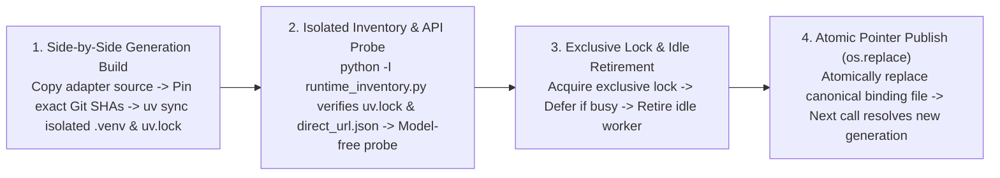

# Release Compatibility & Silent Update

[中文](release-compatibility-and-update.md) · [Back to Documentation Center](README.en.md)

This document explains MindIE Agent's two-tier release architecture (Feature Milestones and the `channels/0.1.json` product combination manifest), paired component and plugin release gates, deterministic host CLI compatibility matching, and independent runtime component Release discovery with side-by-side isolated `uv` environment builds and idle cutover.

- Governed by: [Engineering Design Principles](design-principles.en.md)
- Product Release Channel Manifest: [`channels/0.1.json`](../channels/0.1.json) (`schema: "mindie-release-channel/1"`, `track: "0.1"`)
- Release & Verification Records: [Release Records & Roadmap](README.en.md#release-records--roadmap)

---

## Two-Tier Release Evolution, Channel Manifest & Update Discovery Roles

MindIE Agent uses a two-tier **`0.Y.0` Feature Milestone + `0.Y.Z` Maintenance Patch / Independent Component Release** SemVer model and strictly separates the role of the **main repository's verified product combination manifest (`channels/0.1.json`)** from **client-side runtime update discovery (formal GitHub Releases in each official repository)**:

| Dimension | Version Pattern & Carrier | Actual Role & Selection Source | Host Plugin Republish Required? |
| --- | --- | --- | --- |
| **Feature Milestone Release** | `0.Y.0` (`0.1.0` → `0.2.0`) | Major feature additions or cross-component protocol evolution; ships with 12-repository benchmark verification and an updated [`channels/0.1.json`](../channels/0.1.json) milestone manifest | **Yes** (all four Harness plugins align on the new `0.Y.0` milestone baseline) |
| **Host Plugin Release Selection** | Formal GitHub Releases in each of the 4 plugin repositories (`mindie-plugin-release.json`) | Client selects the highest compatible formal plugin Release directly from the official plugin repository based on the installed host CLI version and `harness-compatibility.json` (`mindie_knowledge.releases` / `releases_io.py`) | Published independently when plugin code changes |
| **Independent Shared Component Update** | Formal GitHub Releases in each of the 8 component repositories (`knowledge`, `remote-dev`, `diagnostics`, `profiler`, `sim`, `npu-top`, `coordinator`, `mindie-bench`) | Client **discovers formal GitHub Releases directly from each official component repository** (`mindie_knowledge.component_releases` / `component_runtime.py`), builds a side-by-side isolated `uv` environment from the exact Git SHA, runs a native API probe, and cuts over when idle | **No** (a component bugfix Release can be discovered directly without republishing the four Harness plugins) |
| **Product Channel Manifest** | [`channels/0.1.json`](../channels/0.1.json) (`schema: "mindie-release-channel/1"`) | Records the product-verified 12-repository + 7-corpus version and immutable commit SHA combination for each product milestone (`0.Y.0`) or patch (`0.Y.Z`) for release pipeline gating and audit provenance; **not used by clients as the runtime update selection source** | Updated when assembling a main product milestone or patch record |

### 1. Role and Field Identity of `channels/0.1.json`

[`channels/0.1.json`](../channels/0.1.json) is the main repository's machine-readable record of **product-verified component and corpus combinations** (`schema: "mindie-release-channel/1"`):
- **Track & Patch History**: Declares `track`, `milestone_version`, `current_patch_version`, and the `patch_releases` ledger;
- **12-Repository Component Inventory (`components`) & 7-Corpus Snapshot (`corpora`)**: Records the verified `version`, GitHub `repository`, Release `tag`, and 40-character immutable `commit` (`revision`) SHA for `diagnostics`, `profiler`, `sim`, `npu-top`, `remote-dev`, `knowledge`, `coordinator`, the four Harness plugins (`mindie-agent-codex`, `mindie-agent-cc`, `mindie-agent-kimi`, `mindie-agent-dsh`), and `mindie-bench`. The main repository release collector (`collect_product_benchmarks.py`) enforces exact component, version, and SHA agreement between `channels/0.1.json` and `benchmark-manifest.json`;
- **Policy Metadata & Architectural Targets (`update_policy`)**: Fields such as `independent_update_allowed`, `require_plugin_republish_on_component_patch`, `hotfix_trigger_on_error`, `etag_poll_interval_sec: 3600`, `background_poll_interval_sec: 86400`, and `atomic_idle_cutover_max_ms: 500` represent channel-level policy metadata and architectural design targets (as noted in `implementation_status` inside `channels/0.1.json`). Actual client-side discovery, HTTP cache TTLs, trigger schedules, and cutover mechanics are governed by the runtime and plugin updater source code described in Sections 2–3 below.

### 2. Direct Component Release Discovery & Verification (`component_releases.py`)

Rather than reading `channels/0.1.json` to select runtime updates, client updaters query each official component repository (`mindie-agent/{knowledge,remote-dev,diagnostics,profiler,sim,npu-top,coordinator,mindie-bench}`) directly via `mindie_knowledge.component_releases` and `runtime_inventory.py`:

1. **Monotonic Non-Downgrading Selection (`component_releases.select`)**:
   - Reads the active Python environment's installed first-party component versions and immutable 40-character commit SHAs (`direct_url.json`) via `python -I runtime_inventory.py` without importing runtime engines;
   - For each installed component, selects the **maximum** across the **currently installed version (`installed`)**, the **plugin's declared baseline floor (`baseline`, from `pyproject.toml` or `runtime-requirements.txt`)**, and the **component repository's latest formal GitHub Release (`latest`)**;
   - Never downgrades automatically, and rejects any candidate where the commit SHA changes without a version bump.
2. **Per-Component Release & Benchmark Verification (`Catalog.latest`)**:
   - **Formal Release & Asset Presence Gate**: Accepts only formal Releases (`draft=false`, `prerelease=false`) with a stable SemVer version (no prerelease or build suffix) and verifies that the Release assets include a matching `.whl`, `.tar.gz` (sdist), `SHA256SUMS`, `benchmark-results.json`, `benchmark-results.md`, and `benchmark-SHA256SUMS` (each with size `> 0`). For example, in live discovery testing, `mindie-bench 0.4.2` was rejected because it lacked wheel/sdist assets, whereas the formal Releases across the other seven shared components passed discovery.
   - **Immutable Tag Dereferencing**: Resolves `/git/ref/tags/<tag>` (peeling annotated tag objects up to 4 hops until reaching `type == "commit"`) to obtain the immutable 40-character commit SHA (`revision`), rather than trusting `target_commitish` (which often names a mutable branch).
   - **Source `pyproject.toml` Verification**: Reads `pyproject.toml` at that exact `revision`, verifies its Git blob SHA-1 digest and byte size, and confirms `project.name` and `project.version` match the Release tag.
   - **Benchmark Gate & SHA256 Verification**: Downloads `SHA256SUMS` and `benchmark-results.json`, confirms `SHA256SUMS` covers the wheel, sdist, and benchmark files and matches the SHA-256 digest of `benchmark-results.json`, and verifies that `benchmark-results.json` has `release_gate is True`, matching `version`, and clean `source` / `source_after` records (`revision == revision`, `dirty is False`).
   - **Exact Git SHA Runtime Installation**: Runtime preparation installs the verified component combination from the **exact Git commit SHAs** (`git+https://github.com/mindie-agent/<repo>@<revision>`) into an isolated `uv.lock` environment (without claiming that the client downloads and verifies every byte of the wheel/sdist archives).

### 3. Public Metadata `ETag`/TTL Cache & Host Updater Schedules

1. **Bounded Public Release Metadata Cache (`release_http.py` / `releases_io.py`)**:
   - Plugin and component updaters share `mindie_knowledge.release_http.read` (default cache directory `~/.cache/mindie-agent/releases` or `MINDIE_RELEASE_CACHE`, capped at `128` entries and `64 MiB`, with per-response caps of `2 MiB` for component catalog reads, `1 MiB` for plugin metadata, and `8 MiB` per release page), restricted to official HTTPS origins (`github.com`, `api.github.com`, `release-assets.githubusercontent.com`).
   - Cache entries store public response bytes and selected public headers (`ETag`, `Link`, `Content-Length`, `Content-Type`, `Last-Modified`). Immutable paths (`/git/`, `/contents/`, `/releases/download/`) use a `86400s` (24-hour) TTL; mutable Release endpoints use a `300s` TTL when a GitHub token is available or `900s` unauthenticated, sending `If-None-Match` (`ETag`) conditional requests once the TTL expires and reusing cached bytes on `304 Not Modified`.
   - **Fail-Visible Offline Behavior**: An expired cache entry never conceals a failed network read. Offline, rate-limited, or oversized responses raise explicit errors (`ReleaseFetchError` / `TimeoutError`) rather than silently reporting an up-to-date catalog.
2. **Actual Trigger & Cooldown Schedules Across the Four Host Plugins**:
   - **OpenAI Codex CLI (`update_trigger.py` / `harness_update.py`) & Claude Code (`release_update.py`)**: Coalesced into a background maintenance thread (`mindie-release-check`) inside the MCP server process so foreground tool calls check only a local timestamp with zero network blocking. The cooldown after a successful check is `CHECK_INTERVAL = 300s` (5 minutes), with `FAILURE_BACKOFF = 60s` on errors and `ACTIVATION_BACKOFF = 5s` while a prepared candidate awaits idle handoff.
   - **Kimi Code (`updater.py` / `updater_check.py` / `updater_schedule.py`)**: Executed in the background every `INTERVAL_SECONDS = 300s` (5 minutes) via macOS `launchd` (`agent.mindie.kimi-update`) or Windows Task Scheduler (`MindIEKimiUpdate`), with exponential failure backoff from `300s` up to `6 hours` (`next_retry_at`).
   - **DeepSeek Harness (`host3.mjs` / `updater.py`)**: Triggered by a host timer `30s` after plugin load and every `interval_minutes` (default `5` minutes) thereafter whenever no agent session is actively running, spawning a detached `updater.py check --silent` process.
3. **Strict Separation from Manual `/mindie-agent` Knowledge Activation & Feed Sync**:
   - Public Ascend knowledge corpora (`knowledge-*`) are synchronized only on demand within sessions where the user has explicitly invoked `/mindie-agent`. **Background software update checks and component runtime builds never start a knowledge worker, create a session lease, or trigger corpus synchronization.**

---

## Paired Component and Plugin Releases

MindIE Agent ships **verified combinations of components and plugins**. The OpenAI Codex CLI, Claude Code, Kimi Code, and DeepSeek Harness (DSH) plugins align their version number with the main product at each feature milestone. Shared runtime components (`diagnostics`, `knowledge`, `remote-dev`, `coordinator`, `npu-top`, `profiler`, `sim`) and `mindie-bench` maintain independent version sequences, reuse unchanged formal Releases across milestones, and can both be discovered directly from their official component repositories as new formal Releases ship and be recorded in [`channels/0.1.json`](../channels/0.1.json) when main product releases are assembled.

### Topological Release Order & Checklist

Milestone or coordinated patch releases follow a **bottom-up dependency order** (whereas an independent single-component release only runs that component repository's release workflow and gates):
1. Publish the base diagnostics library [`diagnostics`](https://github.com/mindie-agent/diagnostics) and 4-layer boundary solver [`sim`](https://github.com/mindie-agent/sim) first;
2. Prepare and publish [`remote-dev`](https://github.com/mindie-agent/remote-dev), [`knowledge`](https://github.com/mindie-agent/knowledge), [`profiler`](https://github.com/mindie-agent/profiler), and [`npu-top`](https://github.com/mindie-agent/npu-top), which depend on them;
3. Publish [`coordinator`](https://github.com/mindie-agent/coordinator) pinned to the formal `remote-dev` and `diagnostics` Releases;
4. When host plugins are also being released, publish the four Harness plugins ([`mindie-agent-codex`](https://github.com/mindie-agent/mindie-agent-codex), [`mindie-agent-cc`](https://github.com/mindie-agent/mindie-agent-cc), [`mindie-agent-kimi`](https://github.com/mindie-agent/mindie-agent-kimi), [`mindie-agent-dsh`](https://github.com/mindie-agent/mindie-agent-dsh)) pinned to their runtime dependencies, followed by [`channels/0.1.json`](../channels/0.1.json) and the main product release record.
   - The four host plugins bundle and register `knowledge`, `remote-dev`, and `diagnostics`; `coordinator`, `profiler`, `sim`, and `npu-top` can be installed standalone on demand or wired into plugins as they mature.
   - `mindie-bench` maintains its own version sequence and is referenced by immutable commit SHA in release workflows.

Before publishing any plugin Release or updating [`channels/0.1.json`](../channels/0.1.json), maintainers verify the following checklist:

| Pre-Release Check | Verification Standard |
| --- | --- |
| **1. Complete Dependency Inventory** | Extract direct first-party dependencies from the final `uv.lock` / `runtime-requirements.txt` or `channels/0.1.json` and inventory transitive dependencies in the installed environment; record repository, package name, version, full commit SHA, and Release tag. |
| **2. Formal Component Releases** | Every first-party runtime dependency has a published GitHub Release (`draft=false`, `prerelease=false`). |
| **3. Exact Commit & Version Alignment** | The dereferenced Release tag matches both the declared source pin and installed `direct_url.json`; tag version, source package version, and artifact metadata agree. |
| **4. Published Package Contents** | Download the published packages from the GitHub Release and confirm their contents match the locked source tree. |
| **5. Documented Acceptance Scope** | Record verified host versions, OS platforms, exact tested source SHAs, and known boundaries accurately. |
| **6. Closed-Loop Combination** | Publish plugins or update `channels/0.1.json` only after all underlying component Releases are verified. |
| **7. Release Benchmark Delivery** | Every new code repository Release includes benchmark JSON and Markdown reports generated from the exact tagged commit on a clean checkout. |

### Benchmark Evidence on Every Release

Each code repository declares fixed workloads in `benchmarks/release.json`, executed by a pinned `mindie-bench` runner. The tag-triggered release workflow verifies source and package versions, installs declared dependencies, verifies formal Releases for first-party dependencies, runs local contract tests (excluding `live_npu`), and then executes the benchmark suite and builds release artifacts.

Every new code repository Release ships the following alongside its wheel/sdist or plugin archive:

- `benchmark-results.json`: repository, version, full source SHAs before and after measurement, clean-checkout status, suite digest, execution environment, repeated samples, iteration counts, units, case outcomes, and release gate decision (`release_gate`);
- `benchmark-results.md`: human-readable workload summary, measurements, and scope;
- `release-notes.md` (when `release-notes-path` is supplied): repository-authored community release notes archived with the release assets and covered by `SHA256SUMS`.

Any failed, missing, or timed-out required scenario—or any checkout modification during measurement—blocks publication. Public reports contain synthetic workload descriptions, environment metadata, and numeric measurements only, excluding credentials, user transcripts, and local paths.

The main product repository supports two release gate modes: feature milestones (`release-kind=milestone`) aggregate and verify both the 12-repository component benchmarks and the end-to-end product value suite, whereas maintenance patches (`release-kind=patch`, requiring `PATCH > 0`) never relabel a historical milestone value report as a new experiment while still enforcing formal GitHub Releases, immutable tag SHAs, `mindie-release-benchmark/2` reports, and exact `channels/0.1.json` alignment across all twelve code repositories (see [Release Records & Roadmap](README.en.md#release-records--roadmap)).

> **Note**: `knowledge` is a software runtime package governed by this release checklist, whereas [`knowledge-vllm-ascend`](https://github.com/mindie-agent/knowledge-vllm-ascend), [`knowledge-operators`](https://github.com/mindie-agent/knowledge-operators), [`knowledge-infer-core`](https://github.com/mindie-agent/knowledge-infer-core), [`knowledge-infer-distributed`](https://github.com/mindie-agent/knowledge-infer-distributed), [`knowledge-infer-observability`](https://github.com/mindie-agent/knowledge-infer-observability), [`knowledge-infer-ops-compat`](https://github.com/mindie-agent/knowledge-infer-ops-compat), and [`knowledge-agent-engineering`](https://github.com/mindie-agent/knowledge-agent-engineering) are domain content repositories updated continuously without requiring a new software release for every new knowledge unit.

---

## Host Compatibility Declarations & Deterministic Selection

Host CLIs evolve rapidly, and Hook schemas, MCP timeouts, or plugin manifest rules can differ across versions. To ensure an update never installs a plugin version incompatible with your installed CLI, MindIE Agent uses deterministic compatibility filtering:

1. **Machine-Readable Compatibility Manifest (`harness-compatibility.json` / `mindie-plugin-release.json`)**:
   - Each plugin repository maintains `harness-compatibility.json` (and publishes `mindie-plugin-release.json` on each Release) cataloging every host interface it touches (Hooks, MCP wiring, CLI flags, environment variables), production call sites, official references, tests, and verified SemVer support ranges (DSH also verifies `peerDependencies["@deepseek-ai/dsh"]` in `package.json`).
   - Pre-release checks and client-side `validate_compatibility` enforce that the plugin's declared support range lies strictly within the intersection of all `used_interfaces` ranges, and `verify_release_source` confirms the immutable Git commit contains the exact same compatibility declaration.
2. **Coordinated Monotonic Selection for Plugins and Components**:
   - The plugin selector evaluates the currently installed host CLI version to select the **highest compatible ordinary plugin Release** (`draft=false`, `prerelease=false`).
   - When no newer plugin Release is needed, the host updater invokes component update discovery (`component_update.py`) to advance shared runtime components directly to any newer formal component Releases; when upgrading to a newer plugin Release, component discovery preserves the installed component floor (`max(installed version, new plugin baseline, formal component Release)`) so a plugin upgrade never downgrades a component that was already updated independently.

---

## Side-by-Side Runtime Preparation, API Probe & Idle Cutover

Instead of mutating the active virtual environment in place with single-package replacements, both plugin updates and independent component updates follow a four-step **side-by-side generation build + isolated subprocess probe + idle worker retirement + atomic pointer replacement (`os.replace`)** lifecycle:

- **Zero Hot-Path Network Blocking**: Routine tool calls and short Hooks read only the active local binding or check a local timestamp—never blocking on network requests, release scans, or `uv` builds.
- **No Unsolicited Knowledge Worker Startup & Preserved User Consent**: Release discovery, side-by-side runtime builds, candidate probes, and binding activation are completely model-free and **never start a knowledge background worker or create a session knowledge grant** (the knowledge flywheel remains strictly gated on explicit per-session `/mindie-agent` invocation), while preserving saved contribution, project scope, and fault-reporting choices.
- **Fail-Visible & Idempotent**: If the network is unreachable, a Release asset is incomplete, or a probe fails, the updater records the failure status locally (`status.json` / `release-update.json`) and enters backoff without touching the active runtime. Candidate generations are keyed by `generation_key` (computed from the adapter source digest, target component revisions, and Python/platform ABI) and coalesced under a non-blocking `prepare.lock` so verified generations are never rebuilt redundantly.

### Four-Step Safe Preparation & Idle Cutover Lifecycle

1. **Side-by-Side Isolated Runtime Build (`component_runtime.build`)**:
   - Creates a separate generation directory outside the active runtime (`component-runtimes/<generation_key>`), copies the verified adapter source files (`<= 16 MiB`), writes a standalone `pyproject.toml` pinning the selected component Git commit SHAs via `[tool.uv] override-dependencies`, runs `uv sync --project <runtime> --no-editable --no-dev` within a bounded budget (`420s` default) to create an isolated `.venv` and `uv.lock`, and writes `components.json` (`schema: "mindie-component-runtime/1"`, binding `adapter_source_sha256`, `runtime`, and `lock_sha256`). Any failure leaves the active installation untouched.
2. **Isolated Inventory Verification & Native API Probe**:
   - Runs `python -I runtime_inventory.py <components.json>` in the candidate interpreter to verify the SHA-256 of `uv.lock` (`verify_lock`) and every installed first-party package's `direct_url.json` commit receipt (`verify`), and confirms the retained adapter source bytes have not changed;
   - Executes the host adapter's model-free candidate validator and runtime API probe (`candidate_validate.py` / `runtime_probe.py`) to confirm compatibility before any live binding is touched.
3. **Wait for Idle & Bounded Worker Retirement**:
   - Once preparation and probing succeed, the activator acquires the exclusive operation lock (`update_lock` / `OperationLock`) and checks whether the knowledge service and domain workers are idle (`retire_service` / `stop_if_idle`). If any RPC, capture, or indexing job is active, cutover defers (`deferred` / `service_busy`) without interrupting active work; once idle, it cleanly stops the old background worker within a bounded control window (e.g., `30s`).
4. **Atomic Canonical Binding Publication (`os.replace`)**:
   - After the old worker is confirmed retired (or absent), the activator atomically replaces the canonical binding or generation pointer file (`codex.json`, `cc.json`, or `current.json`) via `os.replace`.
   - **Latency Boundary Note**: Only the final local pointer replacement (`os.replace`) is a sub-second atomic filesystem rename; the end-to-end pipeline—covering side-by-side `uv` environment building, candidate API probing, exclusive lock acquisition, and idle worker retirement—runs under bounded multi-second / multi-minute budgets and **is not promised as `< 500ms` end to end**.

### Implementation Status & Verification Boundary

- **Verified Baseline Mechanisms**: `harness-compatibility.json` host plugin selection and locked plugin-release updates with idle cutover are verified in the `0.1.0` / `0.1.1` plugin releases; the strict `channels/0.1.json` vs. `benchmark-manifest.json` combination alignment gate was added in this cycle via `mindie-bench #27` (`release-kind=patch`, commit `484b80621aaf9293c559786d0ef2174c79a0dbb4`) and verified across cross-platform CI.
- **Shared Component Independent Update Core (`mindie-knowledge #101`, commits `0e4123d` / `7357417`)**: `component_releases.py`, `component_runtime.py`, `runtime_inventory.py`, `release_http.py`, and `releases_io.py` are implemented in `knowledge` and pinned to the formal `diagnostics 0.5.2` release (`801a01b2789aed7f58e971a909205a7d40b61077`), passing the full local test suite (`1555 passed, 22 skipped, 3 deselected, 3 subtests`), the targeted component-update suite (`58 passed`), and all three CI workflows; formal `knowledge 0.13.3` publication awaits final PR CI and the component Release workflow gate.
- **Four-Host Plugin Wiring & Native Acceptance Scope**: `component_update.py` integration across Codex, Claude Code, Kimi Code, and DSH is implemented and unit-tested in the active worktrees, with Phase 2 PRs, `0.1.2` tags, and end-to-end native new-session acceptance in progress.
