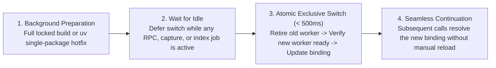

# Release Compatibility & Silent Update

[中文](release-compatibility-and-update.md) · [Back to Documentation Center](README.en.md)

This document explains MindIE Agent's two-tier release architecture (Feature Milestones + Release Channel Manifests), paired component and plugin release rules, independent single-component hotfixes, deterministic host CLI compatibility matching, and three-tier rapid rollout with silent background cutover.

- Governed by: [Engineering Design Principles](design-principles.en.md)
- Active Release Channel Manifest: [`channels/0.1.json`](../channels/0.1.json) (`schema: "mindie-release-channel/1"`, `track: "0.1"`)
- Release & Verification Records: [Release Records & Roadmap](README.en.md#release-records--roadmap)

---

## Two-Tier Release Evolution & Channel Manifest Architecture

MindIE Agent uses a two-tier **`0.Y.0` Feature Milestone + `0.Y.Z` Release Channel Manifest (`channels/0.Y.json`)** SemVer model that decouples major feature milestones from rapid single-component bugfixes:

| Release Tier | Version Pattern | Carrier & Scope | Host Plugin Republish Required? |
| --- | --- | --- | --- |
| **Feature Milestone Release** | `0.Y.0` (`0.1.0` → `0.2.0`) | Major feature additions or cross-component protocol evolution; ships with full release notes and 12-repository benchmark verification | **Yes** (all four Harness plugins align on the new `0.Y.0` milestone baseline) |
| **Channel Patch / Single-Component Hotfix** | `0.Y.Z` (`0.1.1`, `0.1.2`, ...) | Rapid bugfix or single-component update driven by the active channel manifest ([`channels/0.1.json`](../channels/0.1.json), `schema: "mindie-release-channel/1"`) | **No** (only the patched shared component is released and updated in the channel manifest; no need to re-release all four Harness plugins `mindie-agent-codex`, `mindie-agent-cc`, `mindie-agent-kimi`, `mindie-agent-dsh`) |

### 1. Release Channel Manifest Structure (e.g., `channels/0.1.json`)

[`channels/0.1.json`](../channels/0.1.json) serves as the authoritative component manifest for the active release track (`schema: "mindie-release-channel/1"`):
- **Track & Version Metadata**: Declares `track`, `milestone_version`, and `current_patch_version` (which advances as component hotfixes ship);
- **12-Repository Component Manifest (`components`)**: Records the verified `version`, GitHub `repository`, release `tag`, and exact 40-character `commit` (`revision`) SHA for `diagnostics`, `profiler`, `sim`, `npu-top`, `remote-dev`, `knowledge`, `coordinator`, the four Harness plugins (`mindie-agent-codex`, `mindie-agent-cc`, `mindie-agent-kimi`, `mindie-agent-dsh`), and `mindie-bench`;
- **Channel Update Policy (`update_policy`)**:
  - `independent_update_allowed: true`: Enables single-component updates without republishing host plugins;
  - `hotfix_trigger_on_error: true`: Enables immediate self-healing update checks when a runtime fault occurs;
  - `etag_poll_interval_sec: 3600`: 1-hour lightweight HTTP `ETag` channel polling interval;
  - `background_poll_interval_sec: 86400`: 24-hour full background poll interval.

### 2. Independent Single-Component Updates (`< 500ms` Under Idle Atomic Switch)

When a single shared component (such as `remote-dev` or `diagnostics`) ships a bugfix release:
1. Maintainers publish the component's formal GitHub Release and update its `version`, `tag`, and exact `commit` SHA in the active channel manifest (such as [`channels/0.1.json`](../channels/0.1.json)) while incrementing `current_patch_version`, without touching or republishing the four Harness plugin repositories;
2. The client background updater diffs its active component versions against the channel manifest and performs an incremental `uv` single-package replacement for only the modified component;
3. Once no active RPC, capture, or indexing job is running, the updater atomically switches the canonical installation binding in **`< 500ms`**.

### 3. Three-Tier Rapid Rollout

To deliver critical fixes and newly distilled domain knowledge with minimal latency while preserving zero foreground overhead, MindIE Agent uses a three-tier rollout mechanism:

1. **(a) Fault/Crash-Triggered Immediate Self-Healing Check (`hotfix_trigger_on_error: true`)**:
   - Whenever `diagnostics` or an MCP tool encounters an unexpected runtime failure, the update trigger bypasses the standard 24-hour (`86400s`) cooldown (guarded by failure backoff to prevent retry storms) and asynchronously checks the active channel manifest;
   - If a newer component patch is available for the faulting package, it prepares the single-component update in the background and switches atomically during the next idle window.
2. **(b) Lightweight HTTP `ETag` Channel Polling (`etag_poll_interval_sec: 3600`)**:
   - Polls the channel manifest every hour (`3600s`) using conditional `If-None-Match` HTTP requests. Unchanged checks return `304 Not Modified` with zero JSON parsing or environment build overhead, while channel updates trigger immediate background preparation ahead of the `86400s` (`24h`) full background poll interval.
3. **(c) Zero-Code Knowledge & Rule Feed Hot-Reload**:
   - Graded `L1–L4` knowledge units and diagnostic triage rules across the 7 public Ascend corpora are synced incrementally via `feed_sync` and hot-reloaded in place without requiring package reinstallation or worker restarts.

---

## Paired Component and Plugin Releases

MindIE Agent ships **verified combinations of components and plugins**. The OpenAI Codex CLI, Claude Code, Kimi Code, and DeepSeek Harness (DSH) plugins align their version number with the main product at each feature milestone. Shared runtime components (`diagnostics`, `knowledge`, `remote-dev`, `coordinator`, `npu-top`, `profiler`, `sim`) and `mindie-bench` maintain independent version sequences, reuse unchanged formal Releases across milestones, and evolve independently across channel patches via [`channels/0.1.json`](../channels/0.1.json).

### Topological Release Order & Checklist

Milestone releases follow a **bottom-up dependency order** (whereas single-component channel hotfixes only publish the modified component repository and update the channel manifest):
1. Publish the base diagnostics library [`diagnostics`](https://github.com/mindie-agent/diagnostics) and 4-layer boundary solver [`sim`](https://github.com/mindie-agent/sim) first;
2. Prepare and publish [`remote-dev`](https://github.com/mindie-agent/remote-dev), [`knowledge`](https://github.com/mindie-agent/knowledge), [`profiler`](https://github.com/mindie-agent/profiler), and [`npu-top`](https://github.com/mindie-agent/npu-top), which depend on them;
3. Publish [`coordinator`](https://github.com/mindie-agent/coordinator) pinned to the formal `remote-dev` and `diagnostics` Releases;
4. Publish the four Harness plugins ([`mindie-agent-codex`](https://github.com/mindie-agent/mindie-agent-codex), [`mindie-agent-cc`](https://github.com/mindie-agent/mindie-agent-cc), [`mindie-agent-kimi`](https://github.com/mindie-agent/mindie-agent-kimi), [`mindie-agent-dsh`](https://github.com/mindie-agent/mindie-agent-dsh)) pinned to their runtime dependencies, followed by [`channels/0.1.json`](../channels/0.1.json) and the main product release record.
   - The four host plugins bundle and register `knowledge`, `remote-dev`, and `diagnostics`; `coordinator`, `profiler`, `sim`, and `npu-top` can be installed standalone on demand or wired into plugins as they mature.
   - `mindie-bench` maintains its own version sequence and is referenced by immutable commit SHA in release workflows.

Before publishing any plugin Release or advancing `channels/0.1.json`, maintainers verify the following checklist:

| Pre-Release Check | Verification Standard |
| --- | --- |
| **1. Complete Dependency Inventory** | Extract direct first-party dependencies from the final `uv.lock` or `channels/0.1.json` and inventory transitive dependencies in the installed environment; record repository, package name, version, full commit SHA, and Release tag. |
| **2. Formal Component Releases** | Every first-party runtime dependency has a published GitHub Release (`draft=false`, `prerelease=false`). |
| **3. Exact Commit & Version Alignment** | The dereferenced Release tag matches both the declared source pin and installed `direct_url.json`; tag version, source package version, and artifact metadata agree. |
| **4. Published Package Contents** | Download the published packages from the GitHub Release and confirm their contents match the locked source tree. |
| **5. Documented Acceptance Scope** | Record verified host versions, OS platforms, exact tested source SHAs, and known boundaries accurately. |
| **6. Closed-Loop Combination** | Publish plugins or increment `current_patch_version` in `channels/0.1.json` only after all underlying component Releases are verified. |
| **7. Release Benchmark Delivery** | Every new code repository Release includes benchmark JSON and Markdown reports generated from the exact tagged commit on a clean checkout. |

### Benchmark Evidence on Every Release

Each code repository declares fixed workloads in `benchmarks/release.json`, executed by a pinned `mindie-bench` runner. The tag-triggered release workflow verifies source and package versions, installs declared dependencies, verifies formal Releases for first-party dependencies, runs local contract tests (excluding `live_npu`), and then executes the benchmark suite and builds release artifacts.

Every new code repository Release ships the following alongside its wheel/sdist or plugin archive:

- `benchmark-results.json`: repository, version, full source SHAs before and after measurement, clean-checkout status, suite digest, execution environment, repeated samples, iteration counts, units, case outcomes, and release gate decision;
- `benchmark-results.md`: human-readable workload summary, measurements, and scope;

Any failed, missing, or timed-out required scenario—or any checkout modification during measurement—blocks publication. Public reports contain synthetic workload descriptions, environment metadata, and numeric measurements only, excluding credentials, user transcripts, and local paths.

Each product milestone release record verifies and aggregates the formal benchmark and component-value evaluation reports across all twelve code repositories: `diagnostics`, `profiler`, `sim`, `npu-top`, `remote-dev`, `knowledge`, `coordinator`, the four Harness plugins, and `mindie-bench` (see [Release Records & Roadmap](README.en.md#release-records--roadmap)).

> **Note**: `knowledge` is a software runtime package governed by this release and channel hotfix checklist, whereas [`knowledge-vllm-ascend`](https://github.com/mindie-agent/knowledge-vllm-ascend), [`knowledge-operators`](https://github.com/mindie-agent/knowledge-operators), [`knowledge-infer-core`](https://github.com/mindie-agent/knowledge-infer-core), [`knowledge-infer-distributed`](https://github.com/mindie-agent/knowledge-infer-distributed), [`knowledge-infer-observability`](https://github.com/mindie-agent/knowledge-infer-observability), [`knowledge-infer-ops-compat`](https://github.com/mindie-agent/knowledge-infer-ops-compat), and [`knowledge-agent-engineering`](https://github.com/mindie-agent/knowledge-agent-engineering) are domain content repositories updated continuously via zero-code feed hot-reload without requiring a new software release for every new knowledge unit.

---

## Host Compatibility Declarations & Deterministic Selection

Host CLIs evolve rapidly, and Hook schemas, MCP timeouts, or environment variable rules can differ across versions. To ensure an update never installs a plugin version incompatible with your installed CLI, MindIE Agent uses deterministic compatibility filtering:

1. **Machine-Readable Compatibility Manifest (`harness-compatibility.json`)**:
   - Each plugin repository maintains a `harness-compatibility.json` cataloging every host interface it touches (Hooks, MCP wiring, CLI flags, environment variables), production call sites, official references, tests, and verified SemVer support ranges.
   - Pre-release checks enforce that the plugin's declared support range lies strictly within the intersection of all required interface ranges.
2. **Highest Compatible Ordinary Release & Channel Patch Selection**:
   - Both first-time installation and background updates evaluate the currently installed host CLI version using standard SemVer resolution to select the **highest compatible ordinary milestone Release** (`draft=false`, `prerelease=false`), and overlay any newer `0.1.x` component hotfixes declared in the matching track's channel manifest ([`channels/0.1.json`](../channels/0.1.json)).
   - The selector never downgrades automatically and never pulls unverified development branches (`main`).

---

## Silent Background Checks & Atomic Idle Cutover

Updates are triggered asynchronously in the background via **lightweight HTTP `ETag` channel polling (`3600s` / 1h)**, **full background polling (`86400s` / 24h)**, or **fault/crash-triggered immediate self-healing (`hotfix_trigger_on_error: true`)**:

- **Zero Hot-Path Latency**: Routine tool calls check only a lightweight local timestamp (in ~1–2 ms) and never block on network I/O, release scanning, or environment builds. Short Stop Hooks never access the network or run installers.
- **Zero User Interruption & Persistent Consent**: Silent updates never pop up confirmation prompts, inject update notifications into model context, or require manual session reloads—and they preserve your existing contribution, project scope, and fault-reporting settings.
- **Failure Backoff & Idempotency**: Network errors or rate limits trigger exponential backoff without resetting the last-success timestamp; already prepared candidate environments simply wait for an idle window without re-downloading.

### Four-Step Safe Cutover Lifecycle

1. **Background Preparation**: Outside the active runtime binding, the updater either builds an isolated, non-editable `uv` environment (`uv sync --locked --no-editable`) for a `0.Y.0` milestone upgrade or performs an incremental `uv` single-package replacement for a `0.1.x` channel hotfix. Any failure during preparation leaves the existing version untouched.
2. **Wait for Idle**: As long as any MCP tool call, admitted capture, or indexing job is running, the existing service continues handling work and cutover waits patiently.
3. **Atomic Exclusive Cutover (`< 500ms`)**: Once the active service is idle, the updater acquires the exclusive operation lock, cleanly retires the old worker, verifies that the new worker is ready, and atomically updates the single canonical installation binding (switching interpreter, scripts, and engine config together) in `< 500ms`.
4. **Seamless Continuation**: During the sub-second switch window, incoming requests either wait briefly or receive an explicit `temporarily unavailable, not yet executed` status. Afterward, even already running sessions automatically resolve the new canonical binding on their next Hook or tool call.
