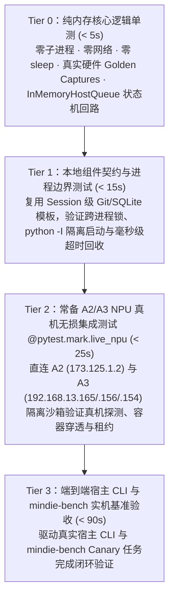

# 分级测试体系与用例设计规范（Tiered Testing Architecture & Case Design）

[English](testing-architecture.en.md) · [返回文档中心](README.md)

本文定义 MindIE Agent 全栈仓库（`knowledge`、`remote-dev`、`coordinator`、`npu-top`、`diagnostics`、各宿主插件与评测仓 `mindie-bench`）统一的**用例有效性红线**与**四级测试金字塔（Tier 0 ~ Tier 3）**。我们的测试体系建立在**默认常备 A2（Ascend 910B）与 A3（Ascend 910C）昇腾 NPU 真机集群**的前提之上，追求极致的信噪比与执行速度。

这是测试设计目标，不表示所有仓库已完成四层验收或达到表中的耗时预算。发布记录必须写明实际源码、用例范围、环境、耗时与未覆盖项；不能把单个探测通过扩展为整个发布组合已经通过。

- 遵循准则：[工程设计原则与演进准则](design-principles.md) · [系统架构与模块分工](architecture.md)

---

## 一、用例有效性红线（Every Test Must Earn Its Keep）

测试的唯一价值是**以最低的时间与维护成本捕获真实的生产缺陷与边界回归**。全栈仓库严禁以下五类无效或虚假测试：

1. **严禁“防御性偏执凑数测试”**：
   - 禁止编写纯粹验证 Python 类型检查、简单的属性赋值、防御性 `ValueError` / `TypeError` 分支（如“传入空字符串抛异常”）、或反复构造 `chmod 0o777` / `symlink` 假想敌却不触及核心业务不变量的单测。
2. **严禁“替静默吞错与假成功背书的测试”**：
   - 禁止编写“当底层数据库连接失败、子进程超时或绑定异常时，断言接口返回 `exit 0` / `{}` / `status="active"`”的假阳性测试；故障测试必须验证错误被真实、可定位地上报，且本地记账超时绝不覆写已成功的远端业务结果。
3. **严禁“静态常量与枚举点名测试”**：
   - 禁止编写逐一核对静态字典、常量表、枚举字符串列表、函数默认参数签名（`inspect.signature`）或 Schema 字段名的字面量测试。
4. **严禁“文档与提示词正则 Grep 测试”**：
   - 禁止在测试套件中用正则表达式或字符串包含去 grep `README.md`、`SKILL.md`、模板文案或文档标题。文档靠架构审查维护，测试只验证可执行代码的真实行为。
5. **严禁“篡改生产脚本或失真 Mock 假测试”**：
   - 严禁在测试中动态覆写生产脚本文件（如把 `admission_ops.py` 替换成几行假桩）来凑绿灯；
   - 严禁使用与真实服务端/硬件返回字段不符的 `MagicMock` 伪造通过（例如用假造的 `npu-smi` 字符串或虚构的 RPC 字段自嗨）。所有离线解析测试必须基于从真实昇腾硬件采集的 **Golden Captures**，所有状态流转测试必须跑在真实的内存回路（如 `InMemoryHostQueue`）或真实 SQLite/Git 临时实例上。

---

## 二、四级测试金字塔（Tier 0 ~ Tier 3，默认常备 A2/A3 昇腾 NPU 环境）

| 层级 | 耗时预算 | 运行频率与定位 | 核心覆盖范围与铁律 |
| --- | --- | --- | --- |
| **Tier 0** 纯内存核心逻辑单测 | **`< 5s`** | 每次保存 / 每次提交必跑 | **零外部子进程、零网络、零 `sleep`**。覆盖解析器（基于真实 A2 910B / A3 910C / A5 硬件 Golden Captures）、状态机流转（`InMemoryHostQueue` 等真实内存回路）、确定性隐私脱敏规则、`TechnicalTokenizerV1` 分词与协议转换。 |
| **Tier 1** 本地组件契约与进程边界测试 | **`< 15s`** | 本地改动组件 / PR 门禁必跑 | **复用 Session 级预构建 Git/SQLite 模板**（`shutil.copytree` 毫秒级派生）。验证跨进程文件锁、`python -I` 真实隔离启动、MCP stdio 帧传输、毫秒级可注入超时与进程树回收。**严禁在测试内联网 `pip install` 或跑 10MB 级 `fsync` 磁盘轰炸**。 |
| **Tier 2** 常备 A2/A3 NPU 真机无损集成测试（`@pytest.mark.live_npu`） | **`< 25s`** | 涉及远端执行、探测、容器、租约或 NPU 工具时常态化必跑 | 直接连接常驻 **A2 (`173.125.1.2`)** 与 **A3 (`192.168.13.165` / `.156` / `.154`)** 昇腾集群，使用隔离沙箱目录（如 `state_dir="/tmp/mindie-npu-test-<uuid>"`）在不干扰线上业务任务的前提下，常态化验证真机 `npu-smi` 探测、多 Die `Phy-ID` 映射、Docker 容器穿透、Linux `/proc` 进程树排空与租约防抢占。 |
| **Tier 3** 端到端宿主 CLI 与 `mindie-bench` 实机基准验收 | **`< 90s`** | 插件发版 / 跨仓联动 / 评测套件变更必跑 | 驱动真实宿主 CLI（Claude Code、Codex、Kimi Code、DSH）与 `mindie-bench` Canary 任务完成从问题触发、知识检索、远端 NPU 验证到经验沉淀的闭环验收。 |

---

## 三、各层级设计细则与最佳实践

### 3.1 Tier 0：用真实硬件 Golden Captures 与内存回路替代 `MagicMock`
- **硬件报文保真**：针对 `npu-smi info`、`npu-smi info -t board`、`lscpu`、容器挂载点与 CANN 报错栈的解析测试，必须使用从真实 A2（910B）、A3（910C 双 Die）与 A5 节点采集的原始输出快照（Golden Captures）。
- **零 `sleep` 状态推进**：测试重试退避、租约过期、增量 Checkpoint 或滑动窗口时，统一通过可注入单调时钟（`clock` / `now_fn`）推进时间，严禁在单测中写 `time.sleep(...)`。

### 3.2 Tier 1：Session 级 Fixture 模板化与可注入超时
- **预构建模板复用**：凡涉及 Git 仓库初始化（`git init` + `commit`）或 SQLite Schema 建表的测试，统一在 `conftest.py` 的 `scope="session"` Fixture 中一次性构建基准目录，单个测试通过拷贝文件树获得独立沙箱，将单次准备耗时控制在毫秒级。
- **毫秒级进程生命周期验证**：验证子进程取消、挂死回收或 `owner-pipe` / `systemd` / Job Object 清理时，通过注入 `50ms ~ 100ms` 级的测试超时参数触发真实信号路径，禁止硬编码数秒的等待周期。

### 3.3 Tier 2：常备 A2/A3 NPU 真机无损沙箱规范（`@pytest.mark.live_npu`）
- **常驻集群就绪**：开发环境默认常备 A2（`173.125.1.2`）与 A3（`192.168.13.165` / `.156` / `.154`）真机 SSH 通道。涉及硬件拓扑、远端同步或容器执行的改动，不能只停留在本地模拟，必须跑通 `@pytest.mark.live_npu`。
- **绝对无损与沙箱隔离**：
  - 远端状态与临时文件必须限定在 `/tmp/mindie-npu-test-<uuid>` 独立沙箱目录内，并在 Fixture `teardown` 中彻底清理；
  - 严禁修改、重启或抢占线上正在运行的业务容器、训练/推理进程或全局配置文件；
  - 租约与进程排空测试仅操作测试自身拉起的受控轻量进程与测试专用沙箱租约。

### 3.4 Tier 3：宿主 CLI 与 `mindie-bench` Canary 闭环
- 在 `mindie-bench` 中，测试套件聚焦于验证 Recipe 构建器、环境隔离（Source Projection / Worktree）、Verifier 判定逻辑、遥测计费对账与 Canary 任务实机闭环，确保评测基础设施本身严谨、快速且无死分支冗余。

## 四、CI 分层与发布 benchmark

普通 PR、分支 CI 和发布前本地组件检查使用 `pytest -m "not live_npu"` 或等价的显式组件入口，不自动连接常备集群或调用付费宿主模型。所有真实 NPU 用例统一标记 `live_npu`；环境变量 opt-in 可以作为第二道运行选择，但不能替代标记。直接调用 `mcp_server.handle()` 的测试仍属于组件契约，只有真实宿主 CLI 路径才构成 Tier 3 宿主验收。

各代码仓维护 `benchmarks/release.json` 和实际工作负载。benchmark 每次执行真实业务操作并校验结果，记录多次独立重复、样本数、迭代次数、数值与单位。发布工作流先验证本地组件契约及正式依赖，再由固定 SHA 的 `mindie-bench` 运行器测量干净的候选源码；只有必需场景全部通过、测量前后 SHA 相同并与 Tag 一致，才可进入发布。

| 证据 | 能支持的判断 | 不能替代的验证 |
| --- | --- | --- |
| 本地业务回归测试 | 授权、协议、状态与错误传播满足指定契约 | 真实宿主或 NPU 运行结果 |
| CPU 微 benchmark | 固定输入下某个核心操作的延迟或吞吐 | 网络性能、NPU 性能、Agent 提效 |
| A2/A3 无损集成 | 指定硬件、容器与源码上的实际行为 | 未运行的平台或整个宿主闭环 |
| 真实宿主与 Canary | 指定版本、平台与任务链路的闭环行为 | 有统计设计的整体生产力提升 |

每个 Release 附带 `benchmark-results.json`、`benchmark-results.md`、`benchmark-SHA256SUMS`，并纳入完整 `SHA256SUMS`。公共报告只包含可公开的工作负载说明与测量数据；原始失败日志、用户输入和凭据不随报告公开。产品主仓聚合十个代码仓结果，本身不添加文档 benchmark；完整规则见[版本兼容与配套发布](release-compatibility-and-update.md#每次发布的-benchmark-交付)。
